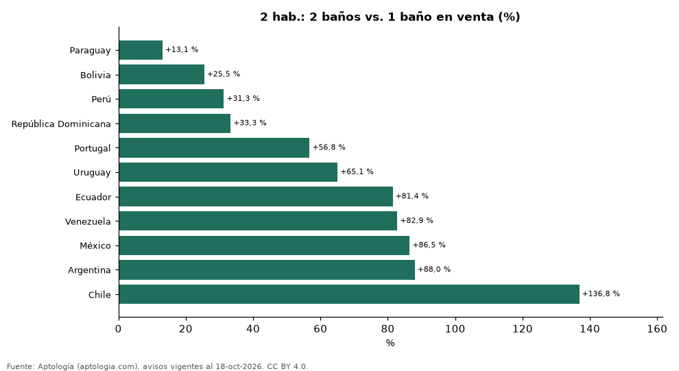

# Cuánto vale el segundo baño en un apartamento de 2 habitaciones en 12 países de Latinoamérica y Portugal (octubre 2026)

**Un apartamento de 2 habitaciones con 2 baños se pide en venta +136,8 % frente a uno con 1 baño en Chile, la mayor diferencia de 11 países, y +13,1 % en Paraguay.** En arriendo, el segundo baño suma de +25,5 % (Paraguay) a +136,4 % (Brasil).

*Resumen: comparamos 38.819 apartamentos de 2 habitaciones con 1 y con 2 baños en venta y arriendo fuera de Colombia.*

**Actualizado:** 18 de octubre de 2026 (datos del 18 de octubre de 2026) · **Próxima actualización:** mensual.

## Resumen

| Indicador | Valor |
|---|---|
| Paraguay (venta) | +13,1 % |
| Bolivia (venta) | +25,5 % |
| Perú (venta) | +31,3 % |
| República Dominicana (venta) | +33,3 % |
| Portugal (venta) | +56,8 % |
| Uruguay (venta) | +65,1 % |
| Ecuador (venta) | +81,4 % |
| Venezuela (venta) | +82,9 % |
| México (venta) | +86,5 % |
| Argentina (venta) | +88,0 % |
| Chile (venta) | +136,8 % |

## Venta: 2 habitaciones con 1 o 2 baños

| País | Moneda | Con 1 baño | Con 2 baños | Diferencia | Diferencia en USD | Avisos (2 / 1 baño) |
|---|---|---|---|---|---|---|
| Paraguay | USD | 137.074 | 155.000 | +13,1 % | USD 17.926 | 1.148 / 414 |
| Bolivia | USD | 81.695 | 102.512 | +25,5 % | USD 20.817 | 611 / 145 |
| Perú | PEN | 399.000 | 524.000 | +31,3 % | USD 36.385 | 1.796 / 205 |
| República Dominicana | USD | 172.500 | 230.000 | +33,3 % | USD 57.500 | 2.135 / 108 |
| Portugal | EUR | 405.000 | 635.000 | +56,8 % | USD 258.539 | 382 / 331 |
| Uruguay | USD | 184.730 | 305.000 | +65,1 % | USD 120.270 | 2.072 / 1.587 |
| Ecuador | USD | 79.500 | 144.250 | +81,4 % | USD 64.750 | 914 / 116 |
| Venezuela | USD | 87.500 | 160.000 | +82,9 % | USD 72.500 | 207 / 48 |
| México | MXN | 2.653.965 | 4.950.000 | +86,5 % | USD 124.342 | 3.764 / 800 |
| Argentina | USD | 125.000 | 235.000 | +88,0 % | USD 110.000 | 910 / 1.454 |
| Chile | UF | 2.660 | 6.300 | +136,8 % | USD 152.570 | 1.766 / 594 |

Medianas en la moneda mayoritaria de cada país; la diferencia en dólares usa la tasa citada. Sin emparejar por barrio: el segundo baño suele venir con más área.

## Arriendo: 2 habitaciones con 1 o 2 baños

| País | Moneda | Con 1 baño | Con 2 baños | Diferencia | Diferencia en USD | Avisos (2 / 1 baño) |
|---|---|---|---|---|---|---|
| Paraguay | PYG | 4.700.000 | 5.900.000 | +25,5 % | USD 210 | 662 / 385 |
| Chile | CLP | 409.000 | 530.000 | +29,6 % | USD 123 | 1.288 / 826 |
| Portugal | EUR | 1.491 | 1.950 | +30,8 % | USD 516 | 67 / 121 |
| Uruguay | UYU | 32.000 | 42.000 | +31,2 % | USD 249 | 193 / 972 |
| Bolivia | USD | 450 | 600 | +33,3 % | USD 150 | 323 / 114 |
| República Dominicana | USD | 1.000 | 1.400 | +40,0 % | USD 400 | 1.026 / 82 |
| Argentina | ARS | 1.000.000 | 1.480.000 | +48,0 % | USD 317 | 287 / 815 |
| Perú | PEN | 2.000 | 3.000 | +50,0 % | USD 291 | 651 / 240 |
| México | MXN | 19.000 | 32.000 | +68,4 % | USD 704 | 3.384 / 772 |
| Ecuador | USD | 375 | 837 | +123,2 % | USD 462 | 575 / 154 |
| Brasil | BRL | 2.200 | 5.200 | +136,4 % | USD 590 | 1.546 / 2.829 |

## Preguntas frecuentes

**¿Cuánto sube el precio un segundo baño?**
En venta, entre +13,1 % y +136,8 % según el país, en apartamentos de 2 habitaciones.

**¿Y en arriendo?**
Entre +25,5 % y +136,4 %.

## Metodología

- **Fuente:** exportes nocturnos de la base de datos de Aptología (aptologia.com) del 18 de octubre de 2026: avisos vigentes de vivienda en portales inmobiliarios de 13 países, recogidos por Aptología y vistos en línea entre el 11 y el 18 de octubre de 2026. Corte: 18 de octubre de 2026.
- **Depuración:** se eliminan duplicados exactos (misma ciudad, zona, tipo, precio, moneda, área, habitaciones y baños) y los precios fuera del percentil 1–99 de cada país, operación, moneda y tipo; el precio por m² usa solo avisos con área declarada entre 12 y 2.000 m² y también se recorta al P1–P99.
- **Qué se mide:** precios pedidos (publicados), no precios de cierre. En arriendo, el canon mensual sin administración, gastos comunes ni condominio.
- **Muestra mínima:** cada cifra publicada se apoya en al menos 30 avisos; las celdas con menos se omiten.
- **Monedas:** nunca se mezclan avisos de monedas distintas sin convertirlos. Conversión a dólares con la tasa de mercado de ExchangeRate-API (open.er-api.com, actualización del 18 Oct 2026): 1 USD = 3.182,80 COP, 1 USD = 18,47 M.N, 1 USD = 5,09 BRL, 1 USD = 3,44 PEN, 1 USD = 982,44 CLP, 1 USD = 1.514,57 ARS, 1 USD = 40,20 UYU, 1 USD = 5.705,37 PYG, 1 USD = 61,27 DOP, 1 USD = 0,89 EUR, 1 USD = 11,72 BOB; la UF chilena a 41.178,64 CLP (mindicador,cl. 18-oct-2026). Los avisos publicados en dólares se usan tal cual.
- **Monedas:** en cada ciudad y operación se usa solo la moneda mayoritaria de los avisos (los avisos en otra moneda se excluyen) y la mediana se convierte a dólares con la tasa citada; nunca se promedian avisos de monedas distintas.
- **Limitaciones:** la cobertura depende de los portales que recorre Aptología en cada país y es mayor en las ciudades grandes y en los segmentos medio-alto y alto; el área es la que declara el aviso, sin verificar; los nombres de zona vienen de los portales.
- **Privacidad:** solo se publican agregados; no se publica ningún dato personal, enlace a avisos ni nombre de anunciante.
- **Datos abiertos:** [datos.csv](datos.csv), licencia CC BY 4.0.

## Cómo citar

Pinzón Pineda, D. M. (2026). *Cuánto vale el segundo baño en un apartamento de 2 habitaciones en 12 países de Latinoamérica y Portugal (octubre 2026)*. Aptología (aptologia.com). https://github.com/elbroker/aptologia-datos/tree/main/estudios/cuanto-vale-un-bano-extra-apartamento-latinoamerica-2026. Datos: datos.csv, licencia CC BY 4.0.
