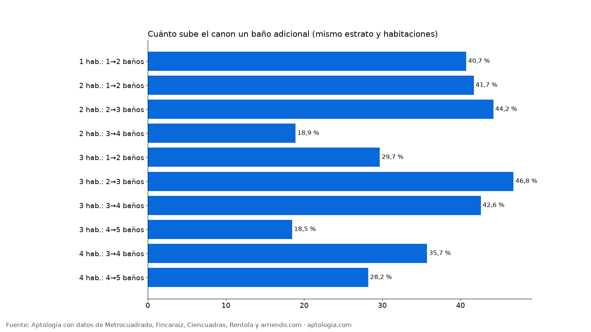

# ¿Cuánto vale un baño extra en un arriendo en Bogotá? Diferencia por habitaciones y estrato (2026)

**En Bogotá, un baño adicional sube el arriendo 38,9 % en promedio, frente a un apartamento del mismo estrato y número de habitaciones.** En un 2 habitaciones, pasar de 1 a 2 baños sube el canon 41,7 % dentro del mismo estrato; por m² la diferencia es 6,7 %, porque buena parte de la prima es área extra.

*Resumen: comparamos 16.147 apartamentos en arriendo únicos en Bogotá según su número de baños, dentro del mismo estrato y número de habitaciones.*

**Actualizado:** 13 de octubre de 2026 · **Próxima actualización:** mensual.

## Baño adicional por número de habitaciones

| Habitaciones | Baños | Canon mediano antes | Canon mediano después | Diferencia en canon (mismo estrato) | Diferencia por m² | Avisos comparados |
|---|---|---|---|---|---|---|
| 1 | 1 → 2 | $2.000.000 | $3.800.000 | 40,7 % | -9,5 % | 1.140 |
| 2 | 1 → 2 | $1.537.000 | $3.500.000 | 41,7 % | 6,7 % | 1.115 |
| 2 | 2 → 3 | $3.500.000 | $8.000.000 | 44,2 % | 6,0 % | 902 |
| 2 | 3 → 4 | $8.000.000 | $10.000.000 | 18,9 % | -16,3 % | 113 |
| 3 | 1 → 2 | $1.400.000 | $2.970.000 | 29,7 % | 10,8 % | 301 |
| 3 | 2 → 3 | $2.970.000 | $7.881.500 | 46,8 % | 8,6 % | 627 |
| 3 | 3 → 4 | $7.881.500 | $13.000.000 | 42,6 % | 6,8 % | 1.045 |
| 3 | 4 → 5 | $13.000.000 | $15.000.000 | 18,5 % | 4,4 % | 507 |
| 4 | 3 → 4 | $6.090.000 | $13.000.000 | 35,7 % | 11,0 % | 102 |
| 4 | 4 → 5 | $13.000.000 | $18.000.000 | 28,2 % | 9,6 % | 277 |

**Cómo usarlo para decidir:** si compartes el apartamento o vives en pareja, el segundo baño suele ser el gasto que más se nota en el día a día. Si vives solo, un apartamento con un baño del mismo estrato te ahorra esa diferencia cada mes. La diferencia por m² muestra que buena parte de la prima es área extra.

## Preguntas frecuentes

**¿Cuánto más cuesta un apartamento con 2 baños en Bogotá?**
En un 2 habitaciones, el segundo baño sube el canon 41,7 % frente a uno comparable del mismo estrato, corte al 13 de octubre de 2026.

**¿El baño extra encarece el precio por m²?**
Menos que el canon: parte de la diferencia es que los apartamentos con más baños son más grandes. Ver la columna de diferencia por m².

## Metodología

- **Fuente:** base de ingesta diaria de Aptología, con avisos públicos de Metrocuadrado, Fincaraíz, Ciencuadras, Rentola y arriendo.com. Corte al 13 de octubre de 2026.
- **Filtros:** avisos vivos que pasan el control de calidad, en Bogotá, canon entre $400.000 y $30.000.000. Se excluyen TikTok y Facebook Marketplace.
- **Duplicados:** se deja un aviso por grupo de duplicados (el mismo inmueble en varios portales).
- **Comparación:** dentro de cada celda de estrato × habitaciones se compara el canon mediano con n+1 baños frente a n baños (mínimo 8 avisos por lado) y se promedia ponderando por el tamaño del grupo menor. Se reporta solo cuando hay 30 avisos o más comparados.
- **Limitaciones:** son precios pedidos, no cerrados. Los barrios y localidades vienen tal como los escribe cada portal.
- **Datos abiertos:** [datos.csv](data/cuanto_vale_un_bano_extra_arriendo_bogota_datos.csv), licencia CC BY 4.0.

## Cómo citar

Pinzón Pineda, D. M. (2026). *¿Cuánto vale un baño extra en un arriendo en Bogotá? Diferencia por habitaciones y estrato (2026)*. Aptología. https://www.aptologia.com/estudios/cuanto-vale-un-bano-extra-arriendo-bogota. Datos: datos.csv, licencia CC BY 4.0.
