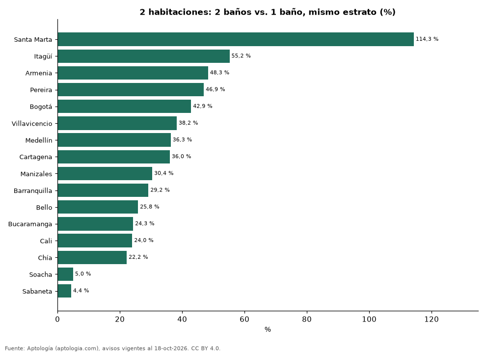

# Cuánto vale un segundo baño: precio de apartamentos de 2 habitaciones con 1 y 2 baños en Colombia (octubre 2026)

**Un apartamento de 2 habitaciones con 2 baños se pide en Colombia un 37,4 % más caro que uno con 1 baño del mismo estrato y ciudad; la mayor diferencia está en Santa Marta (114,3 %).** En Bogotá es 42,9 %. La menor, en Sabaneta (4,4 %). Sin emparejar por estrato la diferencia sería 91,8 %.

*Resumen: comparamos 27.076 apartamentos de 2 habitaciones en venta con 1 o 2 baños en 16 ciudades.*

**Actualizado:** 18 de octubre de 2026 (datos del 18 de octubre de 2026) · **Próxima actualización:** mensual.

## Resumen

| Indicador | Valor |
|---|---|
| Colombia | +37,4 % |
| Mayor | Santa Marta: +114,3 % |
| Menor | Sabaneta: +4,4 % |

## Ciudades

| Ciudad | 2 baños vs. 1 (mismo estrato) | Combinaciones de estrato | Avisos (2 / 1) |
|---|---|---|---|
| Santa Marta | +114,3 % | 1 | 558 / 36 |
| Itagüí | +55,2 % | 1 | 160 / 33 |
| Armenia | +48,3 % | 3 | 511 / 155 |
| Pereira | +46,9 % | 2 | 474 / 114 |
| Bogotá | +42,9 % | 5 | 3.561 / 2.068 |
| Villavicencio | +38,2 % | 1 | 35 / 33 |
| Medellín | +36,3 % | 3 | 1.626 / 444 |
| Cartagena | +36,0 % | 3 | 1.125 / 134 |
| Manizales | +30,4 % | 2 | 189 / 185 |
| Barranquilla | +29,2 % | 3 | 1.098 / 178 |
| Bello | +25,8 % | 1 | 193 / 92 |
| Bucaramanga | +24,3 % | 1 | 67 / 37 |
| Cali | +24,0 % | 2 | 1.303 / 212 |
| Chía | +22,2 % | 2 | 436 / 105 |
| Soacha | +5,0 % | 1 | 31 / 51 |
| Sabaneta | +4,4 % | 2 | 1.021 / 75 |

Diferencia del precio mediano dentro de cada combinación de ciudad y estrato (30 avisos o más en cada grupo), promediada con peso por avisos. El segundo baño suele venir con más área, así que la cifra incluye ese efecto.

## Preguntas frecuentes

**¿Cuánto vale un baño extra en un apartamento?**
En Colombia, un apartamento de 2 habitaciones con 2 baños se pide un 37,4 % más caro que uno con 1.

## Metodología

- **Fuente:** exportes nocturnos de la base de datos de Aptología (aptologia.com) del 18 de octubre de 2026: avisos vigentes de vivienda en portales inmobiliarios de 13 países, recogidos por Aptología y vistos en línea entre el 11 y el 18 de octubre de 2026. Corte: 18 de octubre de 2026.
- **Depuración:** se eliminan duplicados exactos (misma ciudad, zona, tipo, precio, moneda, área, habitaciones y baños) y los precios fuera del percentil 1–99 de cada país, operación, moneda y tipo; el precio por m² usa solo avisos con área declarada entre 12 y 2.000 m² y también se recorta al P1–P99.
- **Qué se mide:** precios pedidos (publicados), no precios de cierre. En arriendo, el canon mensual sin administración, gastos comunes ni condominio.
- **Muestra mínima:** cada cifra publicada se apoya en al menos 30 avisos; las celdas con menos se omiten.
- **Colombia:** Precios en pesos colombianos, sin conversión de moneda.
- **Limitaciones:** la cobertura depende de los portales que recorre Aptología en cada país y es mayor en las ciudades grandes y en los segmentos medio-alto y alto; el área es la que declara el aviso, sin verificar; los nombres de zona vienen de los portales.
- **Privacidad:** solo se publican agregados; no se publica ningún dato personal, enlace a avisos ni nombre de anunciante.
- **Datos abiertos:** [datos.csv](datos.csv), licencia CC BY 4.0.

## Cómo citar

Pinzón Pineda, D. M. (2026). *Cuánto vale un segundo baño: precio de apartamentos de 2 habitaciones con 1 y 2 baños en Colombia (octubre 2026)*. Aptología (aptologia.com). https://github.com/elbroker/aptologia-datos/tree/main/estudios/cuanto-vale-un-bano-extra-ciudades-colombia-2026. Datos: datos.csv, licencia CC BY 4.0.
