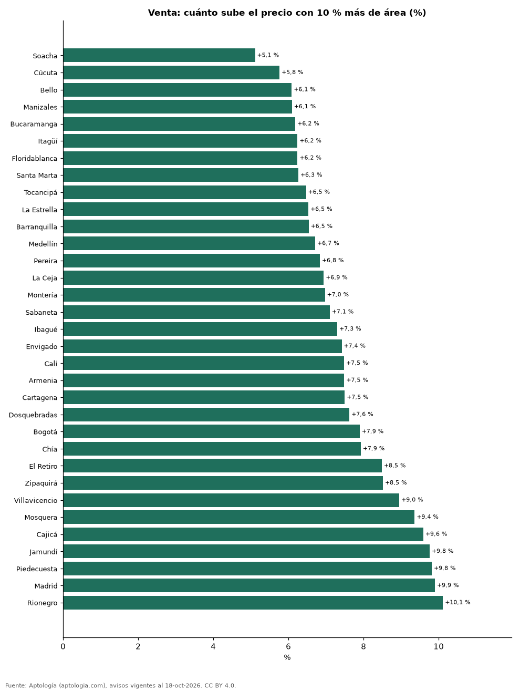

# ¿Cuánto vale un metro cuadrado extra? Cómo sube el precio con el tamaño del apartamento en 33 ciudades de Colombia (octubre 2026)

**En Colombia, dentro del mismo estrato, un apartamento en venta 10 % más grande se pide +7,6 % más caro. En Bogotá un m² extra vale unos 6,07 millones de pesos, frente a 7,25 millones de pesos del m² mediano.** El efecto del tamaño es más débil en Soacha (+5,1 % por 10 % de área) y más fuerte en Rionegro (+10,1 %).

*Resumen: estimamos la relación entre precio y área de 117.698 apartamentos en venta y 64.312 en arriendo en 33 ciudades, con el estrato fijo.*

**Actualizado:** 18 de octubre de 2026 (datos del 18 de octubre de 2026) · **Próxima actualización:** mensual.

## Resumen

| Indicador | Valor |
|---|---|
| +10 % de área (venta, país) | +7,6 % |
| 1 m² extra en Bogotá | 6,07 millones de pesos |
| Efecto más débil | Soacha: +5,1 % |
| Efecto más fuerte | Rionegro: +10,1 % |

## Cuánto sube el precio con el área, por ciudad

| Ciudad | Venta: +10 % de área sube el precio | Valor de 1 m² extra (venta) | Precio mediano del m² | Arriendo: +10 % de área | Avisos (venta / arriendo) |
|---|---|---|---|---|---|
| Soacha | +5,1 % | 1,68 millones de pesos | 3,39 millones de pesos | — | 543 / 144 |
| Cúcuta | +5,8 % | 1,96 millones de pesos | 3,55 millones de pesos | +3,6 % | 664 / 392 |
| Bello | +6,1 % | 3,44 millones de pesos | 5,44 millones de pesos | +7,4 % | 2.194 / 1.083 |
| Manizales | +6,1 % | 3,58 millones de pesos | 5,65 millones de pesos | +6,8 % | 2.800 / 287 |
| Bucaramanga | +6,2 % | 2,94 millones de pesos | 4,67 millones de pesos | +6,7 % | 2.476 / 429 |
| Itagüí | +6,2 % | 4,39 millones de pesos | 6,75 millones de pesos | +6,2 % | 1.927 / 897 |
| Floridablanca | +6,2 % | 3,25 millones de pesos | 5,16 millones de pesos | +6,0 % | 932 / 363 |
| Santa Marta | +6,3 % | 4,90 millones de pesos | 8,72 millones de pesos | +6,1 % | 3.791 / 675 |
| Tocancipá | +6,5 % | 2,36 millones de pesos | 3,62 millones de pesos | — | 240 / 98 |
| La Estrella | +6,5 % | 4,53 millones de pesos | 6,47 millones de pesos | +7,4 % | 484 / 487 |
| Barranquilla | +6,5 % | 2,96 millones de pesos | 4,53 millones de pesos | +6,1 % | 7.646 / 3.805 |
| Medellín | +6,7 % | 5,21 millones de pesos | 7,50 millones de pesos | +6,5 % | 19.694 / 20.159 |
| Pereira | +6,8 % | 3,77 millones de pesos | 5,50 millones de pesos | +6,5 % | 4.380 / 1.549 |
| La Ceja | +6,9 % | 4,51 millones de pesos | 5,92 millones de pesos | +7,5 % | 272 / 350 |
| Montería | +7,0 % | 2,44 millones de pesos | 3,72 millones de pesos | — | 321 / 56 |
| Sabaneta | +7,1 % | 5,28 millones de pesos | 7,12 millones de pesos | +6,0 % | 4.174 / 3.856 |
| Ibagué | +7,3 % | 3,21 millones de pesos | 4,23 millones de pesos | +5,9 % | 1.253 / 262 |
| Envigado | +7,4 % | 6,35 millones de pesos | 8,44 millones de pesos | +6,8 % | 5.502 / 7.279 |
| Cali | +7,5 % | 3,76 millones de pesos | 4,65 millones de pesos | +6,4 % | 9.363 / 1.557 |
| Armenia | +7,5 % | 4,11 millones de pesos | 5,33 millones de pesos | +7,4 % | 2.301 / 336 |
| Cartagena | +7,5 % | 6,07 millones de pesos | 7,88 millones de pesos | +6,9 % | 5.940 / 2.027 |
| Dosquebradas | +7,6 % | 3,52 millones de pesos | 4,65 millones de pesos | — | 594 / 68 |
| Bogotá | +7,9 % | 6,07 millones de pesos | 7,25 millones de pesos | +7,1 % | 30.678 / 12.711 |
| Chía | +7,9 % | 4,61 millones de pesos | 5,53 millones de pesos | +6,0 % | 1.475 / 482 |
| El Retiro | +8,5 % | 8,22 millones de pesos | 9,31 millones de pesos | +8,0 % | 558 / 541 |
| Zipaquirá | +8,5 % | 3,63 millones de pesos | 4,37 millones de pesos | — | 802 / 174 |
| Villavicencio | +9,0 % | 3,87 millones de pesos | 4,20 millones de pesos | — | 361 / 74 |
| Mosquera | +9,4 % | 4,77 millones de pesos | 4,93 millones de pesos | — | 799 / 167 |
| Cajicá | +9,6 % | 5,35 millones de pesos | 5,69 millones de pesos | +9,9 % | 1.475 / 382 |
| Jamundí | +9,8 % | 3,31 millones de pesos | 3,58 millones de pesos | — | 471 / 116 |
| Piedecuesta | +9,8 % | 3,60 millones de pesos | 3,67 millones de pesos | — | 255 / 65 |
| Madrid | +9,9 % | 3,47 millones de pesos | 3,59 millones de pesos | +3,4 % | 449 / 270 |
| Rionegro | +10,1 % | 7,96 millones de pesos | 7,44 millones de pesos | +10,9 % | 2.884 / 3.171 |

Elasticidad precio-área estimada por regresión log-log con efectos fijos de estrato (apartamentos de 25 a 400 m²); el valor del m² extra es la elasticidad × precio mediano ÷ área mediana.

## Preguntas frecuentes

**¿Cuánto vale un metro cuadrado adicional en un apartamento?**
En Bogotá, unos 6,07 millones de pesos en venta, frente a 7,25 millones de pesos del m² mediano.

**¿El m² de los apartamentos grandes es más barato?**
Si la elasticidad es menor que 1, sí: cocina, baños y zonas comunes pesan igual en un apartamento pequeño que en uno grande, y los metros adicionales valen menos que el promedio.

## Metodología

- **Fuente:** exportes nocturnos de la base de datos de Aptología (aptologia.com) del 18 de octubre de 2026: avisos vigentes de vivienda en portales inmobiliarios de 13 países, recogidos por Aptología y vistos en línea entre el 11 y el 18 de octubre de 2026. Corte: 18 de octubre de 2026.
- **Depuración:** se eliminan duplicados exactos (misma ciudad, zona, tipo, precio, moneda, área, habitaciones y baños) y los precios fuera del percentil 1–99 de cada país, operación, moneda y tipo; el precio por m² usa solo avisos con área declarada entre 12 y 2.000 m² y también se recorta al P1–P99.
- **Qué se mide:** precios pedidos (publicados), no precios de cierre. En arriendo, el canon mensual sin administración, gastos comunes ni condominio.
- **Muestra mínima:** cada cifra publicada se apoya en al menos 30 avisos; las celdas con menos se omiten.
- **Colombia:** Precios en pesos colombianos, sin conversión de moneda.
- **Modelo:** log(precio) = b·log(área) + efectos de estrato, por ciudad y operación, con 200 avisos o más; b es la elasticidad (1 = proporcional). +10 % de área equivale a 1,1^b − 1. No controla barrio ni antigüedad.
- **Limitaciones:** la cobertura depende de los portales que recorre Aptología en cada país y es mayor en las ciudades grandes y en los segmentos medio-alto y alto; el área es la que declara el aviso, sin verificar; los nombres de zona vienen de los portales.
- **Privacidad:** solo se publican agregados; no se publica ningún dato personal, enlace a avisos ni nombre de anunciante.
- **Datos abiertos:** [datos.csv](datos.csv), licencia CC BY 4.0.

## Cómo citar

Pinzón Pineda, D. M. (2026). *¿Cuánto vale un metro cuadrado extra? Cómo sube el precio con el tamaño del apartamento en 33 ciudades de Colombia (octubre 2026)*. Aptología (aptologia.com). https://github.com/elbroker/aptologia-datos/tree/main/estudios/cuanto-vale-un-metro-cuadrado-extra-ciudades-colombia-2026. Datos: datos.csv, licencia CC BY 4.0.
