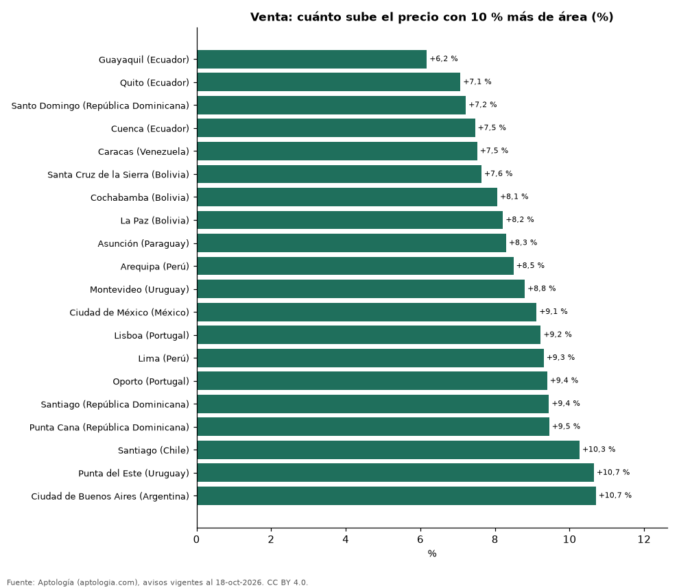

# ¿Cuánto vale un metro cuadrado extra? El precio y el tamaño del apartamento en 20 ciudades de Latinoamérica y Portugal (octubre 2026)

**Un apartamento en venta 10 % más grande se pide +6,2 % más caro en Guayaquil (Ecuador), el efecto más débil de 20 ciudades, y +10,7 % en Ciudad de Buenos Aires (Argentina), el más fuerte.** En la mediana de las ciudades, 10 % más de área sube el precio +8,6 % en venta y +7,3 % en alquiler.

*Resumen: estimamos la relación precio-área de 101.862 apartamentos en venta y alquiler en 26 ciudades fuera de Colombia.*

**Actualizado:** 18 de octubre de 2026 (datos del 18 de octubre de 2026) · **Próxima actualización:** mensual.

## Resumen

| Indicador | Valor |
|---|---|
| Efecto más débil (venta) | Guayaquil (Ecuador): +6,2 % |
| Efecto más fuerte (venta) | Ciudad de Buenos Aires (Argentina): +10,7 % |
| Mediana de ciudades (venta) | +8,6 % |

## Venta

| Ciudad | +10 % de área | Valor de 1 m² extra | m² mediano | Avisos |
|---|---|---|---|---|
| Guayaquil (Ecuador) | +6,2 % | USD 797 | USD 1.391 | 922 |
| Quito (Ecuador) | +7,1 % | USD 803 | USD 1.013 | 2.195 |
| Santo Domingo (República Dominicana) | +7,2 % | USD 1.353 | USD 1.971 | 6.092 |
| Cuenca (Ecuador) | +7,5 % | USD 867 | USD 1.238 | 333 |
| Caracas (Venezuela) | +7,5 % | USD 1.231 | USD 1.423 | 1.350 |
| Santa Cruz de la Sierra (Bolivia) | +7,6 % | USD 921 | USD 1.245 | 1.686 |
| Cochabamba (Bolivia) | +8,1 % | USD 722 | USD 973 | 361 |
| La Paz (Bolivia) | +8,2 % | USD 822 | USD 1.098 | 463 |
| Asunción (Paraguay) | +8,3 % | USD 1.464 | USD 1.897 | 4.103 |
| Arequipa (Perú) | +8,5 % | USD 1.055 | USD 1.227 | 517 |
| Montevideo (Uruguay) | +8,8 % | USD 2.480 | USD 3.035 | 4.535 |
| Ciudad de México (México) | +9,1 % | USD 2.779 | USD 2.897 | 7.640 |
| Lisboa (Portugal) | +9,2 % | USD 7.702 | USD 8.368 | 1.566 |
| Lima (Perú) | +9,3 % | USD 2.018 | USD 2.142 | 6.186 |
| Oporto (Portugal) | +9,4 % | USD 5.107 | USD 5.820 | 622 |
| Santiago (República Dominicana) | +9,4 % | USD 1.437 | USD 1.496 | 522 |
| Punta Cana (República Dominicana) | +9,5 % | USD 2.287 | USD 2.527 | 461 |
| Santiago (Chile) | +10,3 % | USD 3.653 | USD 3.297 | 5.667 |
| Punta del Este (Uruguay) | +10,7 % | USD 3.748 | USD 3.604 | 4.595 |
| Ciudad de Buenos Aires (Argentina) | +10,7 % | USD 2.589 | USD 2.556 | 8.191 |

Elasticidad precio-área por regresión log-log (apartamentos de 25 a 400 m², moneda mayoritaria de la ciudad); valor del m² extra = elasticidad × precio mediano ÷ área mediana, en dólares.

## Alquiler

| Ciudad | +10 % de área (alquiler) | Avisos |
|---|---|---|
| Asunción (Paraguay) | +4,3 % | 2.106 |
| Montevideo (Uruguay) | +4,9 % | 3.047 |
| Santo Domingo (República Dominicana) | +5,9 % | 2.931 |
| Guadalajara (México) | +5,9 % | 835 |
| La Paz (Bolivia) | +5,9 % | 300 |
| Monterrey (México) | +6,0 % | 1.651 |
| Lisboa (Portugal) | +6,2 % | 498 |
| Santa Cruz de la Sierra (Bolivia) | +6,3 % | 957 |
| San Pedro Garza Garcia (México) | +7,1 % | 602 |
| Córdoba (Argentina) | +7,2 % | 202 |
| Ciudad de México (México) | +7,5 % | 4.791 |
| Quito (Ecuador) | +7,8 % | 1.147 |
| Ciudad de Buenos Aires (Argentina) | +7,8 % | 3.091 |
| Guayaquil (Ecuador) | +8,0 % | 1.235 |
| Lima (Perú) | +8,0 % | 2.938 |
| Zapopan (México) | +8,0 % | 836 |
| Caracas (Venezuela) | +8,3 % | 316 |
| Santiago (Chile) | +9,1 % | 3.760 |
| São Paulo (Brasil) | +9,6 % | 10.660 |
| Punta del Este (Uruguay) | +9,7 % | 1.952 |

## Preguntas frecuentes

**¿El metro cuadrado es más barato en apartamentos grandes?**
Donde la elasticidad es menor que 1, sí; en la mediana de ciudades, 10 % más de área sube el precio +8,6 %.

**¿Dónde vale más cada metro extra?**
Donde la elasticidad es mayor, como Ciudad de Buenos Aires (Argentina).

## Metodología

- **Fuente:** exportes nocturnos de la base de datos de Aptología (aptologia.com) del 18 de octubre de 2026: avisos vigentes de vivienda en portales inmobiliarios de 13 países, recogidos por Aptología y vistos en línea entre el 11 y el 18 de octubre de 2026. Corte: 18 de octubre de 2026.
- **Depuración:** se eliminan duplicados exactos (misma ciudad, zona, tipo, precio, moneda, área, habitaciones y baños) y los precios fuera del percentil 1–99 de cada país, operación, moneda y tipo; el precio por m² usa solo avisos con área declarada entre 12 y 2.000 m² y también se recorta al P1–P99.
- **Qué se mide:** precios pedidos (publicados), no precios de cierre. En arriendo, el canon mensual sin administración, gastos comunes ni condominio.
- **Muestra mínima:** cada cifra publicada se apoya en al menos 30 avisos; las celdas con menos se omiten.
- **Monedas:** nunca se mezclan avisos de monedas distintas sin convertirlos. Conversión a dólares con la tasa de mercado de ExchangeRate-API (open.er-api.com, actualización del 18 Oct 2026): 1 USD = 3.182,80 COP, 1 USD = 18,47 M.N, 1 USD = 5,09 BRL, 1 USD = 3,44 PEN, 1 USD = 982,44 CLP, 1 USD = 1.514,57 ARS, 1 USD = 40,20 UYU, 1 USD = 5.705,37 PYG, 1 USD = 61,27 DOP, 1 USD = 0,89 EUR, 1 USD = 11,72 BOB; la UF chilena a 41.178,64 CLP (mindicador,cl. 18-oct-2026). Los avisos publicados en dólares se usan tal cual.
- **Monedas:** en cada ciudad y operación se usa solo la moneda mayoritaria de los avisos (los avisos en otra moneda se excluyen) y la mediana se convierte a dólares con la tasa citada; nunca se promedian avisos de monedas distintas.
- **Modelo:** log(precio) = b·log(área), por ciudad y operación con 200 avisos o más, en la moneda mayoritaria; b no depende de la tasa de cambio. No controla zona ni antigüedad.
- **Limitaciones:** la cobertura depende de los portales que recorre Aptología en cada país y es mayor en las ciudades grandes y en los segmentos medio-alto y alto; el área es la que declara el aviso, sin verificar; los nombres de zona vienen de los portales.
- **Privacidad:** solo se publican agregados; no se publica ningún dato personal, enlace a avisos ni nombre de anunciante.
- **Datos abiertos:** [datos.csv](datos.csv), licencia CC BY 4.0.

## Cómo citar

Pinzón Pineda, D. M. (2026). *¿Cuánto vale un metro cuadrado extra? El precio y el tamaño del apartamento en 20 ciudades de Latinoamérica y Portugal (octubre 2026)*. Aptología (aptologia.com). https://github.com/elbroker/aptologia-datos/tree/main/estudios/cuanto-vale-un-metro-cuadrado-extra-ciudades-latinoamerica-2026. Datos: datos.csv, licencia CC BY 4.0.
