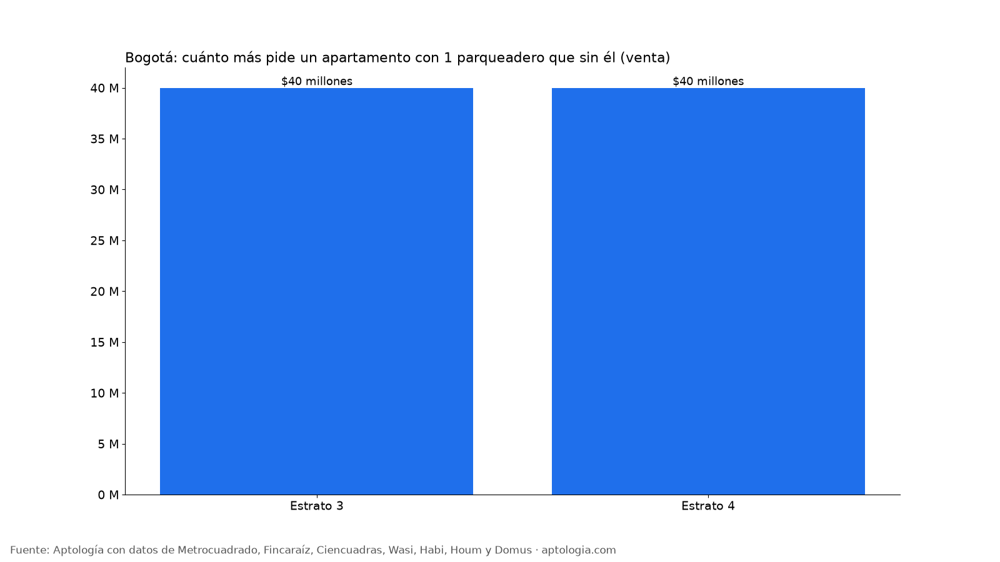
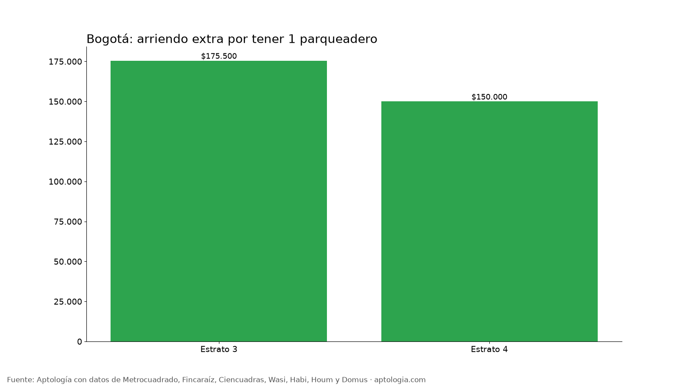

# Cuánto vale un parqueadero en Bogotá: diferencia de precio en venta y en arriendo por estrato (octubre 2026)

**En Bogotá, un apartamento en venta con un parqueadero pide en la mediana $40 millones más que uno comparable sin parqueadero, y uno con dos parqueaderos pide $105 millones más que uno comparable con uno solo.** En arriendo, tener parqueadero sube el canon en $200.000 al mes frente a un apartamento igual sin él.

*Resumen: comparamos 36.813 apartamentos en venta y 14.931 en arriendo, únicos, con y sin parqueadero, dentro de grupos comparables.*

**Actualizado:** 18 de octubre de 2026 (datos del 18 de octubre de 2026) · **Próxima actualización:** mensual.

## Resumen (toda la ciudad)

| Comparación | Diferencia mediana |
|---|---|
| Venta: 1 parqueadero vs. ninguno | $40 millones |
| Venta: 2 parqueaderos vs. 1 | $105 millones |
| Arriendo: 1 parqueadero vs. ninguno | $200.000 al mes |
| Arriendo: 2 parqueaderos vs. 1 | $250.000 al mes |
| Venta: parqueadero propio o independiente vs. comunal o con servidumbre (precio por m²) | +7,0 % |

La diferencia entre 2 y 1 parqueaderos es mayor que la del primero porque los apartamentos con dos cupos suelen estar en edificios de mayor gama aun dentro del mismo grupo; tómala como techo, no como precio de un cupo suelto.

## Por estrato

| Estrato | Venta: 1 vs. 0 | Venta: 2 vs. 1 | Arriendo: 1 vs. 0 | Arriendo: 2 vs. 1 | % en venta con parqueadero | % en arriendo con parqueadero |
|---|---|---|---|---|---|---|
| 3 | $40 millones | — | $175.500 | — | 42,5 % | 27,2 % |
| 4 | $40 millones | $100 millones | $150.000 | $100.000 | 86,0 % | 65,0 % |
| 5 | — | $103 millones | — | $550.000 | 96,5 % | 90,9 % |
| 6 | — | $154 millones | — | $250.000 | 98,2 % | 96,4 % |

## Tipo de parqueadero (avisos que lo informan)

| Tipo | Precio por m² mediano | Avisos |
|---|---|---|
| Comunal | $5.706.522 | 209 |
| Independiente | $8.411.215 | 3.216 |
| Propio | $7.819.905 | 5.431 |
| Servidumbre | $7.575.758 | 682 |

**Cómo usarlo para decidir:** si no tienes carro, un apartamento sin parqueadero en el mismo barrio puede ahorrarte el valor de la tabla. Si lo necesitas, compara ese valor con lo que cuesta arrendar un parqueadero aparte en la zona. El parqueadero propio o independiente se valora más que el comunal o con servidumbre.

## Preguntas frecuentes

**¿Cuánto vale un parqueadero en Bogotá?**
Un apartamento con 1 parqueadero pide en la mediana $40 millones más que uno comparable sin él (mismo estrato, localidad, habitaciones y tamaño), con datos del 18 de octubre de 2026.

**¿Cuánto sube el arriendo por tener parqueadero?**
Unos $200.000 al mes en la mediana de apartamentos comparables.

**¿Cuánto vale el segundo parqueadero?**
Un apartamento con dos parqueaderos pide $105 millones más que uno comparable con uno; parte de esa diferencia se debe a que suelen ser edificios de mayor gama.

## Metodología

- **Fuente:** avisos vivos de vivienda recogidos por la ingesta de Aptología en Metrocuadrado, Fincaraíz, Ciencuadras, Wasi, Habi, Houm y Domus, del 11 al 18 de octubre de 2026. Corte: 18 de octubre de 2026.
- **Depuración:** un mismo inmueble publicado varias veces se cuenta una sola vez (agrupación por portal y, entre portales, por precio, área, habitaciones y coordenadas). Se descartan precios y áreas fuera de rango y, en arriendo, se resta la administración cuando el portal la incluye en el canon.
- **Qué se mide:** precios pedidos (publicados), no precios de cierre.
- **Comparación emparejada:** se calcula la diferencia de la mediana de precio entre apartamentos con y sin parqueadero dentro de grupos del mismo estrato, localidad, número de habitaciones y rango de área (6 avisos o más en cada lado; para 2 vs. 1 también el número de baños), y se resume con la mediana ponderada de esas diferencias. Por estrato solo se muestran cifras con 10 grupos comparables o más. No es un avalúo del parqueadero.
- **Limitaciones:** son precios pedidos en portales, que pueden diferir del valor final de arriendo o venta. La cobertura es mayor en el norte de Bogotá y en estratos 4 a 6, porque ahí se concentra la oferta publicada. Los barrios y la localidad vienen de lo que escribe cada portal; cuando falta la localidad se asigna por los avisos vecinos más cercanos.
- **Datos abiertos:** [datos.csv](datos.csv), licencia CC BY 4.0.

## Cómo citar

Pinzón Pineda, D. M. (2026). *Cuánto vale un parqueadero en Bogotá: diferencia de precio en venta y en arriendo por estrato (octubre 2026)*. Aptología. https://www.aptologia.com/estudios/cuanto-vale-un-parqueadero-bogota-2026. Datos: datos.csv, licencia CC BY 4.0.
