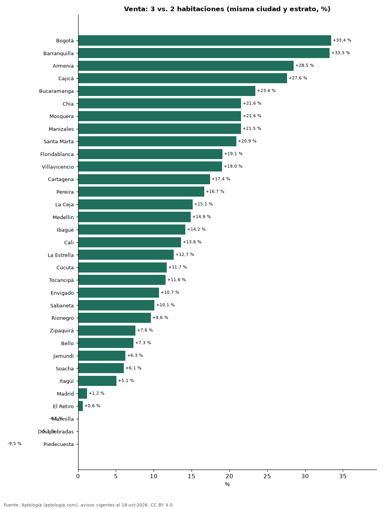

# ¿Cuánto más cuesta una habitación extra al comprar apartamento? Por ciudad y estrato en Colombia (octubre 2026)

**En Colombia, pasar de un apartamento de 2 a uno de 3 habitaciones en venta sube el precio pedido +20,9 % dentro de la misma ciudad y estrato; la mayor diferencia está en Bogotá (+33,4 %) y la menor en Piedecuesta (-9,5 %).** De 1 a 2 habitaciones: +27,8 %. De 3 a 4 habitaciones: +26,8 %.

*Resumen: comparamos 117.643 apartamentos en venta de 1 a 4 habitaciones dentro de cada ciudad y estrato.*

**Actualizado:** 18 de octubre de 2026 (datos del 18 de octubre de 2026) · **Próxima actualización:** mensual.

## Resumen

| Indicador | Valor |
|---|---|
| De 1 a 2 hab. | +27,8 % |
| De 2 a 3 hab. | +20,9 % |
| De 3 a 4 hab. | +26,8 % |
| Mayor (2→3) | Bogotá: +33,4 % |
| Menor (2→3) | Piedecuesta: -9,5 % |

## Cuánto sube el precio con cada habitación

| Paso | Cuánto sube el precio | Avisos (con más hab.) |
|---|---|---|
| De 1 a 2 habitaciones | +27,8 % | 24.566 |
| De 2 a 3 habitaciones | +20,9 % | 65.261 |
| De 3 a 4 habitaciones | +26,8 % | 9.236 |

Promedio ponderado de celdas ciudad × estrato con 30 avisos o más de cada tamaño.

## De 2 a 3 habitaciones por ciudad

| Ciudad | De 2 a 3 habitaciones | Avisos 3 / 2 hab. |
|---|---|---|
| Bogotá | +33,4 % | 16.584 / 7.608 |
| Barranquilla | +33,3 % | 5.033 / 1.802 |
| Armenia | +28,5 % | 1.265 / 759 |
| Cajicá | +27,6 % | 849 / 521 |
| Bucaramanga | +23,4 % | 1.502 / 356 |
| Chía | +21,6 % | 595 / 585 |
| Mosquera | +21,6 % | 653 / 98 |
| Manizales | +21,5 % | 1.623 / 757 |
| Santa Marta | +20,9 % | 1.127 / 1.367 |
| Floridablanca | +19,1 % | 620 / 68 |
| Villavicencio | +19,0 % | 135 / 70 |
| Cartagena | +17,4 % | 2.394 / 2.315 |
| Pereira | +16,7 % | 2.519 / 1.203 |
| La Ceja | +15,1 % | 106 / 88 |
| Medellín | +14,9 % | 11.276 / 4.448 |
| Ibagué | +14,2 % | 851 / 170 |
| Cali | +13,6 % | 5.610 / 2.470 |
| La Estrella | +12,7 % | 260 / 201 |
| Cúcuta | +11,7 % | 368 / 85 |
| Tocancipá | +11,6 % | 108 / 34 |
| Envigado | +10,7 % | 3.430 / 1.328 |
| Sabaneta | +10,1 % | 2.607 / 1.314 |
| Rionegro | +9,6 % | 1.141 / 1.541 |
| Zipaquirá | +7,6 % | 614 / 93 |
| Bello | +7,3 % | 1.393 / 554 |
| Jamundí | +6,3 % | 154 / 269 |
| Soacha | +6,1 % | 344 / 82 |
| Itagüí | +5,1 % | 1.276 / 456 |
| Madrid | +1,2 % | 189 / 30 |
| El Retiro | +0,6 % | 75 / 219 |
| Marinilla | -4,1 % | 39 / 33 |
| Dosquebradas | -5,1 % | 397 / 134 |
| Piedecuesta | -9,5 % | 124 / 35 |

## Preguntas frecuentes

**¿Cuánto más vale un apartamento de 3 habitaciones que uno de 2?**
En promedio, +20,9 % en la misma ciudad y estrato (octubre de 2026).

**¿Dónde pesa más la habitación extra?**
En Bogotá: +33,4 %.

## Metodología

- **Fuente:** exportes nocturnos de la base de datos de Aptología (aptologia.com) del 18 de octubre de 2026: avisos vigentes de vivienda en portales inmobiliarios de 13 países, recogidos por Aptología y vistos en línea entre el 11 y el 18 de octubre de 2026. Corte: 18 de octubre de 2026.
- **Depuración:** se eliminan duplicados exactos (misma ciudad, zona, tipo, precio, moneda, área, habitaciones y baños) y los precios fuera del percentil 1–99 de cada país, operación, moneda y tipo; el precio por m² usa solo avisos con área declarada entre 12 y 2.000 m² y también se recorta al P1–P99.
- **Qué se mide:** precios pedidos (publicados), no precios de cierre. En arriendo, el canon mensual sin administración, gastos comunes ni condominio.
- **Muestra mínima:** cada cifra publicada se apoya en al menos 30 avisos; las celdas con menos se omiten.
- **Colombia:** Precios en pesos colombianos, sin conversión de moneda.
- **Comparación:** dentro de cada celda ciudad × estrato se comparan las medianas de precio de apartamentos con n y n+1 habitaciones (30 avisos o más de cada lado). No fija el área: la habitación extra viene casi siempre con más metros, y la diferencia incluye ese efecto.
- **Limitaciones:** la cobertura depende de los portales que recorre Aptología en cada país y es mayor en las ciudades grandes y en los segmentos medio-alto y alto; el área es la que declara el aviso, sin verificar; los nombres de zona vienen de los portales.
- **Privacidad:** solo se publican agregados; no se publica ningún dato personal, enlace a avisos ni nombre de anunciante.
- **Datos abiertos:** [datos.csv](datos.csv), licencia CC BY 4.0.

## Cómo citar

Pinzón Pineda, D. M. (2026). *¿Cuánto más cuesta una habitación extra al comprar apartamento? Por ciudad y estrato en Colombia (octubre 2026)*. Aptología (aptologia.com). https://github.com/elbroker/aptologia-datos/tree/main/estudios/cuanto-vale-una-habitacion-extra-venta-ciudades-colombia-2026. Datos: datos.csv, licencia CC BY 4.0.
