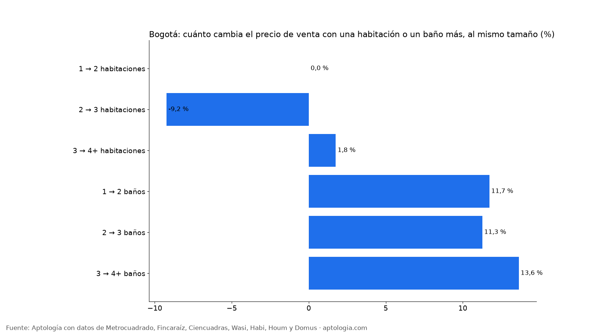

# Cuánto vale una habitación o un baño extra en un apartamento en venta en Bogotá (octubre 2026)

**En Bogotá, a igual tamaño, estrato y localidad, un apartamento en venta con un segundo baño pide 11,7 % más que uno con un solo baño, y pasar de 2 a 3 habitaciones cambia el precio en -9,2 %.** Con el área fija, el baño adicional suma más valor que la habitación adicional, que solo reparte los mismos metros.

*Resumen: comparamos 36.813 apartamentos en venta únicos en Bogotá del mismo estrato, localidad y rango de área.*

**Actualizado:** 18 de octubre de 2026 (datos del 18 de octubre de 2026) · **Próxima actualización:** mensual.

## Cuánto vale una habitación o un baño más (con el mismo área)

| Cambio | Diferencia de precio emparejada | Grupos comparables |
|---|---|---|
| 1 → 2 habitaciones | 0,0 % | 66 |
| 2 → 3 habitaciones | -9,2 % | 151 |
| 3 → 4+ habitaciones | +1,8 % | 82 |
| 1 → 2 baños | +11,7 % | 95 |
| 2 → 3 baños | +11,3 % | 96 |
| 3 → 4+ baños | +13,6 % | 71 |

Como se compara al mismo rango de área, una habitación más significa espacios más pequeños, y eso explica que su prima sea pequeña o negativa. El baño extra, en cambio, se paga.

**Cómo usarlo para decidir:** si comparas dos apartamentos del mismo tamaño, no pagues mucho más por una habitación adicional; sí tiene sentido pagar por el segundo baño si vives con más personas. Para remodelar antes de vender, agregar un baño suele valorizar más que dividir una habitación.

## Preguntas frecuentes

**¿Cuánto vale un baño extra en un apartamento en Bogotá?**
Con el mismo tamaño, estrato y localidad, pasar de 1 a 2 baños se asocia a +11,7 % en el precio pedido, y de 2 a 3 baños a +11,3 % (datos del 18 de octubre de 2026).

**¿Vale más un apartamento de 3 habitaciones que uno de 2 del mismo tamaño?**
Poco: la diferencia emparejada es -9,2 %.

**¿Qué valoriza más un apartamento, una habitación o un baño?**
Con el área fija, el baño adicional.

## Metodología

- **Fuente:** avisos vivos de vivienda recogidos por la ingesta de Aptología en Metrocuadrado, Fincaraíz, Ciencuadras, Wasi, Habi, Houm y Domus, del 11 al 18 de octubre de 2026. Corte: 18 de octubre de 2026.
- **Depuración:** un mismo inmueble publicado varias veces se cuenta una sola vez (agrupación por portal y, entre portales, por precio, área, habitaciones y coordenadas). Se descartan precios y áreas fuera de rango y, en arriendo, se resta la administración cuando el portal la incluye en el canon.
- **Qué se mide:** precios pedidos (publicados), no precios de cierre.
- **Comparación emparejada:** mediana ponderada de las diferencias relativas de precio entre apartamentos con distinto número de habitaciones (o baños) dentro de grupos del mismo estrato, localidad, rango de área y número de baños (o habitaciones), con 6 avisos o más en cada lado. Solo cambios con 10 grupos comparables o más.
- **Limitaciones:** son precios pedidos en portales, que pueden diferir del valor final de arriendo o venta. La cobertura es mayor en el norte de Bogotá y en estratos 4 a 6, porque ahí se concentra la oferta publicada. Los barrios y la localidad vienen de lo que escribe cada portal; cuando falta la localidad se asigna por los avisos vecinos más cercanos.
- **Datos abiertos:** [datos.csv](datos.csv), licencia CC BY 4.0.

## Cómo citar

Pinzón Pineda, D. M. (2026). *Cuánto vale una habitación o un baño extra en un apartamento en venta en Bogotá (octubre 2026)*. Aptología. https://www.aptologia.com/estudios/cuanto-vale-una-habitacion-o-bano-extra-venta-bogota-2026. Datos: datos.csv, licencia CC BY 4.0.
