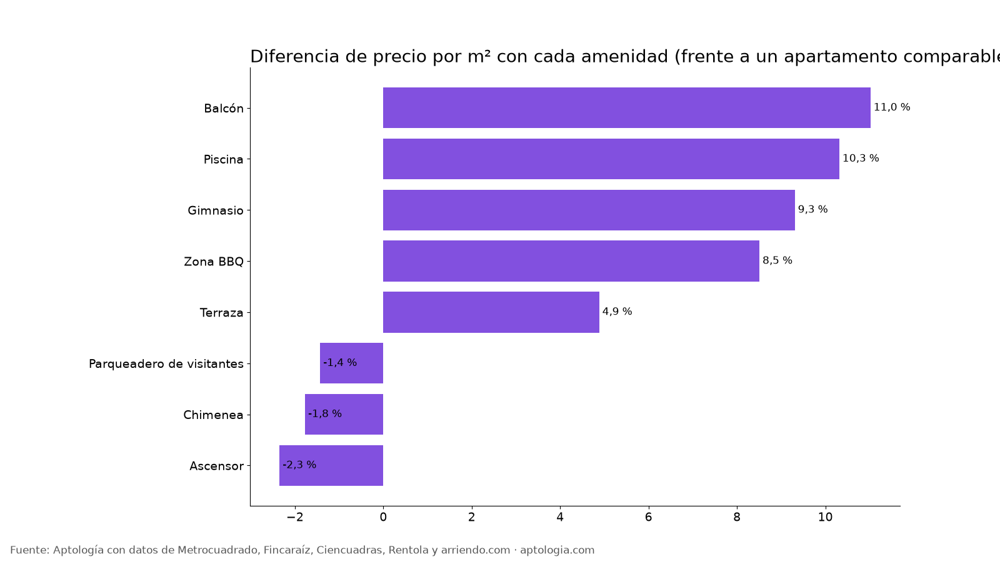

# ¿Cuánto valen el ascensor, el gimnasio, la piscina y otras amenidades en un arriendo en Bogotá? (2026)

**En Bogotá, la amenidad que más sube el arriendo es balcón: 11,0 % más por m² que un apartamento comparable del mismo estrato y habitaciones.** Le siguen piscina (10,3 %) y gimnasio (9,3 %). En cambio, parqueadero de visitantes, chimenea, ascensor no suben el precio por m² (entre -2,3 % y -1,4 %).

*Resumen: medimos la prima de 8 amenidades en 19.156 apartamentos en arriendo únicos en Bogotá con descripción.*

**Actualizado:** 13 de octubre de 2026 · **Próxima actualización:** mensual.

## Prima por amenidad

| Amenidad | Avisos que la mencionan | % de avisos | Canon mediano con ella | Diferencia por m² (comparable) |
|---|---|---|---|---|
| Balcón | 3.248 | 17,0 % | $5.775.000 | 11,0 % |
| Piscina | 788 | 4,1 % | $3.900.000 | 10,3 % |
| Gimnasio | 2.363 | 12,3 % | $3.800.000 | 9,3 % |
| Zona BBQ | 1.502 | 7,8 % | $3.400.000 | 8,5 % |
| Terraza | 2.965 | 15,5 % | $7.200.000 | 4,9 % |
| Parqueadero de visitantes | 398 | 2,1 % | $5.500.000 | -1,4 % |
| Chimenea | 2.058 | 10,7 % | $7.975.000 | -1,8 % |
| Ascensor | 2.305 | 12,0 % | $3.100.000 | -2,3 % |

**Cómo usarlo para decidir:** si no vas a usar el gimnasio o la piscina, buscar sin ellos te ahorra esa prima cada mes, además de una administración más baja.

## Preguntas frecuentes

**¿Cuánto sube el arriendo un gimnasio o una piscina en Bogotá?**
Gimnasio: 9,3 % por m²; piscina: 10,3 %, frente a apartamentos comparables, corte al 13 de octubre de 2026.

**¿Qué amenidad encarece más un arriendo?**
Balcón, con 11,0 % más por m².

## Metodología

- **Fuente:** base de ingesta diaria de Aptología, con avisos públicos de Metrocuadrado, Fincaraíz, Ciencuadras, Rentola y arriendo.com. Corte al 13 de octubre de 2026.
- **Filtros:** avisos vivos que pasan el control de calidad, en Bogotá, canon entre $400.000 y $30.000.000. Se excluyen TikTok y Facebook Marketplace.
- **Duplicados:** se deja un aviso por grupo de duplicados (el mismo inmueble en varios portales).
- **Prima emparejada:** se compara el precio por m² de avisos con y sin el atributo dentro de la misma celda de estrato × habitaciones (mínimo 8 avisos por lado) y se reporta la mediana ponderada de las diferencias. Así la prima no se confunde con estrato o tamaño. El atributo se detecta en el texto del aviso, por lo que solo cuentan avisos con descripción.
- **Limitaciones:** son precios pedidos, no cerrados. Los barrios y localidades vienen tal como los escribe cada portal.
- **Datos abiertos:** [datos.csv](datos.csv), licencia CC BY 4.0.

## Cómo citar

Pinzón Pineda, D. M. (2026). *¿Cuánto valen el ascensor, el gimnasio, la piscina y otras amenidades en un arriendo en Bogotá? (2026)*. Aptología. https://www.aptologia.com/estudios/cuanto-valen-las-amenidades-arriendo-bogota. Datos: datos.csv, licencia CC BY 4.0.
