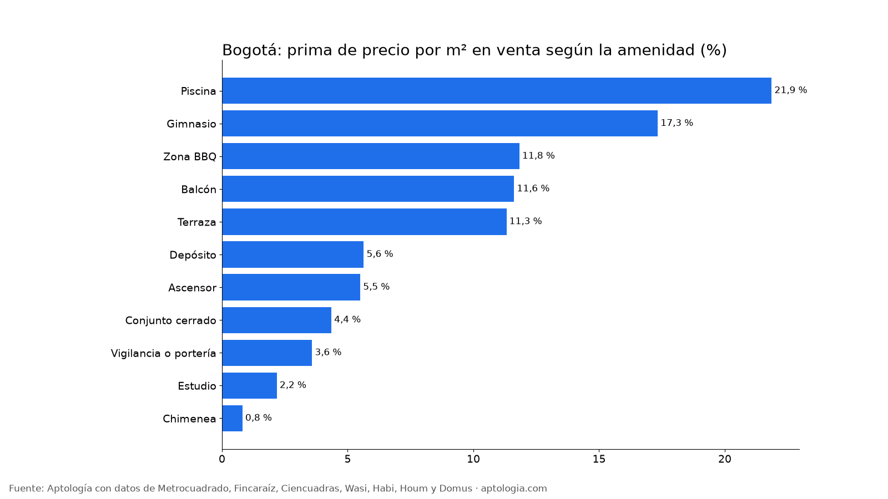

# Cuánto valen las amenidades en un apartamento en venta en Bogotá: ascensor, gimnasio, piscina y más (octubre 2026)

**En Bogotá, el apartamento en venta con piscina pide 21,9 % más por m² que uno comparable sin ella; es la amenidad que más se paga.** En el otro extremo, chimenea se asocia a +0,8 % por m². La comparación es entre apartamentos del mismo estrato, localidad, tamaño y habitaciones.

*Resumen: comparamos 36.813 apartamentos en venta únicos en Bogotá con y sin cada amenidad, dentro de grupos comparables.*

**Actualizado:** 18 de octubre de 2026 (datos del 18 de octubre de 2026) · **Próxima actualización:** mensual.

## Cuánto se paga por cada amenidad

| Amenidad | Prima por m² (emparejada) | Grupos comparables | Avisos con la amenidad | % de los avisos |
|---|---|---|---|---|
| Piscina | +21,9 % | 109 | 3.139 | 8,5 % |
| Gimnasio | +17,3 % | 293 | 14.233 | 38,7 % |
| Zona BBQ | +11,8 % | 178 | 5.334 | 14,5 % |
| Balcón | +11,6 % | 198 | 7.801 | 21,2 % |
| Terraza | +11,3 % | 199 | 7.459 | 20,3 % |
| Depósito | +5,6 % | 233 | 14.749 | 40,1 % |
| Ascensor | +5,5 % | 318 | 20.148 | 54,7 % |
| Conjunto cerrado | +4,4 % | 306 | 12.617 | 34,3 % |
| Vigilancia o portería | +3,6 % | 330 | 22.136 | 60,1 % |
| Estudio | +2,2 % | 216 | 12.823 | 34,8 % |
| Chimenea | +0,8 % | 143 | 10.458 | 28,4 % |

Una prima negativa no significa que la amenidad reste valor: suele indicar que esa amenidad es más común en edificios de otra época o gama dentro del mismo grupo (por ejemplo, la chimenea en edificios más antiguos).

**Cómo usarlo para decidir:** las amenidades también suben la administración. Si no vas a usar piscina o gimnasio, un edificio sin ellas en el mismo barrio puede salir más barato en precio y en cuota mensual.

## Preguntas frecuentes

**¿Cuánto vale tener piscina o gimnasio en un apartamento en Bogotá?**
Piscina: +21,9 % por m²; Gimnasio: +17,3 % por m² frente a apartamentos comparables sin ella (datos del 18 de octubre de 2026).

**¿Qué amenidad sube más el precio de un apartamento?**
Piscina, con +21,9 % por m² en la comparación emparejada.

**¿El ascensor sube el precio de un apartamento?**
Sí: +5,5 % por m² frente a apartamentos comparables sin ascensor.

## Metodología

- **Fuente:** avisos vivos de vivienda recogidos por la ingesta de Aptología en Metrocuadrado, Fincaraíz, Ciencuadras, Wasi, Habi, Houm y Domus, del 11 al 18 de octubre de 2026. Corte: 18 de octubre de 2026.
- **Depuración:** un mismo inmueble publicado varias veces se cuenta una sola vez (agrupación por portal y, entre portales, por precio, área, habitaciones y coordenadas). Se descartan precios y áreas fuera de rango y, en arriendo, se resta la administración cuando el portal la incluye en el canon.
- **Qué se mide:** precios pedidos (publicados), no precios de cierre.
- **Amenidades:** según la lista de características de cada aviso (texto normalizado). Prima emparejada: mediana ponderada de las diferencias de precio por m² entre apartamentos con y sin la amenidad, dentro de grupos del mismo estrato, localidad, habitaciones y rango de área (6 avisos o más en cada lado). Solo amenidades con 10 grupos o más y 80 avisos o más.
- **Limitaciones:** son precios pedidos en portales, que pueden diferir del valor final de arriendo o venta. La cobertura es mayor en el norte de Bogotá y en estratos 4 a 6, porque ahí se concentra la oferta publicada. Los barrios y la localidad vienen de lo que escribe cada portal; cuando falta la localidad se asigna por los avisos vecinos más cercanos.
- **Datos abiertos:** [datos.csv](datos.csv), licencia CC BY 4.0.

## Cómo citar

Pinzón Pineda, D. M. (2026). *Cuánto valen las amenidades en un apartamento en venta en Bogotá: ascensor, gimnasio, piscina y más (octubre 2026)*. Aptología. https://www.aptologia.com/estudios/cuanto-valen-las-amenidades-venta-bogota-2026. Datos: datos.csv, licencia CC BY 4.0.
