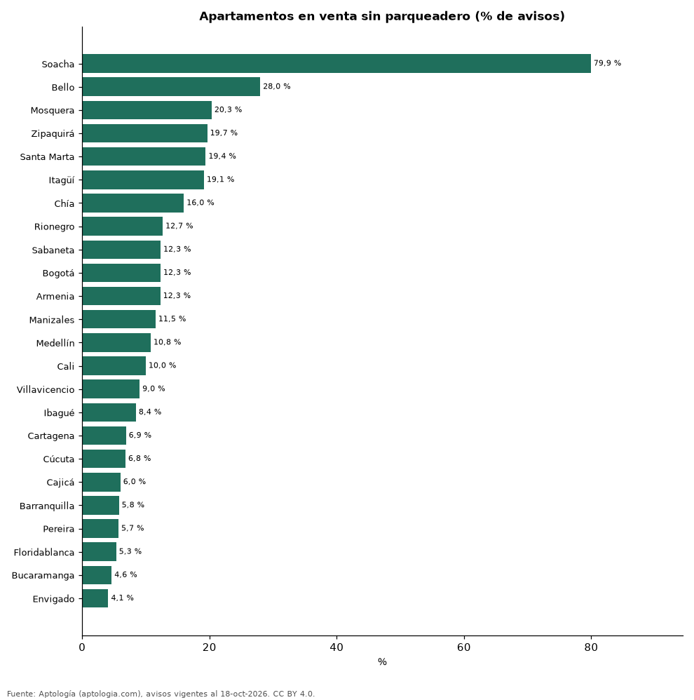

# Cuántos apartamentos en venta tienen parqueadero en cada ciudad de Colombia (octubre 2026)

**En Soacha el 79,9 % de los apartamentos en venta se anuncia sin parqueadero, la mayor proporción de 24 ciudades; en Envigado es solo el 4,1 %.** En todo el país, el 10,8 % no tiene parqueadero; en estrato 6 el 67,9 % tiene 2 o más.

*Resumen: contamos los parqueaderos declarados de 111.547 apartamentos en venta en 24 ciudades con 300 avisos o más.*

**Actualizado:** 18 de octubre de 2026 (datos del 18 de octubre de 2026) · **Próxima actualización:** mensual.

## Resumen

| Indicador | Valor |
|---|---|
| Sin parqueadero (Colombia) | 10,8 % |
| Ciudad con más avisos sin parqueadero | Soacha: 79,9 % |
| Estrato 6 con 2 o más | 67,9 % |

## Parqueaderos por ciudad

| Ciudad | Sin parqueadero | 1 parqueadero | 2 o más | Avisos |
|---|---|---|---|---|
| Soacha | 79,9 % | 18,8 % | 1,2 % | 329 |
| Bello | 28,0 % | 70,1 % | 2,0 % | 2.044 |
| Mosquera | 20,3 % | 72,7 % | 6,9 % | 693 |
| Zipaquirá | 19,7 % | 74,5 % | 5,8 % | 707 |
| Santa Marta | 19,4 % | 66,7 % | 13,9 % | 3.435 |
| Itagüí | 19,1 % | 72,5 % | 8,3 % | 1.787 |
| Chía | 16,0 % | 61,9 % | 22,1 % | 1.326 |
| Rionegro | 12,7 % | 74,0 % | 13,3 % | 2.820 |
| Sabaneta | 12,3 % | 71,0 % | 16,7 % | 4.096 |
| Bogotá | 12,3 % | 32,9 % | 54,8 % | 29.616 |
| Armenia | 12,3 % | 72,8 % | 14,9 % | 2.027 |
| Manizales | 11,5 % | 72,8 % | 15,7 % | 2.366 |
| Medellín | 10,8 % | 41,7 % | 47,5 % | 19.418 |
| Cali | 10,0 % | 45,6 % | 44,4 % | 8.374 |
| Villavicencio | 9,0 % | 69,2 % | 21,8 % | 321 |
| Ibagué | 8,4 % | 76,0 % | 15,5 % | 1.172 |
| Cartagena | 6,9 % | 76,9 % | 16,2 % | 5.464 |
| Cúcuta | 6,8 % | 67,0 % | 26,2 % | 588 |
| Cajicá | 6,0 % | 69,7 % | 24,3 % | 1.432 |
| Barranquilla | 5,8 % | 59,7 % | 34,6 % | 7.319 |
| Pereira | 5,7 % | 73,0 % | 21,3 % | 4.201 |
| Floridablanca | 5,3 % | 71,9 % | 22,8 % | 879 |
| Bucaramanga | 4,6 % | 70,7 % | 24,7 % | 2.266 |
| Envigado | 4,1 % | 42,9 % | 53,0 % | 5.600 |

Porcentaje de los avisos con número de parqueaderos declarado. Se omiten las ciudades donde ningún aviso declara 0 parqueaderos (el portal no informa el dato).

## Parqueaderos por estrato (Colombia)

| Estrato | Sin parqueadero | 2 o más | Avisos |
|---|---|---|---|
| 1 | 44,2 % | 18,0 % | 484 |
| 2 | 60,9 % | 2,9 % | 1.835 |
| 3 | 37,5 % | 3,0 % | 14.419 |
| 4 | 10,3 % | 16,2 % | 30.530 |
| 5 | 4,2 % | 41,7 % | 27.224 |
| 6 | 2,8 % | 67,9 % | 34.645 |

## Preguntas frecuentes

**¿Cuántos apartamentos tienen parqueadero en Colombia?**
El 89,2 % de los apartamentos en venta anuncia al menos uno.

**¿En qué ciudad hay más apartamentos sin parqueadero?**
En Soacha: 79,9 % de la oferta.

## Metodología

- **Fuente:** exportes nocturnos de la base de datos de Aptología (aptologia.com) del 18 de octubre de 2026: avisos vigentes de vivienda en portales inmobiliarios de 13 países, recogidos por Aptología y vistos en línea entre el 11 y el 18 de octubre de 2026. Corte: 18 de octubre de 2026.
- **Depuración:** se eliminan duplicados exactos (misma ciudad, zona, tipo, precio, moneda, área, habitaciones y baños) y los precios fuera del percentil 1–99 de cada país, operación, moneda y tipo; el precio por m² usa solo avisos con área declarada entre 12 y 2.000 m² y también se recorta al P1–P99.
- **Qué se mide:** precios pedidos (publicados), no precios de cierre. En arriendo, el canon mensual sin administración, gastos comunes ni condominio.
- **Muestra mínima:** cada cifra publicada se apoya en al menos 30 avisos; las celdas con menos se omiten.
- **Colombia:** Precios en pesos colombianos, sin conversión de moneda.
- **Limitaciones:** la cobertura depende de los portales que recorre Aptología en cada país y es mayor en las ciudades grandes y en los segmentos medio-alto y alto; el área es la que declara el aviso, sin verificar; los nombres de zona vienen de los portales.
- **Privacidad:** solo se publican agregados; no se publica ningún dato personal, enlace a avisos ni nombre de anunciante.
- **Datos abiertos:** [datos.csv](datos.csv), licencia CC BY 4.0.

## Cómo citar

Pinzón Pineda, D. M. (2026). *Cuántos apartamentos en venta tienen parqueadero en cada ciudad de Colombia (octubre 2026)*. Aptología (aptologia.com). https://github.com/elbroker/aptologia-datos/tree/main/estudios/cuantos-apartamentos-tienen-parqueadero-ciudades-colombia-2026. Datos: datos.csv, licencia CC BY 4.0.
