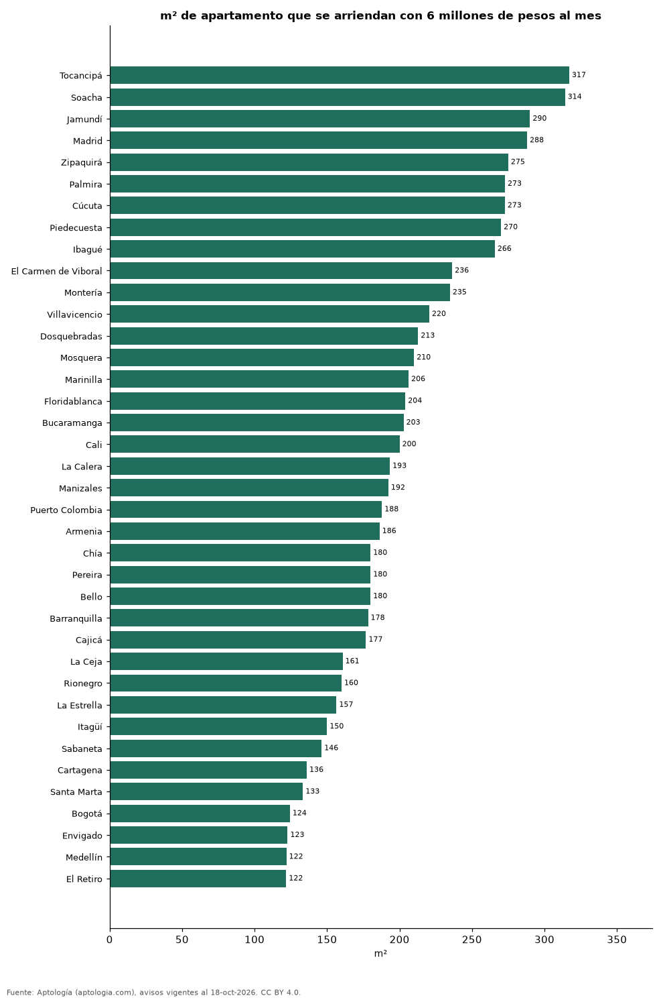

# ¿Cuántos metros cuadrados se arriendan con 6 millones de pesos al mes? 38 ciudades de Colombia (octubre 2026)

**Con 6 millones de pesos al mes se arriendan unos 317 m² de apartamento en Tocancipá, la ciudad que más rinde de 38, y 122 m² en El Retiro.** En Bogotá alcanzan para 124 m² y en Medellín para 122 m².

*Resumen: usamos el precio mediano por m² de 64.524 apartamentos en arriendo con área declarada en 38 ciudades.*

**Actualizado:** 18 de octubre de 2026 (datos del 18 de octubre de 2026) · **Próxima actualización:** mensual.

## Resumen

| Indicador | Valor |
|---|---|
| Más m² | Tocancipá: 317 m² |
| Menos m² | El Retiro: 122 m² |
| Bogotá | 124 m² |
| Medellín | 122 m² |

## Metros cuadrados por 6 millones de pesos al mes

| Ciudad | m² con 6 millones de pesos al mes | Precio por m² (mediana) | Avisos con área |
|---|---|---|---|
| Tocancipá | 317 | 18.924 pesos | 94 |
| Soacha | 314 | 19.098 pesos | 128 |
| Jamundí | 290 | 20.690 pesos | 107 |
| Madrid | 288 | 20.833 pesos | 259 |
| Zipaquirá | 275 | 21.818 pesos | 168 |
| Palmira | 273 | 22.000 pesos | 42 |
| Cúcuta | 273 | 22.007 pesos | 298 |
| Piedecuesta | 270 | 22.222 pesos | 57 |
| Ibagué | 266 | 22.581 pesos | 249 |
| El Carmen de Viboral | 236 | 25.391 pesos | 102 |
| Montería | 235 | 25.556 pesos | 44 |
| Villavicencio | 220 | 27.212 pesos | 74 |
| Dosquebradas | 213 | 28.193 pesos | 70 |
| Mosquera | 210 | 28.571 pesos | 167 |
| Marinilla | 206 | 29.091 pesos | 107 |
| Floridablanca | 204 | 29.412 pesos | 357 |
| Bucaramanga | 203 | 29.588 pesos | 416 |
| Cali | 200 | 30.000 pesos | 1.499 |
| La Calera | 193 | 31.034 pesos | 51 |
| Manizales | 192 | 31.199 pesos | 282 |
| Puerto Colombia | 188 | 31.944 pesos | 90 |
| Armenia | 186 | 32.222 pesos | 337 |
| Chía | 180 | 33.333 pesos | 489 |
| Pereira | 180 | 33.333 pesos | 1.530 |
| Bello | 180 | 33.333 pesos | 1.082 |
| Barranquilla | 178 | 33.654 pesos | 3.694 |
| Cajicá | 177 | 33.929 pesos | 385 |
| La Ceja | 161 | 37.323 pesos | 354 |
| Rionegro | 160 | 37.500 pesos | 3.179 |
| La Estrella | 157 | 38.333 pesos | 489 |
| Itagüí | 150 | 40.000 pesos | 908 |
| Sabaneta | 146 | 41.026 pesos | 3.868 |
| Cartagena | 136 | 44.118 pesos | 2.008 |
| Santa Marta | 133 | 45.000 pesos | 674 |
| Bogotá | 124 | 48.246 pesos | 12.954 |
| Envigado | 123 | 48.864 pesos | 7.303 |
| Medellín | 122 | 49.206 pesos | 20.068 |
| El Retiro | 122 | 49.254 pesos | 541 |

6 millones de pesos al mes ÷ precio mediano por m²; es un tamaño de referencia, no un aviso concreto.

## Preguntas frecuentes

**¿Cuántos metros cuadrados arriendo con 6 millones de pesos al mes en Bogotá?**
Unos 124 m² al precio mediano por m² de octubre de 2026.

**¿Dónde rinde más un presupuesto de 6 millones de pesos al mes?**
En Tocancipá: unos 317 m².

## Metodología

- **Fuente:** exportes nocturnos de la base de datos de Aptología (aptologia.com) del 18 de octubre de 2026: avisos vigentes de vivienda en portales inmobiliarios de 13 países, recogidos por Aptología y vistos en línea entre el 11 y el 18 de octubre de 2026. Corte: 18 de octubre de 2026.
- **Depuración:** se eliminan duplicados exactos (misma ciudad, zona, tipo, precio, moneda, área, habitaciones y baños) y los precios fuera del percentil 1–99 de cada país, operación, moneda y tipo; el precio por m² usa solo avisos con área declarada entre 12 y 2.000 m² y también se recorta al P1–P99.
- **Qué se mide:** precios pedidos (publicados), no precios de cierre. En arriendo, el canon mensual sin administración, gastos comunes ni condominio.
- **Muestra mínima:** cada cifra publicada se apoya en al menos 30 avisos; las celdas con menos se omiten.
- **Colombia:** Precios en pesos colombianos, sin conversión de moneda.
- **Limitaciones:** la cobertura depende de los portales que recorre Aptología en cada país y es mayor en las ciudades grandes y en los segmentos medio-alto y alto; el área es la que declara el aviso, sin verificar; los nombres de zona vienen de los portales.
- **Privacidad:** solo se publican agregados; no se publica ningún dato personal, enlace a avisos ni nombre de anunciante.
- **Datos abiertos:** [datos.csv](datos.csv), licencia CC BY 4.0.

## Cómo citar

Pinzón Pineda, D. M. (2026). *¿Cuántos metros cuadrados se arriendan con 6 millones de pesos al mes? 38 ciudades de Colombia (octubre 2026)*. Aptología (aptologia.com). https://github.com/elbroker/aptologia-datos/tree/main/estudios/cuantos-metros-cuadrados-arrienda-6-millones-ciudades-colombia-2026. Datos: datos.csv, licencia CC BY 4.0.
