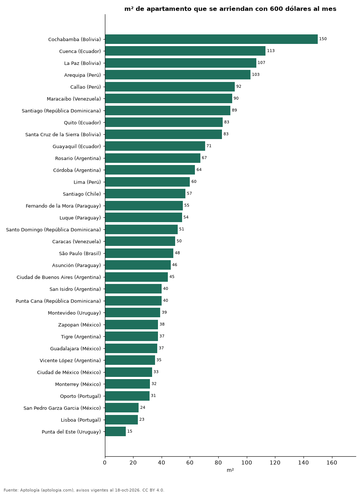

# ¿Cuántos metros cuadrados se arriendan con 600 dólares al mes? 34 ciudades de Latinoamérica y Portugal (octubre 2026)

**Con 600 dólares al mes se arriendan unos 150 m² de apartamento en Cochabamba (Bolivia), la ciudad que más rinde de 34, y solo 15 m² en Punta del Este (Uruguay).**

*Resumen: usamos el precio mediano por m² en dólares de 53.548 apartamentos en alquiler con área declarada en 34 ciudades.*

**Actualizado:** 18 de octubre de 2026 (datos del 18 de octubre de 2026) · **Próxima actualización:** mensual.

## Resumen

| Indicador | Valor |
|---|---|
| Más m² | Cochabamba: 150 m² |
| Menos m² | Punta del Este: 15 m² |
| Ciudades | 34 |

## Metros cuadrados por 600 dólares al mes

| Ciudad | m² con 600 dólares al mes | USD por m² al mes | Avisos |
|---|---|---|---|
| Cochabamba (Bolivia) | 150 | 4,0 | 91 |
| Cuenca (Ecuador) | 113 | 5,3 | 176 |
| La Paz (Bolivia) | 107 | 5,6 | 298 |
| Arequipa (Perú) | 103 | 5,8 | 46 |
| Callao (Perú) | 92 | 6,5 | 31 |
| Maracaibo (Venezuela) | 90 | 6,7 | 38 |
| Santiago (República Dominicana) | 89 | 6,8 | 116 |
| Quito (Ecuador) | 83 | 7,2 | 1.167 |
| Santa Cruz de la Sierra (Bolivia) | 83 | 7,3 | 947 |
| Guayaquil (Ecuador) | 71 | 8,5 | 1.231 |
| Rosario (Argentina) | 67 | 8,9 | 129 |
| Córdoba (Argentina) | 64 | 9,4 | 216 |
| Lima (Perú) | 60 | 10,0 | 4.134 |
| Santiago (Chile) | 57 | 10,6 | 7.098 |
| Fernando de la Mora (Paraguay) | 55 | 10,9 | 37 |
| Luque (Paraguay) | 54 | 11,0 | 47 |
| Santo Domingo (República Dominicana) | 51 | 11,7 | 3.410 |
| Caracas (Venezuela) | 50 | 12,1 | 326 |
| São Paulo (Brasil) | 48 | 12,4 | 10.656 |
| Asunción (Paraguay) | 46 | 12,9 | 3.560 |
| Ciudad de Buenos Aires (Argentina) | 45 | 13,5 | 4.316 |
| San Isidro (Argentina) | 40 | 15,0 | 148 |
| Punta Cana (República Dominicana) | 40 | 15,0 | 93 |
| Montevideo (Uruguay) | 39 | 15,3 | 3.702 |
| Zapopan (México) | 38 | 16,0 | 823 |
| Tigre (Argentina) | 37 | 16,0 | 151 |
| Guadalajara (México) | 37 | 16,2 | 838 |
| Vicente López (Argentina) | 35 | 17,0 | 168 |
| Ciudad de México (México) | 33 | 18,1 | 4.782 |
| Monterrey (México) | 32 | 18,8 | 1.645 |
| Oporto (Portugal) | 31 | 19,1 | 78 |
| San Pedro Garza Garcia (México) | 24 | 25,1 | 595 |
| Lisboa (Portugal) | 23 | 25,8 | 491 |
| Punta del Este (Uruguay) | 15 | 40,6 | 1.964 |

600 dólares al mes ÷ precio mediano por m² en dólares; tamaño de referencia, no un aviso concreto.

## Preguntas frecuentes

**¿Dónde rinde más un presupuesto de 600 dólares al mes?**
En Cochabamba (Bolivia): unos 150 m².

**¿Dónde rinde menos?**
En Punta del Este (Uruguay): unos 15 m².

## Metodología

- **Fuente:** exportes nocturnos de la base de datos de Aptología (aptologia.com) del 18 de octubre de 2026: avisos vigentes de vivienda en portales inmobiliarios de 13 países, recogidos por Aptología y vistos en línea entre el 11 y el 18 de octubre de 2026. Corte: 18 de octubre de 2026.
- **Depuración:** se eliminan duplicados exactos (misma ciudad, zona, tipo, precio, moneda, área, habitaciones y baños) y los precios fuera del percentil 1–99 de cada país, operación, moneda y tipo; el precio por m² usa solo avisos con área declarada entre 12 y 2.000 m² y también se recorta al P1–P99.
- **Qué se mide:** precios pedidos (publicados), no precios de cierre. En arriendo, el canon mensual sin administración, gastos comunes ni condominio.
- **Muestra mínima:** cada cifra publicada se apoya en al menos 30 avisos; las celdas con menos se omiten.
- **Monedas:** nunca se mezclan avisos de monedas distintas sin convertirlos. Conversión a dólares con la tasa de mercado de ExchangeRate-API (open.er-api.com, actualización del 18 Oct 2026): 1 USD = 3.182,80 COP, 1 USD = 18,47 M.N, 1 USD = 5,09 BRL, 1 USD = 3,44 PEN, 1 USD = 982,44 CLP, 1 USD = 1.514,57 ARS, 1 USD = 40,20 UYU, 1 USD = 5.705,37 PYG, 1 USD = 61,27 DOP, 1 USD = 0,89 EUR, 1 USD = 11,72 BOB; la UF chilena a 41.178,64 CLP (mindicador,cl. 18-oct-2026). Los avisos publicados en dólares se usan tal cual.
- **Monedas:** cada aviso se convierte a dólares con la tasa citada antes de calcular la mediana del precio por m²; Colombia se analiza aparte en pesos.
- **Limitaciones:** la cobertura depende de los portales que recorre Aptología en cada país y es mayor en las ciudades grandes y en los segmentos medio-alto y alto; el área es la que declara el aviso, sin verificar; los nombres de zona vienen de los portales.
- **Privacidad:** solo se publican agregados; no se publica ningún dato personal, enlace a avisos ni nombre de anunciante.
- **Datos abiertos:** [datos.csv](datos.csv), licencia CC BY 4.0.

## Cómo citar

Pinzón Pineda, D. M. (2026). *¿Cuántos metros cuadrados se arriendan con 600 dólares al mes? 34 ciudades de Latinoamérica y Portugal (octubre 2026)*. Aptología (aptologia.com). https://github.com/elbroker/aptologia-datos/tree/main/estudios/cuantos-metros-cuadrados-arrienda-600-dolares-latinoamerica-2026. Datos: datos.csv, licencia CC BY 4.0.
