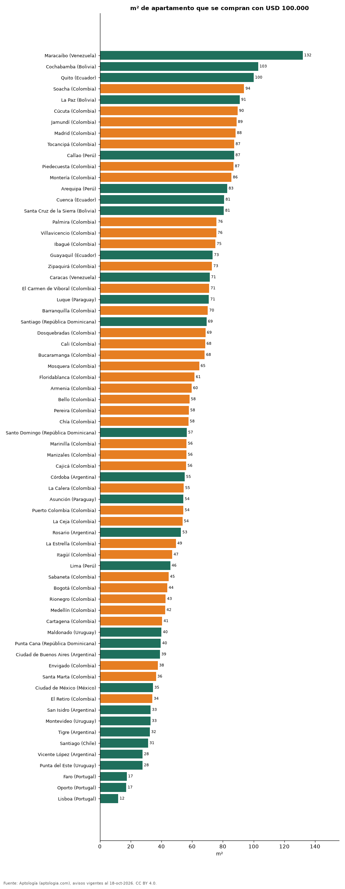

# Cuántos metros cuadrados se pueden comprar con USD 100.000 en 68 ciudades de Latinoamérica y Portugal (octubre 2026)

**Con USD 100.000 se pueden comprar 132 m² de apartamento en Maracaibo (Venezuela), la ciudad que más rinde, y solo 12 m² en Lisboa (Portugal).** En Bogotá alcanzan para 44 m².

*Resumen: usamos la mediana del precio por m² de 185.251 apartamentos en venta en 68 ciudades.*

**Actualizado:** 18 de octubre de 2026 (datos del 18 de octubre de 2026) · **Próxima actualización:** mensual.

## Resumen

| Indicador | Valor |
|---|---|
| Más m² | Maracaibo: 132 m² |
| Menos m² | Lisboa: 12 m² |
| Bogotá | 44 m² |

## Ciudades

| País | Ciudad | m² que alcanzan | USD por m² | Avisos |
|---|---|---|---|---|
| Venezuela | Maracaibo | 132 | 758 | 62 |
| Bolivia | Cochabamba | 103 | 971 | 366 |
| Ecuador | Quito | 100 | 1.000 | 2.240 |
| Colombia | Soacha | 94 | 1.066 | 566 |
| Bolivia | La Paz | 91 | 1.099 | 462 |
| Colombia | Cúcuta | 90 | 1.116 | 561 |
| Colombia | Jamundí | 89 | 1.125 | 466 |
| Colombia | Madrid | 88 | 1.134 | 475 |
| Colombia | Tocancipá | 87 | 1.145 | 264 |
| Perú | Callao | 87 | 1.146 | 121 |
| Colombia | Piedecuesta | 87 | 1.151 | 246 |
| Colombia | Montería | 86 | 1.168 | 288 |
| Perú | Arequipa | 83 | 1.207 | 583 |
| Ecuador | Cuenca | 81 | 1.238 | 331 |
| Bolivia | Santa Cruz de la Sierra | 81 | 1.241 | 1.679 |
| Colombia | Palmira | 76 | 1.318 | 112 |
| Colombia | Villavicencio | 76 | 1.321 | 347 |
| Colombia | Ibagué | 75 | 1.332 | 1.217 |
| Ecuador | Guayaquil | 73 | 1.364 | 915 |
| Colombia | Zipaquirá | 73 | 1.372 | 819 |
| Venezuela | Caracas | 71 | 1.400 | 1.464 |
| Colombia | El Carmen de Viboral | 71 | 1.406 | 90 |
| Paraguay | Luque | 71 | 1.410 | 74 |
| Colombia | Barranquilla | 70 | 1.424 | 7.532 |
| República Dominicana | Santiago | 69 | 1.442 | 594 |
| Colombia | Dosquebradas | 69 | 1.456 | 607 |
| Colombia | Cali | 68 | 1.461 | 9.365 |
| Colombia | Bucaramanga | 68 | 1.466 | 2.439 |
| Colombia | Mosquera | 65 | 1.548 | 817 |
| Colombia | Floridablanca | 61 | 1.626 | 919 |
| Colombia | Armenia | 60 | 1.675 | 2.278 |
| Colombia | Bello | 58 | 1.716 | 2.319 |
| Colombia | Pereira | 58 | 1.728 | 4.376 |
| Colombia | Chía | 58 | 1.737 | 1.507 |
| República Dominicana | Santo Domingo | 57 | 1.769 | 7.645 |
| Colombia | Marinilla | 56 | 1.775 | 164 |
| Colombia | Manizales | 56 | 1.776 | 2.788 |
| Colombia | Cajicá | 56 | 1.782 | 1.517 |
| Argentina | Córdoba | 55 | 1.813 | 188 |
| Colombia | La Calera | 55 | 1.833 | 139 |
| Paraguay | Asunción | 54 | 1.843 | 4.612 |
| Colombia | Puerto Colombia | 54 | 1.843 | 144 |
| Colombia | La Ceja | 54 | 1.861 | 312 |
| Argentina | Rosario | 53 | 1.895 | 33 |
| Colombia | La Estrella | 49 | 2.023 | 561 |
| Colombia | Itagüí | 47 | 2.126 | 2.012 |
| Perú | Lima | 46 | 2.185 | 9.331 |
| Colombia | Sabaneta | 45 | 2.237 | 4.375 |
| Colombia | Bogotá | 44 | 2.282 | 31.265 |
| Colombia | Rionegro | 43 | 2.337 | 3.023 |
| Colombia | Medellín | 42 | 2.356 | 20.515 |
| Colombia | Cartagena | 41 | 2.469 | 5.774 |
| Uruguay | Maldonado | 40 | 2.497 | 156 |
| República Dominicana | Punta Cana | 40 | 2.525 | 442 |
| Argentina | Ciudad de Buenos Aires | 39 | 2.558 | 8.128 |
| Colombia | Envigado | 38 | 2.656 | 5.735 |
| Colombia | Santa Marta | 36 | 2.740 | 3.779 |
| México | Ciudad de México | 35 | 2.894 | 7.519 |
| Colombia | El Retiro | 34 | 2.929 | 618 |
| Argentina | San Isidro | 33 | 3.032 | 181 |
| Uruguay | Montevideo | 33 | 3.040 | 4.466 |
| Argentina | Tigre | 32 | 3.080 | 121 |
| Chile | Santiago | 31 | 3.189 | 6.247 |
| Argentina | Vicente López | 28 | 3.600 | 157 |
| Uruguay | Punta del Este | 28 | 3.604 | 4.562 |
| Portugal | Faro | 17 | 5.735 | 86 |
| Portugal | Oporto | 17 | 5.820 | 607 |
| Portugal | Lisboa | 12 | 8.383 | 1.548 |

m² que alcanzan = USD 100.000 ÷ mediana del precio por m².

## Preguntas frecuentes

**¿Cuántos metros cuadrados se pueden comprar con USD 100.000 en Bogotá?**
Unos 44 m² de apartamento, según la mediana de octubre de 2026.

## Metodología

- **Fuente:** exportes nocturnos de la base de datos de Aptología (aptologia.com) del 18 de octubre de 2026: avisos vigentes de vivienda en portales inmobiliarios de 13 países, recogidos por Aptología y vistos en línea entre el 11 y el 18 de octubre de 2026. Corte: 18 de octubre de 2026.
- **Depuración:** se eliminan duplicados exactos (misma ciudad, zona, tipo, precio, moneda, área, habitaciones y baños) y los precios fuera del percentil 1–99 de cada país, operación, moneda y tipo; el precio por m² usa solo avisos con área declarada entre 12 y 2.000 m² y también se recorta al P1–P99.
- **Qué se mide:** precios pedidos (publicados), no precios de cierre. En arriendo, el canon mensual sin administración, gastos comunes ni condominio.
- **Muestra mínima:** cada cifra publicada se apoya en al menos 30 avisos; las celdas con menos se omiten.
- **Monedas:** nunca se mezclan avisos de monedas distintas sin convertirlos. Conversión a dólares con la tasa de mercado de ExchangeRate-API (open.er-api.com, actualización del 18 Oct 2026): 1 USD = 3.182,80 COP, 1 USD = 18,47 M.N, 1 USD = 5,09 BRL, 1 USD = 3,44 PEN, 1 USD = 982,44 CLP, 1 USD = 1.514,57 ARS, 1 USD = 40,20 UYU, 1 USD = 5.705,37 PYG, 1 USD = 61,27 DOP, 1 USD = 0,89 EUR, 1 USD = 11,72 BOB; la UF chilena a 41.178,64 CLP (mindicador,cl. 18-oct-2026). Los avisos publicados en dólares se usan tal cual.
- **Limitaciones:** la cobertura depende de los portales que recorre Aptología en cada país y es mayor en las ciudades grandes y en los segmentos medio-alto y alto; el área es la que declara el aviso, sin verificar; los nombres de zona vienen de los portales.
- **Privacidad:** solo se publican agregados; no se publica ningún dato personal, enlace a avisos ni nombre de anunciante.
- **Datos abiertos:** [datos.csv](datos.csv), licencia CC BY 4.0.

## Cómo citar

Pinzón Pineda, D. M. (2026). *Cuántos metros cuadrados se pueden comprar con USD 100.000 en 68 ciudades de Latinoamérica y Portugal (octubre 2026)*. Aptología (aptologia.com). https://github.com/elbroker/aptologia-datos/tree/main/estudios/cuantos-metros-cuadrados-compra-100000-dolares-latinoamerica-2026. Datos: datos.csv, licencia CC BY 4.0.
