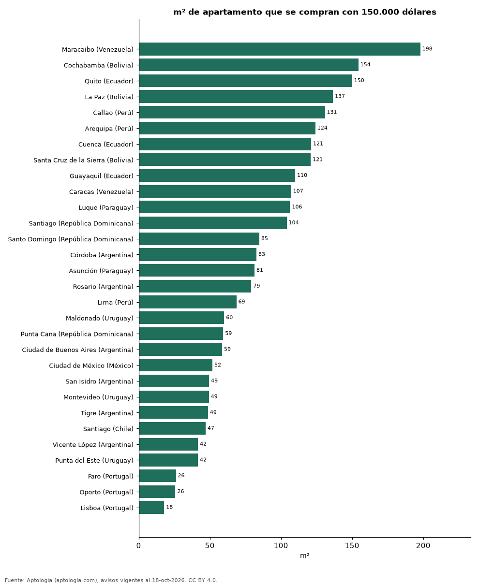

# ¿Cuántos metros cuadrados se compran con 150.000 dólares? 30 ciudades de Latinoamérica y Portugal (octubre 2026)

**Con 150.000 dólares se compran unos 198 m² de apartamento en Maracaibo (Venezuela), la ciudad que más rinde de 30, y solo 18 m² en Lisboa (Portugal).**

*Resumen: usamos el precio mediano por m² en dólares de 64.920 apartamentos en venta con área declarada en 30 ciudades.*

**Actualizado:** 18 de octubre de 2026 (datos del 18 de octubre de 2026) · **Próxima actualización:** mensual.

## Resumen

| Indicador | Valor |
|---|---|
| Más m² | Maracaibo: 198 m² |
| Menos m² | Lisboa: 18 m² |
| Ciudades | 30 |

## Metros cuadrados por 150.000 dólares

| Ciudad | m² con 150.000 dólares | USD por m² | Avisos |
|---|---|---|---|
| Maracaibo (Venezuela) | 198 | 758 | 62 |
| Cochabamba (Bolivia) | 154 | 971 | 366 |
| Quito (Ecuador) | 150 | 1.000 | 2.240 |
| La Paz (Bolivia) | 137 | 1.099 | 462 |
| Callao (Perú) | 131 | 1.146 | 121 |
| Arequipa (Perú) | 124 | 1.207 | 583 |
| Cuenca (Ecuador) | 121 | 1.238 | 331 |
| Santa Cruz de la Sierra (Bolivia) | 121 | 1.241 | 1.679 |
| Guayaquil (Ecuador) | 110 | 1.364 | 915 |
| Caracas (Venezuela) | 107 | 1.400 | 1.464 |
| Luque (Paraguay) | 106 | 1.410 | 74 |
| Santiago (República Dominicana) | 104 | 1.442 | 594 |
| Santo Domingo (República Dominicana) | 85 | 1.769 | 7.645 |
| Córdoba (Argentina) | 83 | 1.813 | 188 |
| Asunción (Paraguay) | 81 | 1.843 | 4.612 |
| Rosario (Argentina) | 79 | 1.895 | 33 |
| Lima (Perú) | 69 | 2.185 | 9.331 |
| Maldonado (Uruguay) | 60 | 2.497 | 156 |
| Punta Cana (República Dominicana) | 59 | 2.525 | 442 |
| Ciudad de Buenos Aires (Argentina) | 59 | 2.558 | 8.128 |
| Ciudad de México (México) | 52 | 2.894 | 7.519 |
| San Isidro (Argentina) | 49 | 3.032 | 181 |
| Montevideo (Uruguay) | 49 | 3.040 | 4.466 |
| Tigre (Argentina) | 49 | 3.080 | 121 |
| Santiago (Chile) | 47 | 3.189 | 6.247 |
| Vicente López (Argentina) | 42 | 3.600 | 157 |
| Punta del Este (Uruguay) | 42 | 3.604 | 4.562 |
| Faro (Portugal) | 26 | 5.735 | 86 |
| Oporto (Portugal) | 26 | 5.820 | 607 |
| Lisboa (Portugal) | 18 | 8.383 | 1.548 |

150.000 dólares ÷ precio mediano por m² en dólares; tamaño de referencia, no un aviso concreto.

## Preguntas frecuentes

**¿Dónde rinde más un presupuesto de 150.000 dólares?**
En Maracaibo (Venezuela): unos 198 m².

**¿Dónde rinde menos?**
En Lisboa (Portugal): unos 18 m².

## Metodología

- **Fuente:** exportes nocturnos de la base de datos de Aptología (aptologia.com) del 18 de octubre de 2026: avisos vigentes de vivienda en portales inmobiliarios de 13 países, recogidos por Aptología y vistos en línea entre el 11 y el 18 de octubre de 2026. Corte: 18 de octubre de 2026.
- **Depuración:** se eliminan duplicados exactos (misma ciudad, zona, tipo, precio, moneda, área, habitaciones y baños) y los precios fuera del percentil 1–99 de cada país, operación, moneda y tipo; el precio por m² usa solo avisos con área declarada entre 12 y 2.000 m² y también se recorta al P1–P99.
- **Qué se mide:** precios pedidos (publicados), no precios de cierre. En arriendo, el canon mensual sin administración, gastos comunes ni condominio.
- **Muestra mínima:** cada cifra publicada se apoya en al menos 30 avisos; las celdas con menos se omiten.
- **Monedas:** nunca se mezclan avisos de monedas distintas sin convertirlos. Conversión a dólares con la tasa de mercado de ExchangeRate-API (open.er-api.com, actualización del 18 Oct 2026): 1 USD = 3.182,80 COP, 1 USD = 18,47 M.N, 1 USD = 5,09 BRL, 1 USD = 3,44 PEN, 1 USD = 982,44 CLP, 1 USD = 1.514,57 ARS, 1 USD = 40,20 UYU, 1 USD = 5.705,37 PYG, 1 USD = 61,27 DOP, 1 USD = 0,89 EUR, 1 USD = 11,72 BOB; la UF chilena a 41.178,64 CLP (mindicador,cl. 18-oct-2026). Los avisos publicados en dólares se usan tal cual.
- **Monedas:** cada aviso se convierte a dólares con la tasa citada antes de calcular la mediana del precio por m²; Colombia se analiza aparte en pesos.
- **Limitaciones:** la cobertura depende de los portales que recorre Aptología en cada país y es mayor en las ciudades grandes y en los segmentos medio-alto y alto; el área es la que declara el aviso, sin verificar; los nombres de zona vienen de los portales.
- **Privacidad:** solo se publican agregados; no se publica ningún dato personal, enlace a avisos ni nombre de anunciante.
- **Datos abiertos:** [datos.csv](datos.csv), licencia CC BY 4.0.

## Cómo citar

Pinzón Pineda, D. M. (2026). *¿Cuántos metros cuadrados se compran con 150.000 dólares? 30 ciudades de Latinoamérica y Portugal (octubre 2026)*. Aptología (aptologia.com). https://github.com/elbroker/aptologia-datos/tree/main/estudios/cuantos-metros-cuadrados-compra-150000-dolares-latinoamerica-2026. Datos: datos.csv, licencia CC BY 4.0.
