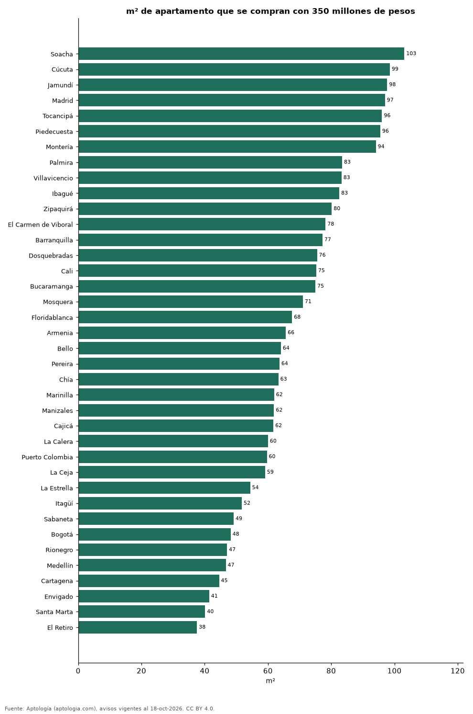

# ¿Cuántos metros cuadrados se compran con 350 millones de pesos? 38 ciudades de Colombia (octubre 2026)

**Con 350 millones de pesos se compran unos 103 m² de apartamento en Soacha, la ciudad que más rinde de 38, y 38 m² en El Retiro.** En Bogotá alcanzan para 48 m² y en Medellín para 47 m².

*Resumen: usamos el precio mediano por m² de 120.331 apartamentos en venta con área declarada en 38 ciudades.*

**Actualizado:** 18 de octubre de 2026 (datos del 18 de octubre de 2026) · **Próxima actualización:** mensual.

## Resumen

| Indicador | Valor |
|---|---|
| Más m² | Soacha: 103 m² |
| Menos m² | El Retiro: 38 m² |
| Bogotá | 48 m² |
| Medellín | 47 m² |

## Metros cuadrados por 350 millones de pesos

| Ciudad | m² con 350 millones de pesos | Precio por m² (mediana) | Avisos con área |
|---|---|---|---|
| Soacha | 103 | 3,39 millones de pesos | 566 |
| Cúcuta | 99 | 3,55 millones de pesos | 561 |
| Jamundí | 98 | 3,58 millones de pesos | 466 |
| Madrid | 97 | 3,61 millones de pesos | 475 |
| Tocancipá | 96 | 3,64 millones de pesos | 264 |
| Piedecuesta | 96 | 3,66 millones de pesos | 246 |
| Montería | 94 | 3,72 millones de pesos | 288 |
| Palmira | 83 | 4,19 millones de pesos | 112 |
| Villavicencio | 83 | 4,20 millones de pesos | 347 |
| Ibagué | 83 | 4,24 millones de pesos | 1.217 |
| Zipaquirá | 80 | 4,37 millones de pesos | 819 |
| El Carmen de Viboral | 78 | 4,48 millones de pesos | 90 |
| Barranquilla | 77 | 4,53 millones de pesos | 7.532 |
| Dosquebradas | 76 | 4,63 millones de pesos | 607 |
| Cali | 75 | 4,65 millones de pesos | 9.365 |
| Bucaramanga | 75 | 4,67 millones de pesos | 2.439 |
| Mosquera | 71 | 4,93 millones de pesos | 817 |
| Floridablanca | 68 | 5,18 millones de pesos | 919 |
| Armenia | 66 | 5,33 millones de pesos | 2.278 |
| Bello | 64 | 5,46 millones de pesos | 2.319 |
| Pereira | 64 | 5,50 millones de pesos | 4.376 |
| Chía | 63 | 5,53 millones de pesos | 1.507 |
| Marinilla | 62 | 5,65 millones de pesos | 164 |
| Manizales | 62 | 5,65 millones de pesos | 2.788 |
| Cajicá | 62 | 5,67 millones de pesos | 1.517 |
| La Calera | 60 | 5,83 millones de pesos | 139 |
| Puerto Colombia | 60 | 5,87 millones de pesos | 144 |
| La Ceja | 59 | 5,92 millones de pesos | 312 |
| La Estrella | 54 | 6,44 millones de pesos | 561 |
| Itagüí | 52 | 6,77 millones de pesos | 2.012 |
| Sabaneta | 49 | 7,12 millones de pesos | 4.375 |
| Bogotá | 48 | 7,26 millones de pesos | 31.265 |
| Rionegro | 47 | 7,44 millones de pesos | 3.023 |
| Medellín | 47 | 7,50 millones de pesos | 20.515 |
| Cartagena | 45 | 7,86 millones de pesos | 5.774 |
| Envigado | 41 | 8,45 millones de pesos | 5.735 |
| Santa Marta | 40 | 8,72 millones de pesos | 3.779 |
| El Retiro | 38 | 9,32 millones de pesos | 618 |

350 millones de pesos ÷ precio mediano por m²; es un tamaño de referencia, no un aviso concreto, antes de gastos notariales e impuestos.

## Preguntas frecuentes

**¿Cuántos metros cuadrados compro con 350 millones de pesos en Bogotá?**
Unos 48 m² al precio mediano por m² de octubre de 2026.

**¿Dónde rinde más un presupuesto de 350 millones de pesos?**
En Soacha: unos 103 m².

## Metodología

- **Fuente:** exportes nocturnos de la base de datos de Aptología (aptologia.com) del 18 de octubre de 2026: avisos vigentes de vivienda en portales inmobiliarios de 13 países, recogidos por Aptología y vistos en línea entre el 11 y el 18 de octubre de 2026. Corte: 18 de octubre de 2026.
- **Depuración:** se eliminan duplicados exactos (misma ciudad, zona, tipo, precio, moneda, área, habitaciones y baños) y los precios fuera del percentil 1–99 de cada país, operación, moneda y tipo; el precio por m² usa solo avisos con área declarada entre 12 y 2.000 m² y también se recorta al P1–P99.
- **Qué se mide:** precios pedidos (publicados), no precios de cierre. En arriendo, el canon mensual sin administración, gastos comunes ni condominio.
- **Muestra mínima:** cada cifra publicada se apoya en al menos 30 avisos; las celdas con menos se omiten.
- **Colombia:** Precios en pesos colombianos, sin conversión de moneda.
- **Limitaciones:** la cobertura depende de los portales que recorre Aptología en cada país y es mayor en las ciudades grandes y en los segmentos medio-alto y alto; el área es la que declara el aviso, sin verificar; los nombres de zona vienen de los portales.
- **Privacidad:** solo se publican agregados; no se publica ningún dato personal, enlace a avisos ni nombre de anunciante.
- **Datos abiertos:** [datos.csv](datos.csv), licencia CC BY 4.0.

## Cómo citar

Pinzón Pineda, D. M. (2026). *¿Cuántos metros cuadrados se compran con 350 millones de pesos? 38 ciudades de Colombia (octubre 2026)*. Aptología (aptologia.com). https://github.com/elbroker/aptologia-datos/tree/main/estudios/cuantos-metros-cuadrados-compra-350-millones-ciudades-colombia-2026. Datos: datos.csv, licencia CC BY 4.0.
