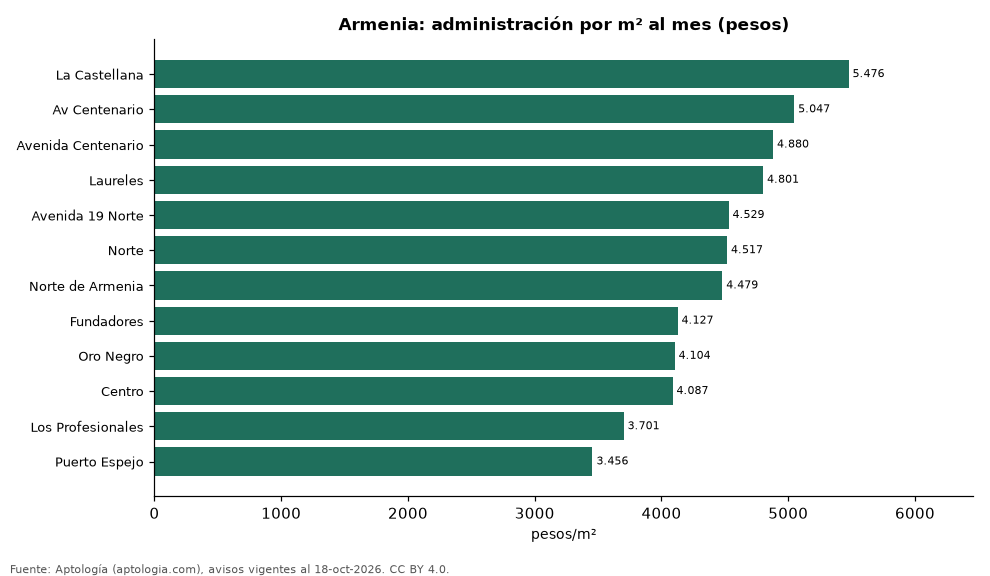

# Cuota de administración en Armenia por barrio: cuánto se paga por m² (octubre 2026)

**En Armenia, la administración más cara por metro cuadrado se paga en La Castellana: 5.476 pesos por m² al mes en la mediana (525.000 pesos de cuota). La más barata, en Puerto Espejo, con 3.456 pesos por m².** La cuota mediana de toda la ciudad es 320.500 pesos al mes (4.296 pesos por m²).

*Resumen: analizamos la cuota de administración de 1.558 apartamentos en 12 barrios de Armenia con 30 avisos o más.*

**Actualizado:** 18 de octubre de 2026 (datos del 18 de octubre de 2026) · **Próxima actualización:** mensual.

## Resumen

| Indicador | Valor |
|---|---|
| Más cara por m² | La Castellana: 5.476 pesos |
| Más barata por m² | Puerto Espejo: 3.456 pesos |
| Cuota mediana de la ciudad | 320.500 pesos |
| Barrios | 12 |

## Administración por barrio

| Barrio | Administración por m² al mes | Cuota mensual (mediana) | Avisos |
|---|---|---|---|
| La Castellana | 5.476 pesos | 525.000 pesos | 93 |
| Av Centenario | 5.047 pesos | 364.000 pesos | 37 |
| Avenida Centenario | 4.880 pesos | 368.000 pesos | 125 |
| Laureles | 4.801 pesos | 400.000 pesos | 42 |
| Avenida 19 Norte | 4.529 pesos | 350.000 pesos | 49 |
| Norte | 4.517 pesos | 354.000 pesos | 46 |
| Norte de Armenia | 4.479 pesos | 339.000 pesos | 57 |
| Fundadores | 4.127 pesos | 411.102 pesos | 36 |
| Oro Negro | 4.104 pesos | 255.000 pesos | 49 |
| Centro | 4.087 pesos | 330.000 pesos | 37 |
| Los Profesionales | 3.701 pesos | 363.782 pesos | 31 |
| Puerto Espejo | 3.456 pesos | 208.500 pesos | 90 |

Medianas; ordenado de mayor a menor administración por m².

## Preguntas frecuentes

**¿Cuánto se paga de administración en Armenia?**
La cuota mediana es 320.500 pesos al mes (4.296 pesos por m²), según avisos de octubre de 2026.

**¿En qué barrio de Armenia es más cara la administración?**
En La Castellana: 5.476 pesos por m² al mes.

## Metodología

- **Fuente:** exportes nocturnos de la base de datos de Aptología (aptologia.com) del 18 de octubre de 2026: avisos vigentes de vivienda en portales inmobiliarios de 13 países, recogidos por Aptología y vistos en línea entre el 11 y el 18 de octubre de 2026. Corte: 18 de octubre de 2026.
- **Depuración:** se eliminan duplicados exactos (misma ciudad, zona, tipo, precio, moneda, área, habitaciones y baños) y los precios fuera del percentil 1–99 de cada país, operación, moneda y tipo; el precio por m² usa solo avisos con área declarada entre 12 y 2.000 m² y también se recorta al P1–P99.
- **Qué se mide:** precios pedidos (publicados), no precios de cierre. En arriendo, el canon mensual sin administración, gastos comunes ni condominio.
- **Muestra mínima:** cada cifra publicada se apoya en al menos 30 avisos; las celdas con menos se omiten.
- **Colombia:** Precios en pesos colombianos, sin conversión de moneda.
- **Administración:** cuota mensual declarada en avisos de venta y de arriendo de apartamentos (se unen ambas operaciones porque la cuota es del inmueble, quitando repetidos con la misma ciudad, barrio, cuota, área, habitaciones y baños); se descartan cuotas por debajo de 30.000 o por encima de 6 millones de pesos y razones por m² fuera de 500–40.000 pesos.
- **Limitaciones:** la cobertura depende de los portales que recorre Aptología en cada país y es mayor en las ciudades grandes y en los segmentos medio-alto y alto; el área es la que declara el aviso, sin verificar; los nombres de zona vienen de los portales.
- **Privacidad:** solo se publican agregados; no se publica ningún dato personal, enlace a avisos ni nombre de anunciante.
- **Datos abiertos:** [datos.csv](datos.csv), licencia CC BY 4.0.

## Cómo citar

Pinzón Pineda, D. M. (2026). *Cuota de administración en Armenia por barrio: cuánto se paga por m² (octubre 2026)*. Aptología (aptologia.com). https://github.com/elbroker/aptologia-datos/tree/main/estudios/cuota-de-administracion-armenia-por-barrio-2026. Datos: datos.csv, licencia CC BY 4.0.
