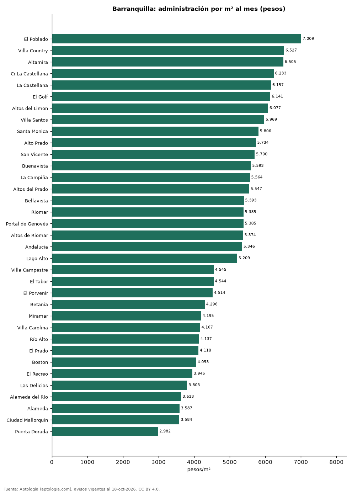

# Cuota de administración en Barranquilla por barrio: cuánto se paga por m² (octubre 2026)

**En Barranquilla, la administración más cara por metro cuadrado se paga en El Poblado: 7.009 pesos por m² al mes en la mediana (590.000 pesos de cuota). La más barata, en Puerta Dorada, con 2.982 pesos por m².** La cuota mediana de toda la ciudad es 500.000 pesos al mes (4.930 pesos por m²).

*Resumen: analizamos la cuota de administración de 6.901 apartamentos en 43 barrios de Barranquilla con 30 avisos o más.*

**Actualizado:** 18 de octubre de 2026 (datos del 18 de octubre de 2026) · **Próxima actualización:** mensual.

## Resumen

| Indicador | Valor |
|---|---|
| Más cara por m² | El Poblado: 7.009 pesos |
| Más barata por m² | Puerta Dorada: 2.982 pesos |
| Cuota mediana de la ciudad | 500.000 pesos |
| Barrios | 43 |

## Administración por barrio

| Barrio | Administración por m² al mes | Cuota mensual (mediana) | Avisos |
|---|---|---|---|
| El Poblado | 7.009 pesos | 590.000 pesos | 66 |
| Villa Country | 6.527 pesos | 900.000 pesos | 156 |
| Altamira | 6.505 pesos | 503.500 pesos | 41 |
| Cr.La Castellana | 6.233 pesos | 700.000 pesos | 67 |
| La Castellana | 6.157 pesos | 698.500 pesos | 88 |
| El Golf | 6.141 pesos | 1.576.000 pesos | 151 |
| Altos del Limon | 6.077 pesos | 700.000 pesos | 111 |
| Villa Santos | 5.969 pesos | 600.000 pesos | 373 |
| Santa Monica | 5.806 pesos | 654.000 pesos | 44 |
| Alto Prado | 5.734 pesos | 937.500 pesos | 434 |
| San Vicente | 5.700 pesos | 530.000 pesos | 109 |
| Buenavista | 5.593 pesos | 750.000 pesos | 168 |
| La Campiña | 5.564 pesos | 572.750 pesos | 74 |
| Altos del Prado | 5.547 pesos | 1.000.000 pesos | 439 |
| Bellavista | 5.393 pesos | 450.000 pesos | 57 |
| Riomar | 5.385 pesos | 650.000 pesos | 335 |
| Portal de Genovés | 5.385 pesos | 550.000 pesos | 61 |
| Altos de Riomar | 5.374 pesos | 730.000 pesos | 479 |
| Andalucia | 5.346 pesos | 520.000 pesos | 103 |
| Lago Alto | 5.209 pesos | 650.000 pesos | 72 |
| Barranquilla | 5.142 pesos | 600.000 pesos | 117 |
| Los Alpes | 5.099 pesos | 553.252 pesos | 42 |
| Conjunto Residencial Villa Campestre | 5.074 pesos | 497.500 pesos | 62 |
| Granadillo | 5.034 pesos | 500.000 pesos | 69 |
| Nuevo Horizonte | 5.018 pesos | 423.000 pesos | 70 |
| Ciudad Jardín | 4.936 pesos | 465.000 pesos | 246 |
| Paraiso | 4.821 pesos | 308.000 pesos | 149 |
| La Concepción | 4.760 pesos | 360.000 pesos | 58 |
| Villa Campestre | 4.545 pesos | 471.000 pesos | 160 |
| El Tabor | 4.544 pesos | 450.000 pesos | 99 |
| El Porvenir | 4.514 pesos | 418.000 pesos | 68 |
| Betania | 4.296 pesos | 322.000 pesos | 39 |
| Miramar | 4.195 pesos | 300.000 pesos | 310 |
| Villa Carolina | 4.167 pesos | 350.000 pesos | 107 |
| Río Alto | 4.137 pesos | 350.000 pesos | 118 |
| El Prado | 4.118 pesos | 485.000 pesos | 187 |
| Boston | 4.053 pesos | 338.000 pesos | 103 |
| El Recreo | 3.945 pesos | 293.000 pesos | 62 |
| Las Delicias | 3.803 pesos | 335.000 pesos | 38 |
| Alameda del Río | 3.633 pesos | 200.000 pesos | 363 |
| Alameda | 3.587 pesos | 200.000 pesos | 57 |
| Ciudad Mallorquin | 3.584 pesos | 201.000 pesos | 104 |
| Puerta Dorada | 2.982 pesos | 163.088 pesos | 35 |

Medianas; ordenado de mayor a menor administración por m².

## Preguntas frecuentes

**¿Cuánto se paga de administración en Barranquilla?**
La cuota mediana es 500.000 pesos al mes (4.930 pesos por m²), según avisos de octubre de 2026.

**¿En qué barrio de Barranquilla es más cara la administración?**
En El Poblado: 7.009 pesos por m² al mes.

## Metodología

- **Fuente:** exportes nocturnos de la base de datos de Aptología (aptologia.com) del 18 de octubre de 2026: avisos vigentes de vivienda en portales inmobiliarios de 13 países, recogidos por Aptología y vistos en línea entre el 11 y el 18 de octubre de 2026. Corte: 18 de octubre de 2026.
- **Depuración:** se eliminan duplicados exactos (misma ciudad, zona, tipo, precio, moneda, área, habitaciones y baños) y los precios fuera del percentil 1–99 de cada país, operación, moneda y tipo; el precio por m² usa solo avisos con área declarada entre 12 y 2.000 m² y también se recorta al P1–P99.
- **Qué se mide:** precios pedidos (publicados), no precios de cierre. En arriendo, el canon mensual sin administración, gastos comunes ni condominio.
- **Muestra mínima:** cada cifra publicada se apoya en al menos 30 avisos; las celdas con menos se omiten.
- **Colombia:** Precios en pesos colombianos, sin conversión de moneda.
- **Administración:** cuota mensual declarada en avisos de venta y de arriendo de apartamentos (se unen ambas operaciones porque la cuota es del inmueble, quitando repetidos con la misma ciudad, barrio, cuota, área, habitaciones y baños); se descartan cuotas por debajo de 30.000 o por encima de 6 millones de pesos y razones por m² fuera de 500–40.000 pesos.
- **Limitaciones:** la cobertura depende de los portales que recorre Aptología en cada país y es mayor en las ciudades grandes y en los segmentos medio-alto y alto; el área es la que declara el aviso, sin verificar; los nombres de zona vienen de los portales.
- **Privacidad:** solo se publican agregados; no se publica ningún dato personal, enlace a avisos ni nombre de anunciante.
- **Datos abiertos:** [datos.csv](datos.csv), licencia CC BY 4.0.

## Cómo citar

Pinzón Pineda, D. M. (2026). *Cuota de administración en Barranquilla por barrio: cuánto se paga por m² (octubre 2026)*. Aptología (aptologia.com). https://github.com/elbroker/aptologia-datos/tree/main/estudios/cuota-de-administracion-barranquilla-por-barrio-2026. Datos: datos.csv, licencia CC BY 4.0.
