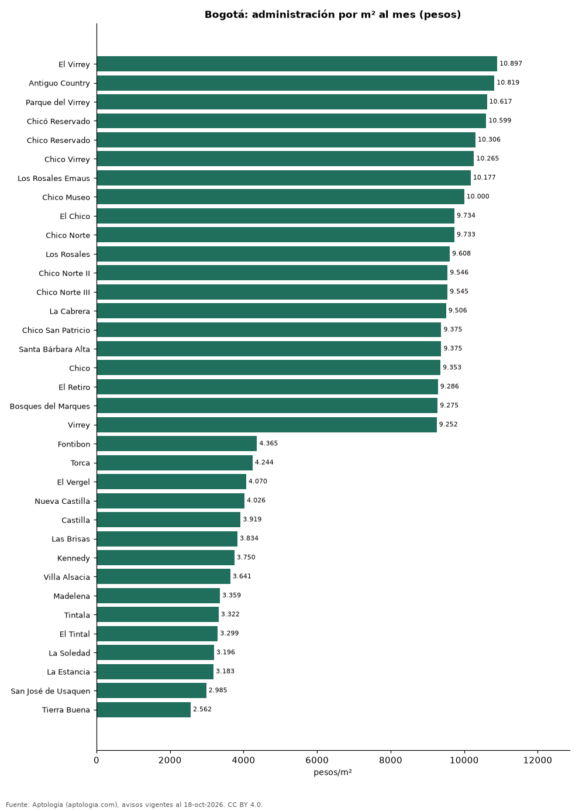

# Cuota de administración en Bogotá por barrio: cuánto se paga por m² (octubre 2026)

**En Bogotá, la administración más cara por metro cuadrado se paga en El Virrey: 10.897 pesos por m² al mes en la mediana (1.433.000 pesos de cuota). La más barata, en Tierra Buena, con 2.562 pesos por m².** La cuota mediana de toda la ciudad es 750.000 pesos al mes (7.026 pesos por m²).

*Resumen: analizamos la cuota de administración de 31.874 apartamentos en 164 barrios de Bogotá con 30 avisos o más.*

**Actualizado:** 18 de octubre de 2026 (datos del 18 de octubre de 2026) · **Próxima actualización:** mensual.

## Resumen

| Indicador | Valor |
|---|---|
| Más cara por m² | El Virrey: 10.897 pesos |
| Más barata por m² | Tierra Buena: 2.562 pesos |
| Cuota mediana de la ciudad | 750.000 pesos |
| Barrios | 164 |

## Administración por barrio

| Barrio | Administración por m² al mes | Cuota mensual (mediana) | Avisos |
|---|---|---|---|
| El Virrey | 10.897 pesos | 1.433.000 pesos | 121 |
| Antiguo Country | 10.819 pesos | 942.000 pesos | 123 |
| Parque del Virrey | 10.617 pesos | 1.200.000 pesos | 67 |
| Chicó Reservado | 10.599 pesos | 1.870.000 pesos | 85 |
| Chico Reservado | 10.306 pesos | 1.576.000 pesos | 444 |
| Chico Virrey | 10.265 pesos | 1.450.000 pesos | 58 |
| Los Rosales Emaus | 10.177 pesos | 1.800.000 pesos | 64 |
| Chico Museo | 10.000 pesos | 1.861.000 pesos | 78 |
| El Chico | 9.734 pesos | 1.430.000 pesos | 221 |
| Chico Norte | 9.733 pesos | 1.200.000 pesos | 1.008 |
| Los Rosales | 9.608 pesos | 1.910.500 pesos | 922 |
| Chico Norte II | 9.546 pesos | 1.041.350 pesos | 64 |
| Chico Norte III | 9.545 pesos | 917.000 pesos | 125 |
| La Cabrera | 9.506 pesos | 1.900.000 pesos | 425 |
| Chico San Patricio | 9.375 pesos | 1.030.000 pesos | 83 |
| Santa Bárbara Alta | 9.375 pesos | 2.200.000 pesos | 177 |
| Chico | 9.353 pesos | 1.275.000 pesos | 755 |
| El Retiro | 9.286 pesos | 2.100.000 pesos | 55 |
| Bosques del Marques | 9.275 pesos | 2.915.500 pesos | 70 |
| Virrey | 9.252 pesos | 1.180.000 pesos | 84 |
| La Candelaria | 9.252 pesos | 500.000 pesos | 67 |
| Nuevo Country | 9.224 pesos | 717.500 pesos | 50 |
| Chicó | 9.207 pesos | 1.576.000 pesos | 31 |
| Chico Santa Bárbara | 9.170 pesos | 1.000.000 pesos | 39 |
| Chicó Navarra | 9.089 pesos | 1.274.500 pesos | 194 |
| Rosales | 9.078 pesos | 1.800.000 pesos | 466 |
| Cabrera | 9.066 pesos | 1.670.000 pesos | 232 |
| Chapinero | 9.055 pesos | 650.000 pesos | 535 |
| El Nogal | 9.034 pesos | 1.841.500 pesos | 240 |
| Refugio | 9.028 pesos | 1.900.000 pesos | 96 |
| Las Rosales | 8.978 pesos | 1.800.000 pesos | 122 |
| Santa Bárbara Occidental | 8.881 pesos | 1.061.700 pesos | 387 |
| Nogal | 8.858 pesos | 1.700.000 pesos | 105 |
| Bellavista | 8.847 pesos | 1.800.000 pesos | 47 |
| Chapinero Alto | 8.842 pesos | 700.000 pesos | 321 |
| Rincon del Chico | 8.808 pesos | 1.100.000 pesos | 133 |
| San Patricio | 8.801 pesos | 1.200.000 pesos | 511 |
| Chapinero Central | 8.770 pesos | 350.000 pesos | 119 |
| Bosques de la Cañada | 8.746 pesos | 1.706.500 pesos | 34 |
| Santa Ana Oriental | 8.720 pesos | 2.000.000 pesos | 116 |
| San Martín | 8.643 pesos | 460.000 pesos | 31 |
| Santa Bárbara Oriental | 8.621 pesos | 900.000 pesos | 139 |
| Santa Paula | 8.602 pesos | 1.078.630 pesos | 417 |
| Quinta Camacho | 8.592 pesos | 857.600 pesos | 49 |
| Montearroyo | 8.470 pesos | 2.539.000 pesos | 92 |
| Molinos Norte | 8.462 pesos | 1.100.000 pesos | 53 |
| La Castellana | 8.448 pesos | 446.489 pesos | 89 |
| Chico Navarra | 8.446 pesos | 1.263.000 pesos | 450 |
| Bella Suiza | 8.417 pesos | 896.950 pesos | 419 |
| Santa Bibiana | 8.407 pesos | 1.214.500 pesos | 194 |
| El Refugio | 8.395 pesos | 1.980.000 pesos | 216 |
| Sierras del Moral | 8.373 pesos | 1.800.000 pesos | 73 |
| Pasadena | 8.333 pesos | 756.000 pesos | 199 |
| La Alhambra | 8.266 pesos | 670.000 pesos | 36 |
| Contador | 8.233 pesos | 850.000 pesos | 33 |
| San Luis | 8.137 pesos | 395.500 pesos | 32 |
| Chicó Alto | 8.061 pesos | 1.770.500 pesos | 62 |
| Santa Bárbara | 8.031 pesos | 1.045.600 pesos | 1.111 |
| Cerros de Niza | 8.026 pesos | 1.550.000 pesos | 42 |
| Chico Alto | 8.000 pesos | 1.971.850 pesos | 176 |
| Lindaraja | 7.988 pesos | 1.500.000 pesos | 32 |
| Altos de Bella Suiza | 7.976 pesos | 1.000.000 pesos | 75 |
| Reserva de la Sierra | 7.919 pesos | 1.396.900 pesos | 30 |
| Centro Internacional | 7.895 pesos | 450.000 pesos | 121 |
| Santa Ana | 7.812 pesos | 1.360.000 pesos | 104 |
| El Contador | 7.769 pesos | 681.500 pesos | 86 |
| Norte | 7.663 pesos | 1.369.000 pesos | 152 |
| Barrios Unidos | 7.662 pesos | 380.000 pesos | 95 |
| Santa Bárbara Central | 7.604 pesos | 1.000.000 pesos | 505 |
| La Calleja | 7.586 pesos | 1.100.000 pesos | 289 |
| La Carolina | 7.583 pesos | 1.500.000 pesos | 359 |
| Bosque de Pinos | 7.568 pesos | 1.300.000 pesos | 106 |
| Santa Ana Occidental | 7.494 pesos | 820.000 pesos | 74 |
| La Macarena | 7.414 pesos | 400.000 pesos | 45 |
| Los Andes | 7.408 pesos | 627.500 pesos | 38 |
| Sotileza | 7.397 pesos | 1.272.950 pesos | 68 |
| Galerias | 7.353 pesos | 316.913 pesos | 47 |
| Multicentro | 7.318 pesos | 1.444.500 pesos | 58 |
| Teusaquillo | 7.280 pesos | 357.200 pesos | 109 |
| Usaquen | 7.240 pesos | 871.500 pesos | 186 |
| Country Club | 7.221 pesos | 1.154.550 pesos | 38 |
| Alhambra | 7.215 pesos | 601.200 pesos | 73 |
| Bosque Medina | 7.215 pesos | 1.755.000 pesos | 176 |
| Belmira | 7.214 pesos | 617.300 pesos | 100 |
| Rosales Bella Vista | 7.143 pesos | 1.600.000 pesos | 37 |
| Lisboa | 7.131 pesos | 700.000 pesos | 93 |
| El Batan | 7.074 pesos | 690.000 pesos | 64 |
| Cedritos | 7.031 pesos | 560.000 pesos | 924 |
| Quinta Paredes | 6.957 pesos | 500.000 pesos | 99 |
| Niza Suba | 6.925 pesos | 1.490.900 pesos | 34 |
| El Batán | 6.924 pesos | 634.000 pesos | 36 |
| Puente Largo | 6.886 pesos | 690.000 pesos | 117 |
| Colinas de Suba | 6.854 pesos | 1.694.000 pesos | 46 |
| Recodo del Country | 6.838 pesos | 1.252.000 pesos | 52 |
| Los Cedros | 6.779 pesos | 483.000 pesos | 52 |
| Gratamira | 6.681 pesos | 925.500 pesos | 96 |
| Prado Veraniego | 6.667 pesos | 321.000 pesos | 63 |
| Las Nieves | 6.655 pesos | 327.709 pesos | 93 |
| Polo Club | 6.635 pesos | 478.338 pesos | 44 |
| Cerros de Suba | 6.607 pesos | 1.602.000 pesos | 158 |
| Nueva Autopista | 6.537 pesos | 759.500 pesos | 40 |
| Gran America | 6.490 pesos | 362.100 pesos | 32 |
| Victoria Norte | 6.388 pesos | 475.000 pesos | 49 |
| Niza | 6.344 pesos | 671.000 pesos | 95 |
| Batan | 6.329 pesos | 615.000 pesos | 59 |
| El Recuerdo | 6.277 pesos | 400.000 pesos | 30 |
| Santa Fe | 6.250 pesos | 252.200 pesos | 41 |
| Salitre | 6.154 pesos | 571.100 pesos | 39 |
| Mazuren Colina | 6.135 pesos | 525.000 pesos | 36 |
| Nueva Zelandia | 6.097 pesos | 370.000 pesos | 32 |
| Las Villas | 6.095 pesos | 532.800 pesos | 33 |
| Ciudad Salitre | 6.013 pesos | 614.750 pesos | 156 |
| Barrancas Norte | 5.992 pesos | 310.000 pesos | 48 |
| Santa Teresa | 5.901 pesos | 400.000 pesos | 69 |
| Ciudad Salitre Oriental | 5.880 pesos | 601.500 pesos | 60 |
| Lisboa Usaquén | 5.874 pesos | 678.000 pesos | 31 |
| Ciudad Salitre Occidental | 5.833 pesos | 600.000 pesos | 81 |
| El Redil | 5.833 pesos | 260.000 pesos | 99 |
| La Colina Campestre | 5.814 pesos | 658.000 pesos | 47 |
| Alejandria | 5.769 pesos | 700.000 pesos | 89 |
| Cedro Golf | 5.750 pesos | 470.000 pesos | 75 |
| Pontevedra | 5.740 pesos | 510.500 pesos | 70 |
| Britalia | 5.722 pesos | 385.000 pesos | 63 |
| Cantalejo | 5.713 pesos | 400.000 pesos | 47 |
| Prado Pinzon | 5.680 pesos | 325.000 pesos | 31 |
| Mazuren | 5.678 pesos | 450.000 pesos | 99 |
| Los Lagartos | 5.672 pesos | 1.100.000 pesos | 40 |
| Colina Campestre | 5.597 pesos | 650.000 pesos | 679 |
| Toberin | 5.556 pesos | 256.000 pesos | 43 |
| San José de Bavaria | 5.546 pesos | 380.000 pesos | 70 |
| Nicolas de Federman | 5.476 pesos | 640.151 pesos | 172 |
| La Felicidad | 5.411 pesos | 372.500 pesos | 112 |
| Lagos de Cordoba | 5.360 pesos | 720.000 pesos | 79 |
| El Liston | 5.238 pesos | 170.000 pesos | 31 |
| Modelia | 5.225 pesos | 398.000 pesos | 100 |
| Normandia | 5.162 pesos | 349.000 pesos | 50 |
| Suba | 5.154 pesos | 315.000 pesos | 131 |
| Tibana | 5.143 pesos | 209.200 pesos | 35 |
| Gran Granada | 5.120 pesos | 362.500 pesos | 114 |
| Hayuelos | 5.078 pesos | 327.200 pesos | 97 |
| Montevideo | 5.000 pesos | 250.999 pesos | 70 |
| Tibabita | 5.000 pesos | 343.500 pesos | 40 |
| San Cristóbal Norte | 4.967 pesos | 300.000 pesos | 36 |
| Mirandela | 4.738 pesos | 304.000 pesos | 66 |
| Alameda | 4.650 pesos | 358.000 pesos | 61 |
| San Antonio Norte | 4.511 pesos | 240.000 pesos | 81 |
| Verbenal | 4.493 pesos | 235.546 pesos | 32 |
| Engativá | 4.396 pesos | 278.000 pesos | 138 |
| Lagos de Torca | 4.369 pesos | 242.500 pesos | 154 |
| Fontibon | 4.365 pesos | 200.000 pesos | 297 |
| Torca | 4.244 pesos | 200.000 pesos | 31 |
| El Vergel | 4.070 pesos | 164.000 pesos | 30 |
| Nueva Castilla | 4.026 pesos | 222.200 pesos | 42 |
| Castilla | 3.919 pesos | 221.500 pesos | 128 |
| Las Brisas | 3.834 pesos | 145.400 pesos | 33 |
| Kennedy | 3.750 pesos | 152.494 pesos | 34 |
| Villa Alsacia | 3.641 pesos | 190.000 pesos | 30 |
| Madelena | 3.359 pesos | 155.350 pesos | 86 |
| Tintala | 3.322 pesos | 168.000 pesos | 55 |
| El Tintal | 3.299 pesos | 146.400 pesos | 86 |
| La Soledad | 3.196 pesos | 342.500 pesos | 50 |
| La Estancia | 3.183 pesos | 146.200 pesos | 30 |
| San José de Usaquen | 2.985 pesos | 150.000 pesos | 33 |
| Tierra Buena | 2.562 pesos | 128.000 pesos | 32 |

Medianas; ordenado de mayor a menor administración por m².

## Preguntas frecuentes

**¿Cuánto se paga de administración en Bogotá?**
La cuota mediana es 750.000 pesos al mes (7.026 pesos por m²), según avisos de octubre de 2026.

**¿En qué barrio de Bogotá es más cara la administración?**
En El Virrey: 10.897 pesos por m² al mes.

## Metodología

- **Fuente:** exportes nocturnos de la base de datos de Aptología (aptologia.com) del 18 de octubre de 2026: avisos vigentes de vivienda en portales inmobiliarios de 13 países, recogidos por Aptología y vistos en línea entre el 11 y el 18 de octubre de 2026. Corte: 18 de octubre de 2026.
- **Depuración:** se eliminan duplicados exactos (misma ciudad, zona, tipo, precio, moneda, área, habitaciones y baños) y los precios fuera del percentil 1–99 de cada país, operación, moneda y tipo; el precio por m² usa solo avisos con área declarada entre 12 y 2.000 m² y también se recorta al P1–P99.
- **Qué se mide:** precios pedidos (publicados), no precios de cierre. En arriendo, el canon mensual sin administración, gastos comunes ni condominio.
- **Muestra mínima:** cada cifra publicada se apoya en al menos 30 avisos; las celdas con menos se omiten.
- **Colombia:** Precios en pesos colombianos, sin conversión de moneda.
- **Administración:** cuota mensual declarada en avisos de venta y de arriendo de apartamentos (se unen ambas operaciones porque la cuota es del inmueble, quitando repetidos con la misma ciudad, barrio, cuota, área, habitaciones y baños); se descartan cuotas por debajo de 30.000 o por encima de 6 millones de pesos y razones por m² fuera de 500–40.000 pesos.
- **Limitaciones:** la cobertura depende de los portales que recorre Aptología en cada país y es mayor en las ciudades grandes y en los segmentos medio-alto y alto; el área es la que declara el aviso, sin verificar; los nombres de zona vienen de los portales.
- **Privacidad:** solo se publican agregados; no se publica ningún dato personal, enlace a avisos ni nombre de anunciante.
- **Datos abiertos:** [datos.csv](datos.csv), licencia CC BY 4.0.

## Cómo citar

Pinzón Pineda, D. M. (2026). *Cuota de administración en Bogotá por barrio: cuánto se paga por m² (octubre 2026)*. Aptología (aptologia.com). https://github.com/elbroker/aptologia-datos/tree/main/estudios/cuota-de-administracion-bogota-por-barrio-2026. Datos: datos.csv, licencia CC BY 4.0.
