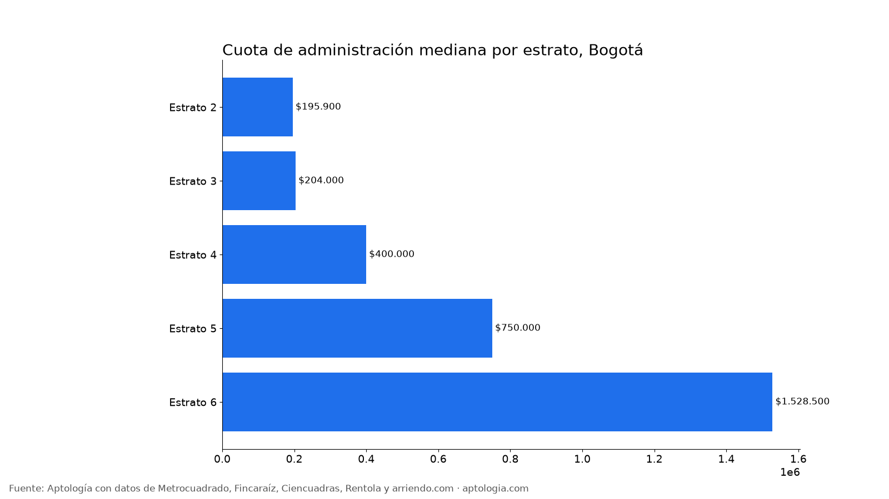
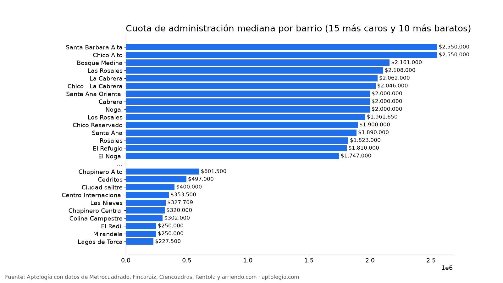

# Cuota de administración en Bogotá por barrio y estrato (octubre 2026)

**En Bogotá, la cuota de administración de un apartamento en arriendo suma en la mediana el 15,8 % del canon: $700.000 al mes sobre un arriendo mediano de $4.000.000.** Va de $204.000 en estrato 3 a $1.528.500 en estrato 6, pero como proporción del arriendo es casi igual en todos los estratos (13 % a 17 %). Por metro cuadrado, la administración cuesta $5.000/m² en estrato 3 y $10.075/m² en estrato 6.

*Resumen: medimos 8.023 apartamentos en arriendo en Bogotá que publican la cuota de administración aparte del canon, sin duplicados, con corte al 12 de octubre de 2026.*

**Actualizado:** 12 de octubre de 2026 · **Próxima actualización:** mensual.

## La cifra por estrato

| Estrato | Administración mediana | Rango típico (p25–p75) | % del canon | Por m² | Avisos |
|---|---|---|---|---|---|
| Estrato 2 | $195.900 | $125.200 – $250.000 | 16,3 % | $4.444/m² | 165 |
| Estrato 3 | $204.000 | $166.000 – $300.000 | 13,3 % | $5.000/m² | 1.251 |
| Estrato 4 | $400.000 | $268.300 – $531.000 | 15,9 % | $6.806/m² | 1.777 |
| Estrato 5 | $750.000 | $500.000 – $1.083.800 | 16,6 % | $8.871/m² | 1.129 |
| Estrato 6 | $1.528.500 | $900.000 – $2.355.000 | 16,2 % | $10.075/m² | 3.650 |

## Por barrio

Barrios con al menos 30 avisos, de la administración más alta a la más baja. El enlace lleva a los apartamentos en arriendo de ese barrio.

| Barrio | Estrato más común | Administración mediana | % del canon | Avisos |
|---|---|---|---|---|
| [Santa Barbara Alta](/arriendo/bogota/santa-barbara-alta) | 6 | $2.550.000 | 14,9 % | 76 |
| [Chico Alto](/arriendo/bogota/chico-alto) | 6 | $2.550.000 | 17,3 % | 52 |
| [Bosque Medina](/arriendo/bogota/bosque-medina) | 6 | $2.161.000 | 16,7 % | 30 |
| [Las Rosales](/arriendo/bogota/las-rosales) | 6 | $2.108.000 | 17,0 % | 41 |
| [La Cabrera](/arriendo/bogota/la-cabrera) | 6 | $2.062.000 | 13,9 % | 274 |
| [Chico   La Cabrera](/arriendo/bogota/chico-la-cabrera) | 6 | $2.046.000 | 13,4 % | 42 |
| [Santa Ana Oriental](/arriendo/bogota/santa-ana-oriental) | 6 | $2.000.000 | 15,9 % | 52 |
| [Cabrera](/arriendo/bogota/cabrera) | 6 | $2.000.000 | 13,9 % | 76 |
| [Nogal](/arriendo/bogota/nogal) | 6 | $2.000.000 | 16,4 % | 31 |
| [Los Rosales](/arriendo/bogota/los-rosales) | 6 | $1.961.650 | 17,9 % | 316 |
| [Chico Reservado](/arriendo/bogota/chico-reservado) | 6 | $1.900.000 | 15,7 % | 185 |
| [Santa Ana](/arriendo/bogota/santa-ana) | 6 | $1.890.000 | 13,3 % | 32 |
| [Rosales](/arriendo/bogota/rosales) | 6 | $1.823.000 | 17,2 % | 70 |
| [El Refugio](/arriendo/bogota/el-refugio) | 6 | $1.810.000 | 16,1 % | 80 |
| [El Nogal](/arriendo/bogota/el-nogal) | 6 | $1.747.000 | 16,3 % | 123 |
| [El chico](/arriendo/bogota/el-chico) | 6 | $1.550.000 | 16,8 % | 74 |
| [El Virrey](/arriendo/bogota/el-virrey) | 6 | $1.400.000 | 15,4 % | 53 |
| [La Carolina](/arriendo/bogota/la-carolina) | 6 | $1.395.000 | 14,3 % | 67 |
| [Chico](/arriendo/bogota/chico) | 6 | $1.263.050 | 15,0 % | 176 |
| [San Patricio](/arriendo/bogota/san-patricio) | 6 | $1.170.400 | 18,1 % | 111 |
| [Chico Navarra](/arriendo/bogota/chico-navarra) | 6 | $1.103.000 | 17,2 % | 80 |
| [Rincon Del Chico](/arriendo/bogota/rincon-del-chico) | 6 | $1.074.000 | 17,7 % | 40 |
| [Chico norte](/arriendo/bogota/chico-norte) | 6 | $1.056.350 | 15,3 % | 382 |
| [Santa Paula](/arriendo/bogota/santa-paula) | 6 | $1.009.000 | 17,2 % | 78 |
| [Santa Bibiana](/arriendo/bogota/santa-bibiana) | 6 | $915.000 | 15,7 % | 48 |
| [Antiguo Country](/arriendo/bogota/antiguo-country) | 5 | $900.000 | 18,8 % | 83 |
| [Chico Norte Et. Ii](/arriendo/bogota/chico-norte-et-ii) | 6 | $899.000 | 14,3 % | 31 |
| [Bella Suiza](/arriendo/bogota/bella-suiza) | 5 | $896.950 | 16,1 % | 64 |
| [Santa Barbara Occidental](/arriendo/bogota/santa-barbara-occidental) | 5 | $850.000 | 15,7 % | 79 |
| [Santa Barbara Central](/arriendo/bogota/santa-barbara-central) | 6 | $800.000 | 18,0 % | 104 |
| [Santa Barbara](/arriendo/bogota/santa-barbara) | 6 | $800.000 | 18,0 % | 191 |
| [Santa Barbara Oriental](/arriendo/bogota/santa-barbara-oriental) | 5 | $760.700 | 16,3 % | 49 |
| [Chico Norte Et. Iii](/arriendo/bogota/chico-norte-et-iii) | 6 | $700.000 | 14,0 % | 47 |
| [Chapinero Alto](/arriendo/bogota/chapinero-alto) | 4 | $601.500 | 19,0 % | 68 |
| [Cedritos](/arriendo/bogota/cedritos) | 4 | $497.000 | 18,2 % | 215 |
| [Ciudad salitre](/arriendo/bogota/ciudad-salitre) | 4 | $400.000 | 12,8 % | 38 |
| [Centro Internacional](/arriendo/bogota/centro-internacional) | 4 | $353.500 | 14,9 % | 46 |
| [Las Nieves](/arriendo/bogota/las-nieves) | 3 | $327.709 | 16,8 % | 38 |
| [Chapinero Central](/arriendo/bogota/chapinero-central) | 3 | $320.000 | 15,7 % | 69 |
| [Colina Campestre](/arriendo/bogota/colina-campestre) | 4 | $302.000 | 14,3 % | 82 |
| [El Redil](/arriendo/bogota/el-redil) | 4 | $250.000 | 21,7 % | 108 |
| [Mirandela](/arriendo/bogota/mirandela) | 3 | $250.000 | 23,1 % | 32 |
| [Lagos de Torca](/arriendo/bogota/lagos-de-torca) | 3 | $227.500 | 13,8 % | 50 |

**Cómo usarlo para decidir:** suma siempre la administración al canon antes de comparar. Un apartamento de $2.420.000 en estrato 4 cuesta en la práctica unos $2.820.000 al mes. Si el aviso dice "administración incluida", el canon ya la trae.

## Preguntas frecuentes

**¿Cuánto se paga de administración en Bogotá?**
La mediana es $700.000 al mes, el 15,8 % del canon, en 8.023 avisos con corte al 12 de octubre de 2026. La mitad de los apartamentos paga entre $330.000 y $1.530.000.

**¿Cuánto es la administración en estrato 3?**
La mediana es $204.000 al mes (13,3 % del canon), con un rango típico de $166.000 a $300.000.

**¿Cuánto es la administración en estrato 4?**
La mediana es $400.000 al mes (15,9 % del canon).

**¿Cuánto es la administración en estrato 6?**
La mediana es $1.528.500 al mes; la mitad paga entre $900.000 y $2.355.000.

**¿La administración la paga el inquilino o el propietario?**
En la mayoría de avisos el inquilino la paga aparte del canon; por eso este estudio la mide por separado. Cuando el aviso dice "administración incluida", ya está dentro del canon. Lo que se pacte debe quedar escrito en el contrato.

**¿En qué barrio de Bogotá la administración es más alta?**
Entre los barrios con al menos 30 avisos, Santa Barbara Alta ($2.550.000) y Chico Alto ($2.550.000). La más baja está en Lagos de Torca ($227.500).

## Metodología

- **Fuente:** base de ingesta diaria de Aptología, con avisos públicos de Metrocuadrado, Fincaraíz, Ciencuadras, Rentola y arriendo.com. Corte al 12 de octubre de 2026.
- **Filtros:** avisos vivos que pasan el control de calidad, solo apartamentos en Bogotá, canon entre $400.000 y $30.000.000. Se excluyen TikTok y Facebook Marketplace.
- **Duplicados:** se deja un aviso por grupo de duplicados (el mismo inmueble en varios portales). Quedan 21.042 apartamentos únicos.
- **Administración:** solo avisos que publican la cuota aparte (no "incluida"), entre $30.000 y $5.000.000 y menor que el canon. El valor por m² usa áreas de 20 a 400 m².
- **Limitaciones:** son precios pedidos, no cerrados. Los barrios vienen tal como los escribe cada portal, así que un mismo sector puede aparecer con dos nombres. Solo se publican grupos con al menos 20 avisos.
- **Datos abiertos:** [datos.csv](datos.csv), licencia CC BY 4.0.

## Cómo citar

Pinzón Pineda, D. M. (2026). *Cuota de administración en Bogotá por barrio y estrato (octubre 2026)*. Aptología. https://www.aptologia.com/estudios/cuota-de-administracion-bogota. Datos: datos.csv, licencia CC BY 4.0.
