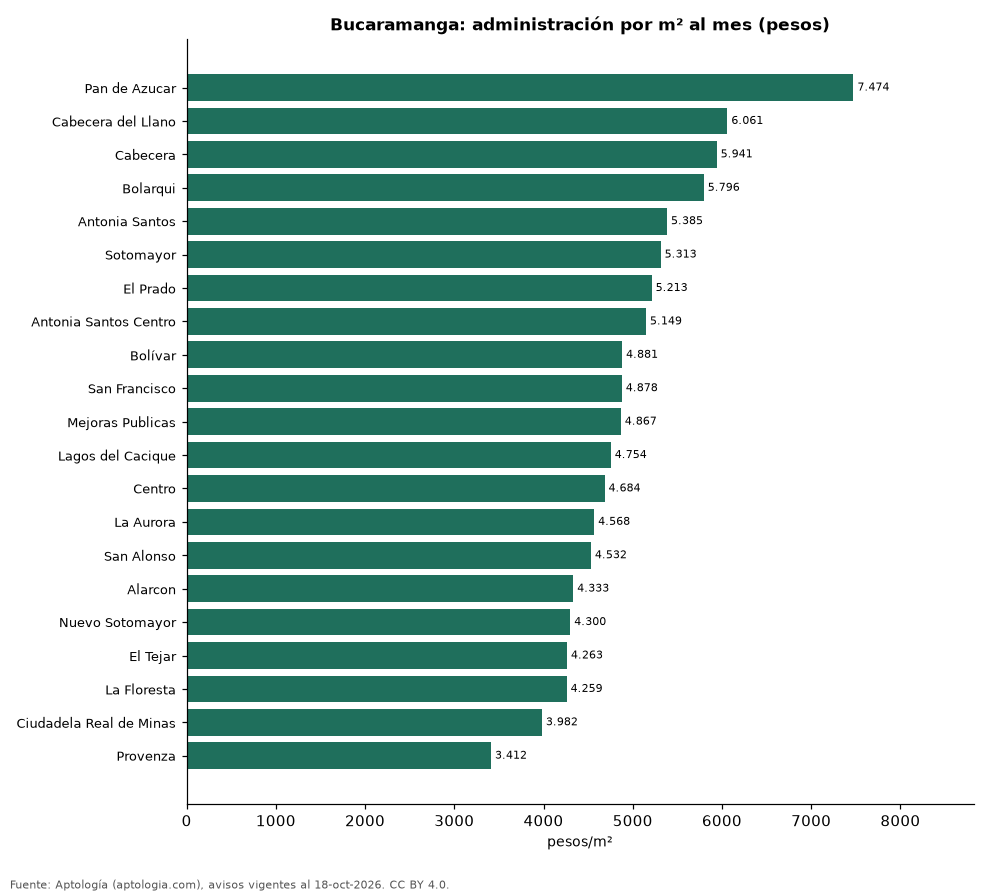

# Cuota de administración en Bucaramanga por barrio: cuánto se paga por m² (octubre 2026)

**En Bucaramanga, la administración más cara por metro cuadrado se paga en Pan de Azucar: 7.474 pesos por m² al mes en la mediana (705.000 pesos de cuota). La más barata, en Provenza, con 3.412 pesos por m².** La cuota mediana de toda la ciudad es 440.000 pesos al mes (4.823 pesos por m²).

*Resumen: analizamos la cuota de administración de 2.231 apartamentos en 21 barrios de Bucaramanga con 30 avisos o más.*

**Actualizado:** 18 de octubre de 2026 (datos del 18 de octubre de 2026) · **Próxima actualización:** mensual.

## Resumen

| Indicador | Valor |
|---|---|
| Más cara por m² | Pan de Azucar: 7.474 pesos |
| Más barata por m² | Provenza: 3.412 pesos |
| Cuota mediana de la ciudad | 440.000 pesos |
| Barrios | 21 |

## Administración por barrio

| Barrio | Administración por m² al mes | Cuota mensual (mediana) | Avisos |
|---|---|---|---|
| Pan de Azucar | 7.474 pesos | 705.000 pesos | 42 |
| Cabecera del Llano | 6.061 pesos | 791.000 pesos | 363 |
| Cabecera | 5.941 pesos | 802.000 pesos | 34 |
| Bolarqui | 5.796 pesos | 641.500 pesos | 32 |
| Antonia Santos | 5.385 pesos | 352.000 pesos | 43 |
| Sotomayor | 5.313 pesos | 615.000 pesos | 216 |
| El Prado | 5.213 pesos | 430.200 pesos | 54 |
| Antonia Santos Centro | 5.149 pesos | 391.200 pesos | 71 |
| Bolívar | 4.881 pesos | 387.000 pesos | 31 |
| San Francisco | 4.878 pesos | 325.000 pesos | 94 |
| Mejoras Publicas | 4.867 pesos | 448.000 pesos | 87 |
| Lagos del Cacique | 4.754 pesos | 700.000 pesos | 37 |
| Centro | 4.684 pesos | 352.500 pesos | 36 |
| La Aurora | 4.568 pesos | 402.000 pesos | 57 |
| San Alonso | 4.532 pesos | 402.000 pesos | 57 |
| Alarcon | 4.333 pesos | 285.000 pesos | 37 |
| Nuevo Sotomayor | 4.300 pesos | 454.000 pesos | 61 |
| El Tejar | 4.263 pesos | 452.000 pesos | 75 |
| La Floresta | 4.259 pesos | 460.000 pesos | 51 |
| Ciudadela Real de Minas | 3.982 pesos | 400.000 pesos | 61 |
| Provenza | 3.412 pesos | 263.100 pesos | 45 |

Medianas; ordenado de mayor a menor administración por m².

## Preguntas frecuentes

**¿Cuánto se paga de administración en Bucaramanga?**
La cuota mediana es 440.000 pesos al mes (4.823 pesos por m²), según avisos de octubre de 2026.

**¿En qué barrio de Bucaramanga es más cara la administración?**
En Pan de Azucar: 7.474 pesos por m² al mes.

## Metodología

- **Fuente:** exportes nocturnos de la base de datos de Aptología (aptologia.com) del 18 de octubre de 2026: avisos vigentes de vivienda en portales inmobiliarios de 13 países, recogidos por Aptología y vistos en línea entre el 11 y el 18 de octubre de 2026. Corte: 18 de octubre de 2026.
- **Depuración:** se eliminan duplicados exactos (misma ciudad, zona, tipo, precio, moneda, área, habitaciones y baños) y los precios fuera del percentil 1–99 de cada país, operación, moneda y tipo; el precio por m² usa solo avisos con área declarada entre 12 y 2.000 m² y también se recorta al P1–P99.
- **Qué se mide:** precios pedidos (publicados), no precios de cierre. En arriendo, el canon mensual sin administración, gastos comunes ni condominio.
- **Muestra mínima:** cada cifra publicada se apoya en al menos 30 avisos; las celdas con menos se omiten.
- **Colombia:** Precios en pesos colombianos, sin conversión de moneda.
- **Administración:** cuota mensual declarada en avisos de venta y de arriendo de apartamentos (se unen ambas operaciones porque la cuota es del inmueble, quitando repetidos con la misma ciudad, barrio, cuota, área, habitaciones y baños); se descartan cuotas por debajo de 30.000 o por encima de 6 millones de pesos y razones por m² fuera de 500–40.000 pesos.
- **Limitaciones:** la cobertura depende de los portales que recorre Aptología en cada país y es mayor en las ciudades grandes y en los segmentos medio-alto y alto; el área es la que declara el aviso, sin verificar; los nombres de zona vienen de los portales.
- **Privacidad:** solo se publican agregados; no se publica ningún dato personal, enlace a avisos ni nombre de anunciante.
- **Datos abiertos:** [datos.csv](datos.csv), licencia CC BY 4.0.

## Cómo citar

Pinzón Pineda, D. M. (2026). *Cuota de administración en Bucaramanga por barrio: cuánto se paga por m² (octubre 2026)*. Aptología (aptologia.com). https://github.com/elbroker/aptologia-datos/tree/main/estudios/cuota-de-administracion-bucaramanga-por-barrio-2026. Datos: datos.csv, licencia CC BY 4.0.
