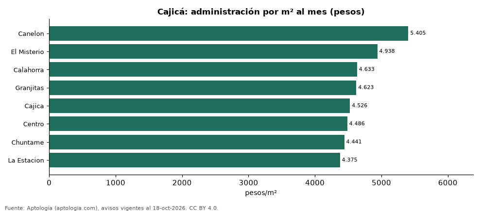

# Cuota de administración en Cajicá por barrio: cuánto se paga por m² (octubre 2026)

**En Cajicá, la administración más cara por metro cuadrado se paga en Canelon: 5.405 pesos por m² al mes en la mediana (390.000 pesos de cuota). La más barata, en La Estacion, con 4.375 pesos por m².** La cuota mediana de toda la ciudad es 330.000 pesos al mes (4.689 pesos por m²).

*Resumen: analizamos la cuota de administración de 1.306 apartamentos en 8 barrios de Cajicá con 30 avisos o más.*

**Actualizado:** 18 de octubre de 2026 (datos del 18 de octubre de 2026) · **Próxima actualización:** mensual.

## Resumen

| Indicador | Valor |
|---|---|
| Más cara por m² | Canelon: 5.405 pesos |
| Más barata por m² | La Estacion: 4.375 pesos |
| Cuota mediana de la ciudad | 330.000 pesos |
| Barrios | 8 |

## Administración por barrio

| Barrio | Administración por m² al mes | Cuota mensual (mediana) | Avisos |
|---|---|---|---|
| Canelon | 5.405 pesos | 390.000 pesos | 57 |
| El Misterio | 4.938 pesos | 295.000 pesos | 49 |
| Calahorra | 4.633 pesos | 376.000 pesos | 85 |
| Granjitas | 4.623 pesos | 261.420 pesos | 30 |
| Cajica | 4.526 pesos | 325.000 pesos | 169 |
| Centro | 4.486 pesos | 350.000 pesos | 105 |
| Chuntame | 4.441 pesos | 280.550 pesos | 102 |
| La Estacion | 4.375 pesos | 345.000 pesos | 76 |

Medianas; ordenado de mayor a menor administración por m².

## Preguntas frecuentes

**¿Cuánto se paga de administración en Cajicá?**
La cuota mediana es 330.000 pesos al mes (4.689 pesos por m²), según avisos de octubre de 2026.

**¿En qué barrio de Cajicá es más cara la administración?**
En Canelon: 5.405 pesos por m² al mes.

## Metodología

- **Fuente:** exportes nocturnos de la base de datos de Aptología (aptologia.com) del 18 de octubre de 2026: avisos vigentes de vivienda en portales inmobiliarios de 13 países, recogidos por Aptología y vistos en línea entre el 11 y el 18 de octubre de 2026. Corte: 18 de octubre de 2026.
- **Depuración:** se eliminan duplicados exactos (misma ciudad, zona, tipo, precio, moneda, área, habitaciones y baños) y los precios fuera del percentil 1–99 de cada país, operación, moneda y tipo; el precio por m² usa solo avisos con área declarada entre 12 y 2.000 m² y también se recorta al P1–P99.
- **Qué se mide:** precios pedidos (publicados), no precios de cierre. En arriendo, el canon mensual sin administración, gastos comunes ni condominio.
- **Muestra mínima:** cada cifra publicada se apoya en al menos 30 avisos; las celdas con menos se omiten.
- **Colombia:** Precios en pesos colombianos, sin conversión de moneda.
- **Administración:** cuota mensual declarada en avisos de venta y de arriendo de apartamentos (se unen ambas operaciones porque la cuota es del inmueble, quitando repetidos con la misma ciudad, barrio, cuota, área, habitaciones y baños); se descartan cuotas por debajo de 30.000 o por encima de 6 millones de pesos y razones por m² fuera de 500–40.000 pesos.
- **Limitaciones:** la cobertura depende de los portales que recorre Aptología en cada país y es mayor en las ciudades grandes y en los segmentos medio-alto y alto; el área es la que declara el aviso, sin verificar; los nombres de zona vienen de los portales.
- **Privacidad:** solo se publican agregados; no se publica ningún dato personal, enlace a avisos ni nombre de anunciante.
- **Datos abiertos:** [datos.csv](datos.csv), licencia CC BY 4.0.

## Cómo citar

Pinzón Pineda, D. M. (2026). *Cuota de administración en Cajicá por barrio: cuánto se paga por m² (octubre 2026)*. Aptología (aptologia.com). https://github.com/elbroker/aptologia-datos/tree/main/estudios/cuota-de-administracion-cajica-por-barrio-2026. Datos: datos.csv, licencia CC BY 4.0.
