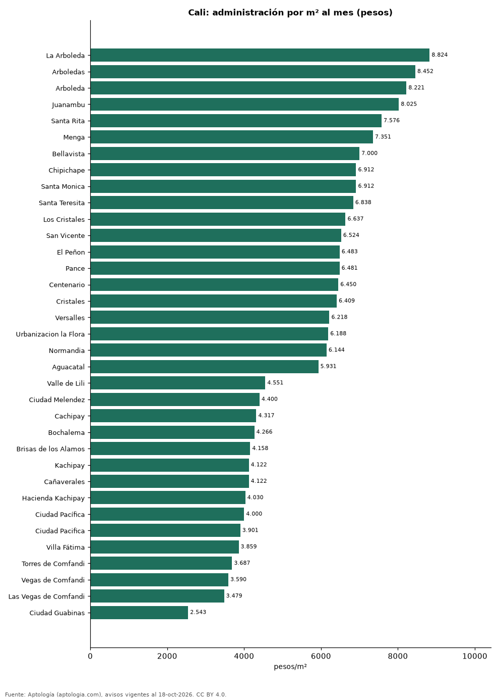

# Cuota de administración en Cali por barrio: cuánto se paga por m² (octubre 2026)

**En Cali, la administración más cara por metro cuadrado se paga en La Arboleda: 8.824 pesos por m² al mes en la mediana (1.600.500 pesos de cuota). La más barata, en Ciudad Guabinas, con 2.543 pesos por m².** La cuota mediana de toda la ciudad es 480.000 pesos al mes (5.311 pesos por m²).

*Resumen: analizamos la cuota de administración de 7.226 apartamentos en 56 barrios de Cali con 30 avisos o más.*

**Actualizado:** 18 de octubre de 2026 (datos del 18 de octubre de 2026) · **Próxima actualización:** mensual.

## Resumen

| Indicador | Valor |
|---|---|
| Más cara por m² | La Arboleda: 8.824 pesos |
| Más barata por m² | Ciudad Guabinas: 2.543 pesos |
| Cuota mediana de la ciudad | 480.000 pesos |
| Barrios | 56 |

## Administración por barrio

| Barrio | Administración por m² al mes | Cuota mensual (mediana) | Avisos |
|---|---|---|---|
| La Arboleda | 8.824 pesos | 1.600.500 pesos | 64 |
| Arboledas | 8.452 pesos | 1.646.000 pesos | 56 |
| Arboleda | 8.221 pesos | 1.347.500 pesos | 40 |
| Juanambu | 8.025 pesos | 1.300.000 pesos | 67 |
| Santa Rita | 7.576 pesos | 1.649.000 pesos | 69 |
| Menga | 7.351 pesos | 1.040.000 pesos | 65 |
| Bellavista | 7.000 pesos | 1.000.000 pesos | 173 |
| Chipichape | 6.912 pesos | 800.000 pesos | 47 |
| Santa Monica | 6.912 pesos | 1.200.000 pesos | 100 |
| Santa Teresita | 6.838 pesos | 1.250.000 pesos | 305 |
| Los Cristales | 6.637 pesos | 785.000 pesos | 45 |
| San Vicente | 6.524 pesos | 778.500 pesos | 30 |
| El Peñon | 6.483 pesos | 1.089.000 pesos | 38 |
| Pance | 6.481 pesos | 852.000 pesos | 381 |
| Centenario | 6.450 pesos | 1.000.000 pesos | 48 |
| Cristales | 6.409 pesos | 852.000 pesos | 167 |
| Versalles | 6.218 pesos | 1.000.000 pesos | 73 |
| Urbanizacion la Flora | 6.188 pesos | 553.500 pesos | 54 |
| Normandia | 6.144 pesos | 1.370.000 pesos | 172 |
| Aguacatal | 5.931 pesos | 1.110.500 pesos | 90 |
| Ciudad Jardín | 5.921 pesos | 800.000 pesos | 292 |
| El Ingenio | 5.893 pesos | 600.000 pesos | 153 |
| Camino Real | 5.846 pesos | 576.000 pesos | 33 |
| Ciudad Capri | 5.826 pesos | 551.500 pesos | 40 |
| La Hacienda | 5.769 pesos | 460.000 pesos | 87 |
| Prados del Norte | 5.769 pesos | 430.000 pesos | 73 |
| Quintas de Don Simón | 5.729 pesos | 580.000 pesos | 61 |
| Cuarto de Legua | 5.663 pesos | 618.000 pesos | 33 |
| El Caney | 5.421 pesos | 350.000 pesos | 30 |
| Caney | 5.368 pesos | 393.000 pesos | 88 |
| El Refugio | 5.328 pesos | 410.000 pesos | 60 |
| El Limonar | 5.209 pesos | 422.500 pesos | 52 |
| Santa Anita | 5.190 pesos | 473.000 pesos | 63 |
| Santa Isabel | 5.181 pesos | 589.500 pesos | 72 |
| La Flora | 5.114 pesos | 503.000 pesos | 108 |
| Primero de Mayo | 4.988 pesos | 342.000 pesos | 38 |
| La Selva | 4.811 pesos | 256.193 pesos | 41 |
| Melendez | 4.674 pesos | 296.000 pesos | 38 |
| Granada | 4.640 pesos | 716.000 pesos | 63 |
| Valle del Lili | 4.635 pesos | 343.500 pesos | 584 |
| Tequendama | 4.574 pesos | 602.500 pesos | 32 |
| Valle de Lili | 4.551 pesos | 342.500 pesos | 140 |
| Ciudad Melendez | 4.400 pesos | 280.000 pesos | 186 |
| Cachipay | 4.317 pesos | 260.000 pesos | 74 |
| Bochalema | 4.266 pesos | 287.000 pesos | 434 |
| Brisas de los Alamos | 4.158 pesos | 246.000 pesos | 43 |
| Kachipay | 4.122 pesos | 237.500 pesos | 46 |
| Cañaverales | 4.122 pesos | 233.750 pesos | 38 |
| Hacienda Kachipay | 4.030 pesos | 250.000 pesos | 42 |
| Ciudad Pacífica | 4.000 pesos | 243.000 pesos | 101 |
| Ciudad Pacifica | 3.901 pesos | 236.500 pesos | 60 |
| Villa Fátima | 3.859 pesos | 222.650 pesos | 34 |
| Torres de Comfandi | 3.687 pesos | 190.000 pesos | 30 |
| Vegas de Comfandi | 3.590 pesos | 199.500 pesos | 34 |
| Las Vegas de Comfandi | 3.479 pesos | 210.000 pesos | 32 |
| Ciudad Guabinas | 2.543 pesos | 133.255 pesos | 33 |

Medianas; ordenado de mayor a menor administración por m².

## Preguntas frecuentes

**¿Cuánto se paga de administración en Cali?**
La cuota mediana es 480.000 pesos al mes (5.311 pesos por m²), según avisos de octubre de 2026.

**¿En qué barrio de Cali es más cara la administración?**
En La Arboleda: 8.824 pesos por m² al mes.

## Metodología

- **Fuente:** exportes nocturnos de la base de datos de Aptología (aptologia.com) del 18 de octubre de 2026: avisos vigentes de vivienda en portales inmobiliarios de 13 países, recogidos por Aptología y vistos en línea entre el 11 y el 18 de octubre de 2026. Corte: 18 de octubre de 2026.
- **Depuración:** se eliminan duplicados exactos (misma ciudad, zona, tipo, precio, moneda, área, habitaciones y baños) y los precios fuera del percentil 1–99 de cada país, operación, moneda y tipo; el precio por m² usa solo avisos con área declarada entre 12 y 2.000 m² y también se recorta al P1–P99.
- **Qué se mide:** precios pedidos (publicados), no precios de cierre. En arriendo, el canon mensual sin administración, gastos comunes ni condominio.
- **Muestra mínima:** cada cifra publicada se apoya en al menos 30 avisos; las celdas con menos se omiten.
- **Colombia:** Precios en pesos colombianos, sin conversión de moneda.
- **Administración:** cuota mensual declarada en avisos de venta y de arriendo de apartamentos (se unen ambas operaciones porque la cuota es del inmueble, quitando repetidos con la misma ciudad, barrio, cuota, área, habitaciones y baños); se descartan cuotas por debajo de 30.000 o por encima de 6 millones de pesos y razones por m² fuera de 500–40.000 pesos.
- **Limitaciones:** la cobertura depende de los portales que recorre Aptología en cada país y es mayor en las ciudades grandes y en los segmentos medio-alto y alto; el área es la que declara el aviso, sin verificar; los nombres de zona vienen de los portales.
- **Privacidad:** solo se publican agregados; no se publica ningún dato personal, enlace a avisos ni nombre de anunciante.
- **Datos abiertos:** [datos.csv](datos.csv), licencia CC BY 4.0.

## Cómo citar

Pinzón Pineda, D. M. (2026). *Cuota de administración en Cali por barrio: cuánto se paga por m² (octubre 2026)*. Aptología (aptologia.com). https://github.com/elbroker/aptologia-datos/tree/main/estudios/cuota-de-administracion-cali-por-barrio-2026. Datos: datos.csv, licencia CC BY 4.0.
