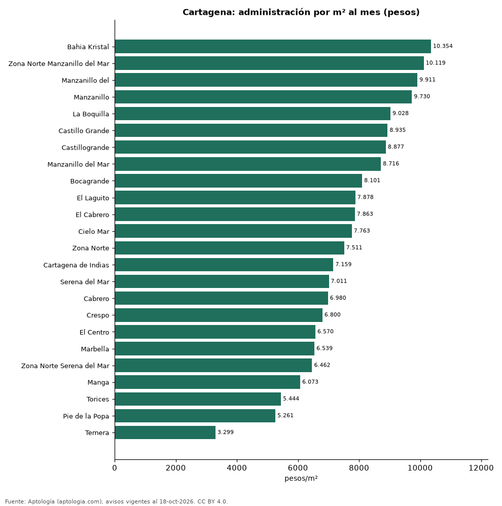

# Cuota de administración en Cartagena por barrio: cuánto se paga por m² (octubre 2026)

**En Cartagena, la administración más cara por metro cuadrado se paga en Bahia Kristal: 10.354 pesos por m² al mes en la mediana (720.000 pesos de cuota). La más barata, en Ternera, con 3.299 pesos por m².** La cuota mediana de toda la ciudad es 740.000 pesos al mes (7.303 pesos por m²).

*Resumen: analizamos la cuota de administración de 4.891 apartamentos en 24 barrios de Cartagena con 30 avisos o más.*

**Actualizado:** 18 de octubre de 2026 (datos del 18 de octubre de 2026) · **Próxima actualización:** mensual.

## Resumen

| Indicador | Valor |
|---|---|
| Más cara por m² | Bahia Kristal: 10.354 pesos |
| Más barata por m² | Ternera: 3.299 pesos |
| Cuota mediana de la ciudad | 740.000 pesos |
| Barrios | 24 |

## Administración por barrio

| Barrio | Administración por m² al mes | Cuota mensual (mediana) | Avisos |
|---|---|---|---|
| Bahia Kristal | 10.354 pesos | 720.000 pesos | 30 |
| Zona Norte Manzanillo del Mar | 10.119 pesos | 1.050.000 pesos | 31 |
| Manzanillo del | 9.911 pesos | 829.000 pesos | 30 |
| Manzanillo | 9.730 pesos | 763.000 pesos | 128 |
| La Boquilla | 9.028 pesos | 990.000 pesos | 333 |
| Castillo Grande | 8.935 pesos | 1.290.000 pesos | 46 |
| Castillogrande | 8.877 pesos | 1.450.000 pesos | 231 |
| Manzanillo del Mar | 8.716 pesos | 980.000 pesos | 53 |
| Bocagrande | 8.101 pesos | 960.000 pesos | 613 |
| El Laguito | 7.878 pesos | 658.000 pesos | 220 |
| El Cabrero | 7.863 pesos | 800.000 pesos | 115 |
| Cielo Mar | 7.763 pesos | 751.300 pesos | 135 |
| Zona Norte | 7.511 pesos | 755.000 pesos | 122 |
| Cartagena de Indias | 7.159 pesos | 822.500 pesos | 256 |
| Serena del Mar | 7.011 pesos | 534.650 pesos | 413 |
| Cabrero | 6.980 pesos | 750.000 pesos | 58 |
| Crespo | 6.800 pesos | 699.000 pesos | 224 |
| El Centro | 6.570 pesos | 528.500 pesos | 36 |
| Marbella | 6.539 pesos | 600.000 pesos | 156 |
| Zona Norte Serena del Mar | 6.462 pesos | 600.000 pesos | 55 |
| Manga | 6.073 pesos | 750.000 pesos | 312 |
| Torices | 5.444 pesos | 300.000 pesos | 99 |
| Pie de la Popa | 5.261 pesos | 445.000 pesos | 78 |
| Ternera | 3.299 pesos | 230.000 pesos | 31 |

Medianas; ordenado de mayor a menor administración por m².

## Preguntas frecuentes

**¿Cuánto se paga de administración en Cartagena?**
La cuota mediana es 740.000 pesos al mes (7.303 pesos por m²), según avisos de octubre de 2026.

**¿En qué barrio de Cartagena es más cara la administración?**
En Bahia Kristal: 10.354 pesos por m² al mes.

## Metodología

- **Fuente:** exportes nocturnos de la base de datos de Aptología (aptologia.com) del 18 de octubre de 2026: avisos vigentes de vivienda en portales inmobiliarios de 13 países, recogidos por Aptología y vistos en línea entre el 11 y el 18 de octubre de 2026. Corte: 18 de octubre de 2026.
- **Depuración:** se eliminan duplicados exactos (misma ciudad, zona, tipo, precio, moneda, área, habitaciones y baños) y los precios fuera del percentil 1–99 de cada país, operación, moneda y tipo; el precio por m² usa solo avisos con área declarada entre 12 y 2.000 m² y también se recorta al P1–P99.
- **Qué se mide:** precios pedidos (publicados), no precios de cierre. En arriendo, el canon mensual sin administración, gastos comunes ni condominio.
- **Muestra mínima:** cada cifra publicada se apoya en al menos 30 avisos; las celdas con menos se omiten.
- **Colombia:** Precios en pesos colombianos, sin conversión de moneda.
- **Administración:** cuota mensual declarada en avisos de venta y de arriendo de apartamentos (se unen ambas operaciones porque la cuota es del inmueble, quitando repetidos con la misma ciudad, barrio, cuota, área, habitaciones y baños); se descartan cuotas por debajo de 30.000 o por encima de 6 millones de pesos y razones por m² fuera de 500–40.000 pesos.
- **Limitaciones:** la cobertura depende de los portales que recorre Aptología en cada país y es mayor en las ciudades grandes y en los segmentos medio-alto y alto; el área es la que declara el aviso, sin verificar; los nombres de zona vienen de los portales.
- **Privacidad:** solo se publican agregados; no se publica ningún dato personal, enlace a avisos ni nombre de anunciante.
- **Datos abiertos:** [datos.csv](datos.csv), licencia CC BY 4.0.

## Cómo citar

Pinzón Pineda, D. M. (2026). *Cuota de administración en Cartagena por barrio: cuánto se paga por m² (octubre 2026)*. Aptología (aptologia.com). https://github.com/elbroker/aptologia-datos/tree/main/estudios/cuota-de-administracion-cartagena-por-barrio-2026. Datos: datos.csv, licencia CC BY 4.0.
