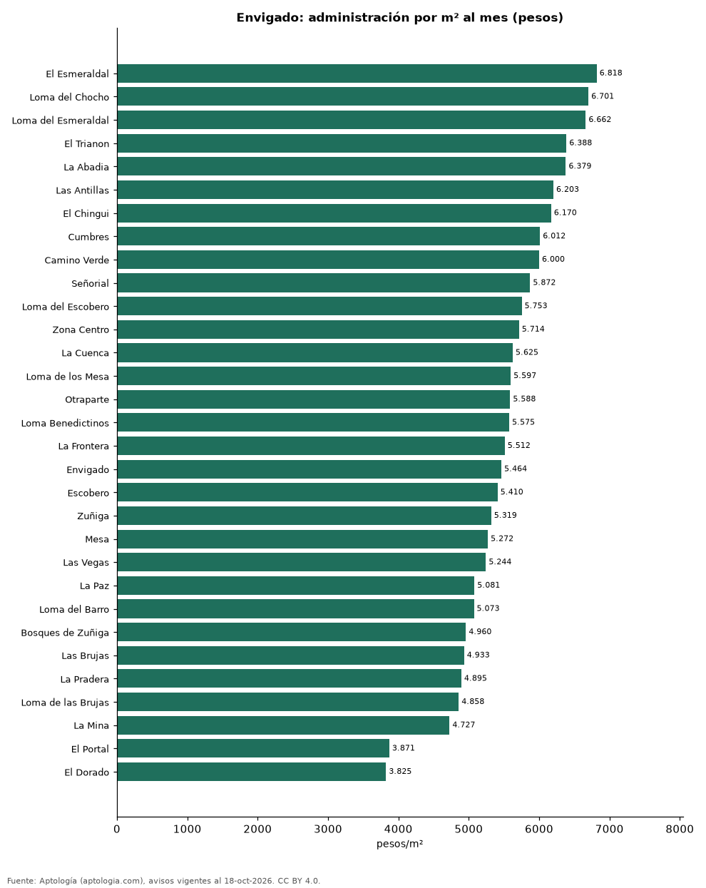

# Cuota de administración en Envigado por barrio: cuánto se paga por m² (octubre 2026)

**En Envigado, la administración más cara por metro cuadrado se paga en El Esmeraldal: 6.818 pesos por m² al mes en la mediana (721.448 pesos de cuota). La más barata, en El Dorado, con 3.825 pesos por m².** La cuota mediana de toda la ciudad es 560.000 pesos al mes (5.669 pesos por m²).

*Resumen: analizamos la cuota de administración de 3.623 apartamentos en 31 barrios de Envigado con 30 avisos o más.*

**Actualizado:** 18 de octubre de 2026 (datos del 18 de octubre de 2026) · **Próxima actualización:** mensual.

## Resumen

| Indicador | Valor |
|---|---|
| Más cara por m² | El Esmeraldal: 6.818 pesos |
| Más barata por m² | El Dorado: 3.825 pesos |
| Cuota mediana de la ciudad | 560.000 pesos |
| Barrios | 31 |

## Administración por barrio

| Barrio | Administración por m² al mes | Cuota mensual (mediana) | Avisos |
|---|---|---|---|
| El Esmeraldal | 6.818 pesos | 721.448 pesos | 87 |
| Loma del Chocho | 6.701 pesos | 670.000 pesos | 93 |
| Loma del Esmeraldal | 6.662 pesos | 674.294 pesos | 144 |
| El Trianon | 6.388 pesos | 421.500 pesos | 61 |
| La Abadia | 6.379 pesos | 542.600 pesos | 40 |
| Las Antillas | 6.203 pesos | 433.000 pesos | 81 |
| El Chingui | 6.170 pesos | 500.000 pesos | 79 |
| Cumbres | 6.012 pesos | 620.000 pesos | 181 |
| Camino Verde | 6.000 pesos | 500.000 pesos | 185 |
| Señorial | 5.872 pesos | 442.750 pesos | 70 |
| Loma del Escobero | 5.753 pesos | 585.000 pesos | 115 |
| Zona Centro | 5.714 pesos | 587.000 pesos | 57 |
| La Cuenca | 5.625 pesos | 395.000 pesos | 53 |
| Loma de los Mesa | 5.597 pesos | 560.000 pesos | 50 |
| Otraparte | 5.588 pesos | 605.000 pesos | 71 |
| Loma Benedictinos | 5.575 pesos | 650.000 pesos | 63 |
| La Frontera | 5.512 pesos | 745.000 pesos | 33 |
| Envigado | 5.464 pesos | 636.970 pesos | 349 |
| Escobero | 5.410 pesos | 561.000 pesos | 98 |
| Zuñiga | 5.319 pesos | 676.000 pesos | 119 |
| Mesa | 5.272 pesos | 500.000 pesos | 80 |
| Las Vegas | 5.244 pesos | 433.000 pesos | 63 |
| La Paz | 5.081 pesos | 417.500 pesos | 40 |
| Loma del Barro | 5.073 pesos | 404.000 pesos | 53 |
| Bosques de Zuñiga | 4.960 pesos | 655.000 pesos | 34 |
| Las Brujas | 4.933 pesos | 574.000 pesos | 49 |
| La Pradera | 4.895 pesos | 568.500 pesos | 34 |
| Loma de las Brujas | 4.858 pesos | 650.000 pesos | 202 |
| La Mina | 4.727 pesos | 278.000 pesos | 43 |
| El Portal | 3.871 pesos | 495.000 pesos | 65 |
| El Dorado | 3.825 pesos | 295.000 pesos | 36 |

Medianas; ordenado de mayor a menor administración por m².

## Preguntas frecuentes

**¿Cuánto se paga de administración en Envigado?**
La cuota mediana es 560.000 pesos al mes (5.669 pesos por m²), según avisos de octubre de 2026.

**¿En qué barrio de Envigado es más cara la administración?**
En El Esmeraldal: 6.818 pesos por m² al mes.

## Metodología

- **Fuente:** exportes nocturnos de la base de datos de Aptología (aptologia.com) del 18 de octubre de 2026: avisos vigentes de vivienda en portales inmobiliarios de 13 países, recogidos por Aptología y vistos en línea entre el 11 y el 18 de octubre de 2026. Corte: 18 de octubre de 2026.
- **Depuración:** se eliminan duplicados exactos (misma ciudad, zona, tipo, precio, moneda, área, habitaciones y baños) y los precios fuera del percentil 1–99 de cada país, operación, moneda y tipo; el precio por m² usa solo avisos con área declarada entre 12 y 2.000 m² y también se recorta al P1–P99.
- **Qué se mide:** precios pedidos (publicados), no precios de cierre. En arriendo, el canon mensual sin administración, gastos comunes ni condominio.
- **Muestra mínima:** cada cifra publicada se apoya en al menos 30 avisos; las celdas con menos se omiten.
- **Colombia:** Precios en pesos colombianos, sin conversión de moneda.
- **Administración:** cuota mensual declarada en avisos de venta y de arriendo de apartamentos (se unen ambas operaciones porque la cuota es del inmueble, quitando repetidos con la misma ciudad, barrio, cuota, área, habitaciones y baños); se descartan cuotas por debajo de 30.000 o por encima de 6 millones de pesos y razones por m² fuera de 500–40.000 pesos.
- **Limitaciones:** la cobertura depende de los portales que recorre Aptología en cada país y es mayor en las ciudades grandes y en los segmentos medio-alto y alto; el área es la que declara el aviso, sin verificar; los nombres de zona vienen de los portales.
- **Privacidad:** solo se publican agregados; no se publica ningún dato personal, enlace a avisos ni nombre de anunciante.
- **Datos abiertos:** [datos.csv](datos.csv), licencia CC BY 4.0.

## Cómo citar

Pinzón Pineda, D. M. (2026). *Cuota de administración en Envigado por barrio: cuánto se paga por m² (octubre 2026)*. Aptología (aptologia.com). https://github.com/elbroker/aptologia-datos/tree/main/estudios/cuota-de-administracion-envigado-por-barrio-2026. Datos: datos.csv, licencia CC BY 4.0.
