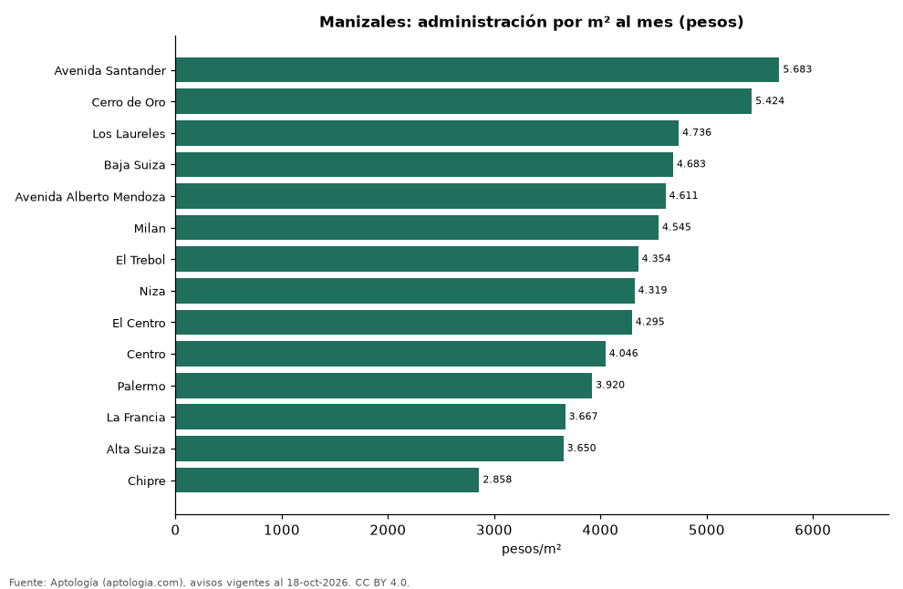

# Cuota de administración en Manizales por barrio: cuánto se paga por m² (octubre 2026)

**En Manizales, la administración más cara por metro cuadrado se paga en Avenida Santander: 5.683 pesos por m² al mes en la mediana (540.000 pesos de cuota). La más barata, en Chipre, con 2.858 pesos por m².** La cuota mediana de toda la ciudad es 293.000 pesos al mes (4.131 pesos por m²).

*Resumen: analizamos la cuota de administración de 1.875 apartamentos en 14 barrios de Manizales con 30 avisos o más.*

**Actualizado:** 18 de octubre de 2026 (datos del 18 de octubre de 2026) · **Próxima actualización:** mensual.

## Resumen

| Indicador | Valor |
|---|---|
| Más cara por m² | Avenida Santander: 5.683 pesos |
| Más barata por m² | Chipre: 2.858 pesos |
| Cuota mediana de la ciudad | 293.000 pesos |
| Barrios | 14 |

## Administración por barrio

| Barrio | Administración por m² al mes | Cuota mensual (mediana) | Avisos |
|---|---|---|---|
| Avenida Santander | 5.683 pesos | 540.000 pesos | 81 |
| Cerro de Oro | 5.424 pesos | 350.000 pesos | 35 |
| Los Laureles | 4.736 pesos | 440.250 pesos | 42 |
| Baja Suiza | 4.683 pesos | 290.000 pesos | 58 |
| Avenida Alberto Mendoza | 4.611 pesos | 347.500 pesos | 30 |
| Milan | 4.545 pesos | 450.000 pesos | 117 |
| El Trebol | 4.354 pesos | 358.000 pesos | 59 |
| Niza | 4.319 pesos | 282.000 pesos | 34 |
| El Centro | 4.295 pesos | 300.000 pesos | 46 |
| Centro | 4.046 pesos | 296.415 pesos | 33 |
| Palermo | 3.920 pesos | 370.500 pesos | 238 |
| La Francia | 3.667 pesos | 230.000 pesos | 85 |
| Alta Suiza | 3.650 pesos | 241.000 pesos | 46 |
| Chipre | 2.858 pesos | 207.500 pesos | 64 |

Medianas; ordenado de mayor a menor administración por m².

## Preguntas frecuentes

**¿Cuánto se paga de administración en Manizales?**
La cuota mediana es 293.000 pesos al mes (4.131 pesos por m²), según avisos de octubre de 2026.

**¿En qué barrio de Manizales es más cara la administración?**
En Avenida Santander: 5.683 pesos por m² al mes.

## Metodología

- **Fuente:** exportes nocturnos de la base de datos de Aptología (aptologia.com) del 18 de octubre de 2026: avisos vigentes de vivienda en portales inmobiliarios de 13 países, recogidos por Aptología y vistos en línea entre el 11 y el 18 de octubre de 2026. Corte: 18 de octubre de 2026.
- **Depuración:** se eliminan duplicados exactos (misma ciudad, zona, tipo, precio, moneda, área, habitaciones y baños) y los precios fuera del percentil 1–99 de cada país, operación, moneda y tipo; el precio por m² usa solo avisos con área declarada entre 12 y 2.000 m² y también se recorta al P1–P99.
- **Qué se mide:** precios pedidos (publicados), no precios de cierre. En arriendo, el canon mensual sin administración, gastos comunes ni condominio.
- **Muestra mínima:** cada cifra publicada se apoya en al menos 30 avisos; las celdas con menos se omiten.
- **Colombia:** Precios en pesos colombianos, sin conversión de moneda.
- **Administración:** cuota mensual declarada en avisos de venta y de arriendo de apartamentos (se unen ambas operaciones porque la cuota es del inmueble, quitando repetidos con la misma ciudad, barrio, cuota, área, habitaciones y baños); se descartan cuotas por debajo de 30.000 o por encima de 6 millones de pesos y razones por m² fuera de 500–40.000 pesos.
- **Limitaciones:** la cobertura depende de los portales que recorre Aptología en cada país y es mayor en las ciudades grandes y en los segmentos medio-alto y alto; el área es la que declara el aviso, sin verificar; los nombres de zona vienen de los portales.
- **Privacidad:** solo se publican agregados; no se publica ningún dato personal, enlace a avisos ni nombre de anunciante.
- **Datos abiertos:** [datos.csv](datos.csv), licencia CC BY 4.0.

## Cómo citar

Pinzón Pineda, D. M. (2026). *Cuota de administración en Manizales por barrio: cuánto se paga por m² (octubre 2026)*. Aptología (aptologia.com). https://github.com/elbroker/aptologia-datos/tree/main/estudios/cuota-de-administracion-manizales-por-barrio-2026. Datos: datos.csv, licencia CC BY 4.0.
