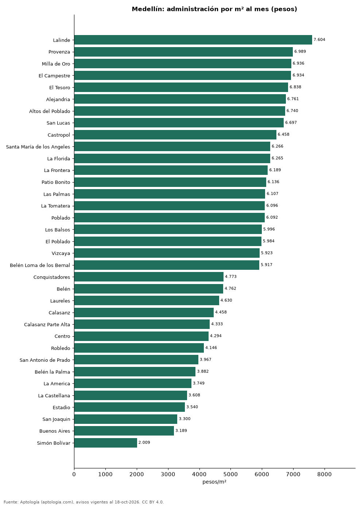

# Cuota de administración en Medellín por barrio: cuánto se paga por m² (octubre 2026)

**En Medellín, la administración más cara por metro cuadrado se paga en Lalinde: 7.604 pesos por m² al mes en la mediana (826.414 pesos de cuota). La más barata, en Simón Bolívar, con 2.009 pesos por m².** La cuota mediana de toda la ciudad es 648.402 pesos al mes (5.577 pesos por m²).

*Resumen: analizamos la cuota de administración de 13.056 apartamentos en 48 barrios de Medellín con 30 avisos o más.*

**Actualizado:** 18 de octubre de 2026 (datos del 18 de octubre de 2026) · **Próxima actualización:** mensual.

## Resumen

| Indicador | Valor |
|---|---|
| Más cara por m² | Lalinde: 7.604 pesos |
| Más barata por m² | Simón Bolívar: 2.009 pesos |
| Cuota mediana de la ciudad | 648.402 pesos |
| Barrios | 48 |

## Administración por barrio

| Barrio | Administración por m² al mes | Cuota mensual (mediana) | Avisos |
|---|---|---|---|
| Lalinde | 7.604 pesos | 826.414 pesos | 63 |
| Provenza | 6.989 pesos | 1.066.000 pesos | 91 |
| Milla de Oro | 6.936 pesos | 1.000.000 pesos | 65 |
| El Campestre | 6.934 pesos | 1.070.000 pesos | 99 |
| El Tesoro | 6.838 pesos | 1.200.000 pesos | 177 |
| Alejandria | 6.761 pesos | 1.050.000 pesos | 59 |
| Altos del Poblado | 6.740 pesos | 718.305 pesos | 122 |
| San Lucas | 6.697 pesos | 1.200.000 pesos | 139 |
| Castropol | 6.458 pesos | 869.733 pesos | 277 |
| Santa María de los Angeles | 6.266 pesos | 853.000 pesos | 126 |
| La Florida | 6.265 pesos | 1.103.088 pesos | 40 |
| La Frontera | 6.189 pesos | 777.000 pesos | 60 |
| Patio Bonito | 6.136 pesos | 828.246 pesos | 98 |
| Las Palmas | 6.107 pesos | 580.000 pesos | 203 |
| La Tomatera | 6.096 pesos | 1.300.000 pesos | 31 |
| Poblado | 6.092 pesos | 870.728 pesos | 560 |
| Los Balsos | 5.996 pesos | 1.080.000 pesos | 228 |
| El Poblado | 5.984 pesos | 871.850 pesos | 3.448 |
| Vizcaya | 5.923 pesos | 948.000 pesos | 37 |
| Belén Loma de los Bernal | 5.917 pesos | 468.335 pesos | 65 |
| Loma del Indio | 5.833 pesos | 400.000 pesos | 157 |
| Ciudad del Río | 5.777 pesos | 492.500 pesos | 164 |
| Loma de los Bernal | 5.714 pesos | 480.000 pesos | 211 |
| Boston | 5.544 pesos | 333.000 pesos | 66 |
| La Calera | 5.328 pesos | 1.235.500 pesos | 44 |
| Vía las Palmas | 5.279 pesos | 502.000 pesos | 54 |
| San Diego | 5.245 pesos | 426.000 pesos | 57 |
| San German | 5.154 pesos | 350.000 pesos | 46 |
| Los Colores | 5.042 pesos | 380.000 pesos | 109 |
| Rodeo Alto | 5.000 pesos | 295.000 pesos | 93 |
| Medellín | 5.000 pesos | 540.000 pesos | 58 |
| La Candelaria | 4.881 pesos | 507.000 pesos | 110 |
| Guayabal | 4.775 pesos | 350.000 pesos | 73 |
| Conquistadores | 4.773 pesos | 596.500 pesos | 170 |
| Belén | 4.762 pesos | 380.000 pesos | 453 |
| Laureles | 4.630 pesos | 550.500 pesos | 1.404 |
| Calasanz | 4.458 pesos | 321.500 pesos | 294 |
| Calasanz Parte Alta | 4.333 pesos | 284.000 pesos | 45 |
| Centro | 4.294 pesos | 623.498 pesos | 46 |
| Robledo | 4.146 pesos | 200.000 pesos | 173 |
| San Antonio de Prado | 3.967 pesos | 187.250 pesos | 70 |
| Belén la Palma | 3.882 pesos | 416.000 pesos | 43 |
| La America | 3.749 pesos | 258.000 pesos | 94 |
| La Castellana | 3.608 pesos | 410.000 pesos | 117 |
| Estadio | 3.540 pesos | 435.000 pesos | 41 |
| San Joaquin | 3.300 pesos | 384.000 pesos | 36 |
| Buenos Aires | 3.189 pesos | 177.400 pesos | 43 |
| Simón Bolívar | 2.009 pesos | 210.000 pesos | 48 |

Medianas; ordenado de mayor a menor administración por m².

## Preguntas frecuentes

**¿Cuánto se paga de administración en Medellín?**
La cuota mediana es 648.402 pesos al mes (5.577 pesos por m²), según avisos de octubre de 2026.

**¿En qué barrio de Medellín es más cara la administración?**
En Lalinde: 7.604 pesos por m² al mes.

## Metodología

- **Fuente:** exportes nocturnos de la base de datos de Aptología (aptologia.com) del 18 de octubre de 2026: avisos vigentes de vivienda en portales inmobiliarios de 13 países, recogidos por Aptología y vistos en línea entre el 11 y el 18 de octubre de 2026. Corte: 18 de octubre de 2026.
- **Depuración:** se eliminan duplicados exactos (misma ciudad, zona, tipo, precio, moneda, área, habitaciones y baños) y los precios fuera del percentil 1–99 de cada país, operación, moneda y tipo; el precio por m² usa solo avisos con área declarada entre 12 y 2.000 m² y también se recorta al P1–P99.
- **Qué se mide:** precios pedidos (publicados), no precios de cierre. En arriendo, el canon mensual sin administración, gastos comunes ni condominio.
- **Muestra mínima:** cada cifra publicada se apoya en al menos 30 avisos; las celdas con menos se omiten.
- **Colombia:** Precios en pesos colombianos, sin conversión de moneda.
- **Administración:** cuota mensual declarada en avisos de venta y de arriendo de apartamentos (se unen ambas operaciones porque la cuota es del inmueble, quitando repetidos con la misma ciudad, barrio, cuota, área, habitaciones y baños); se descartan cuotas por debajo de 30.000 o por encima de 6 millones de pesos y razones por m² fuera de 500–40.000 pesos.
- **Limitaciones:** la cobertura depende de los portales que recorre Aptología en cada país y es mayor en las ciudades grandes y en los segmentos medio-alto y alto; el área es la que declara el aviso, sin verificar; los nombres de zona vienen de los portales.
- **Privacidad:** solo se publican agregados; no se publica ningún dato personal, enlace a avisos ni nombre de anunciante.
- **Datos abiertos:** [datos.csv](datos.csv), licencia CC BY 4.0.

## Cómo citar

Pinzón Pineda, D. M. (2026). *Cuota de administración en Medellín por barrio: cuánto se paga por m² (octubre 2026)*. Aptología (aptologia.com). https://github.com/elbroker/aptologia-datos/tree/main/estudios/cuota-de-administracion-medellin-por-barrio-2026. Datos: datos.csv, licencia CC BY 4.0.
