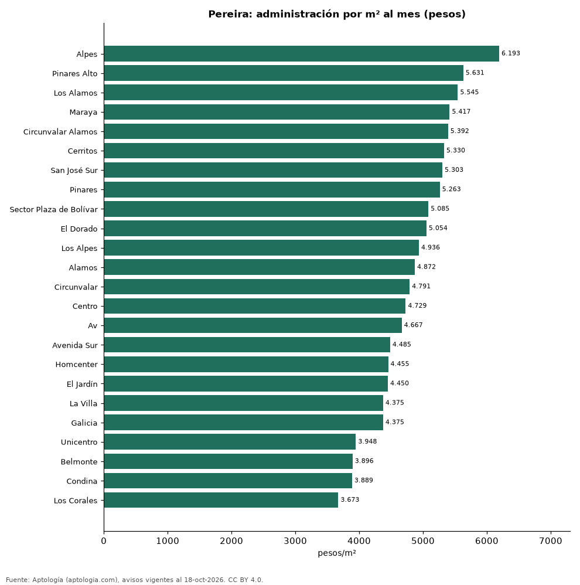

# Cuota de administración en Pereira por barrio: cuánto se paga por m² (octubre 2026)

**En Pereira, la administración más cara por metro cuadrado se paga en Alpes: 6.193 pesos por m² al mes en la mediana (637.000 pesos de cuota). La más barata, en Los Corales, con 3.673 pesos por m².** La cuota mediana de toda la ciudad es 398.000 pesos al mes (4.794 pesos por m²).

*Resumen: analizamos la cuota de administración de 3.583 apartamentos en 24 barrios de Pereira con 30 avisos o más.*

**Actualizado:** 18 de octubre de 2026 (datos del 18 de octubre de 2026) · **Próxima actualización:** mensual.

## Resumen

| Indicador | Valor |
|---|---|
| Más cara por m² | Alpes: 6.193 pesos |
| Más barata por m² | Los Corales: 3.673 pesos |
| Cuota mediana de la ciudad | 398.000 pesos |
| Barrios | 24 |

## Administración por barrio

| Barrio | Administración por m² al mes | Cuota mensual (mediana) | Avisos |
|---|---|---|---|
| Alpes | 6.193 pesos | 637.000 pesos | 30 |
| Pinares Alto | 5.631 pesos | 630.000 pesos | 75 |
| Los Alamos | 5.545 pesos | 615.000 pesos | 91 |
| Maraya | 5.417 pesos | 365.500 pesos | 60 |
| Circunvalar Alamos | 5.392 pesos | 480.000 pesos | 30 |
| Cerritos | 5.330 pesos | 500.000 pesos | 234 |
| San José Sur | 5.303 pesos | 450.000 pesos | 33 |
| Pinares | 5.263 pesos | 523.050 pesos | 609 |
| Sector Plaza de Bolívar | 5.085 pesos | 602.700 pesos | 31 |
| El Dorado | 5.054 pesos | 350.000 pesos | 35 |
| Los Alpes | 4.936 pesos | 490.000 pesos | 153 |
| Alamos | 4.872 pesos | 447.000 pesos | 360 |
| Circunvalar | 4.791 pesos | 470.000 pesos | 110 |
| Centro | 4.729 pesos | 587.500 pesos | 146 |
| Av | 4.667 pesos | 303.500 pesos | 41 |
| Avenida Sur | 4.485 pesos | 303.600 pesos | 54 |
| Homcenter | 4.455 pesos | 343.000 pesos | 31 |
| El Jardín | 4.450 pesos | 321.000 pesos | 39 |
| La Villa | 4.375 pesos | 300.000 pesos | 43 |
| Galicia | 4.375 pesos | 300.000 pesos | 145 |
| Unicentro | 3.948 pesos | 270.000 pesos | 42 |
| Belmonte | 3.896 pesos | 280.000 pesos | 77 |
| Condina | 3.889 pesos | 225.000 pesos | 143 |
| Los Corales | 3.673 pesos | 245.000 pesos | 60 |

Medianas; ordenado de mayor a menor administración por m².

## Preguntas frecuentes

**¿Cuánto se paga de administración en Pereira?**
La cuota mediana es 398.000 pesos al mes (4.794 pesos por m²), según avisos de octubre de 2026.

**¿En qué barrio de Pereira es más cara la administración?**
En Alpes: 6.193 pesos por m² al mes.

## Metodología

- **Fuente:** exportes nocturnos de la base de datos de Aptología (aptologia.com) del 18 de octubre de 2026: avisos vigentes de vivienda en portales inmobiliarios de 13 países, recogidos por Aptología y vistos en línea entre el 11 y el 18 de octubre de 2026. Corte: 18 de octubre de 2026.
- **Depuración:** se eliminan duplicados exactos (misma ciudad, zona, tipo, precio, moneda, área, habitaciones y baños) y los precios fuera del percentil 1–99 de cada país, operación, moneda y tipo; el precio por m² usa solo avisos con área declarada entre 12 y 2.000 m² y también se recorta al P1–P99.
- **Qué se mide:** precios pedidos (publicados), no precios de cierre. En arriendo, el canon mensual sin administración, gastos comunes ni condominio.
- **Muestra mínima:** cada cifra publicada se apoya en al menos 30 avisos; las celdas con menos se omiten.
- **Colombia:** Precios en pesos colombianos, sin conversión de moneda.
- **Administración:** cuota mensual declarada en avisos de venta y de arriendo de apartamentos (se unen ambas operaciones porque la cuota es del inmueble, quitando repetidos con la misma ciudad, barrio, cuota, área, habitaciones y baños); se descartan cuotas por debajo de 30.000 o por encima de 6 millones de pesos y razones por m² fuera de 500–40.000 pesos.
- **Limitaciones:** la cobertura depende de los portales que recorre Aptología en cada país y es mayor en las ciudades grandes y en los segmentos medio-alto y alto; el área es la que declara el aviso, sin verificar; los nombres de zona vienen de los portales.
- **Privacidad:** solo se publican agregados; no se publica ningún dato personal, enlace a avisos ni nombre de anunciante.
- **Datos abiertos:** [datos.csv](datos.csv), licencia CC BY 4.0.

## Cómo citar

Pinzón Pineda, D. M. (2026). *Cuota de administración en Pereira por barrio: cuánto se paga por m² (octubre 2026)*. Aptología (aptologia.com). https://github.com/elbroker/aptologia-datos/tree/main/estudios/cuota-de-administracion-pereira-por-barrio-2026. Datos: datos.csv, licencia CC BY 4.0.
