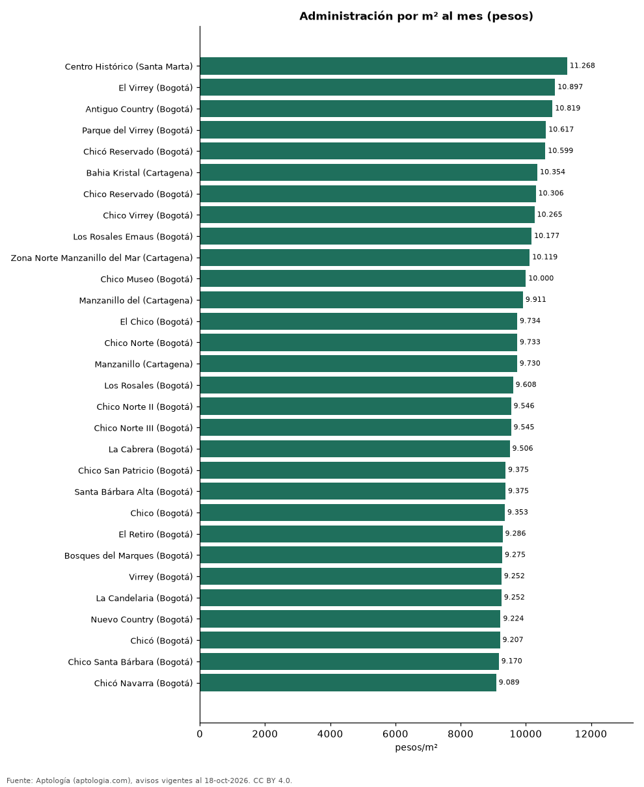

# Los barrios con la administración más cara y más barata de Colombia: ranking de 561 barrios (octubre 2026)

**El barrio de Colombia con la cuota de administración más alta por metro cuadrado es Centro Histórico (Santa Marta): 11.268 pesos por m² al mes en la mediana (625.000 pesos de cuota mensual). La más baja está en Simón Bolívar (Medellín), con 2.009 pesos por m².** De los 40 barrios con la administración más cara por m², 32 están en Bogotá.

*Resumen: analizamos la cuota de administración de 97.227 apartamentos en 561 barrios con 30 avisos o más.*

**Actualizado:** 18 de octubre de 2026 (datos del 18 de octubre de 2026) · **Próxima actualización:** mensual.

## Resumen

| Indicador | Valor |
|---|---|
| Más cara por m² | Centro Histórico (Santa Marta): 11.268 pesos |
| Más barata por m² | Simón Bolívar (Medellín): 2.009 pesos |
| Barrios comparados | 561 |
| Del top 40 en Bogotá | 32 |

## Los 40 barrios con la administración más cara por m²

| Barrio | Ciudad | Administración por m² al mes | Cuota mensual (mediana) | Avisos |
|---|---|---|---|---|
| Centro Histórico | Santa Marta | 11.268 pesos | 625.000 pesos | 30 |
| El Virrey | Bogotá | 10.897 pesos | 1.433.000 pesos | 121 |
| Antiguo Country | Bogotá | 10.819 pesos | 942.000 pesos | 123 |
| Parque del Virrey | Bogotá | 10.617 pesos | 1.200.000 pesos | 67 |
| Chicó Reservado | Bogotá | 10.599 pesos | 1.870.000 pesos | 85 |
| Bahia Kristal | Cartagena | 10.354 pesos | 720.000 pesos | 30 |
| Chico Reservado | Bogotá | 10.306 pesos | 1.576.000 pesos | 444 |
| Chico Virrey | Bogotá | 10.265 pesos | 1.450.000 pesos | 58 |
| Los Rosales Emaus | Bogotá | 10.177 pesos | 1.800.000 pesos | 64 |
| Zona Norte Manzanillo del Mar | Cartagena | 10.119 pesos | 1.050.000 pesos | 31 |
| Chico Museo | Bogotá | 10.000 pesos | 1.861.000 pesos | 78 |
| Manzanillo del | Cartagena | 9.911 pesos | 829.000 pesos | 30 |
| El Chico | Bogotá | 9.734 pesos | 1.430.000 pesos | 221 |
| Chico Norte | Bogotá | 9.733 pesos | 1.200.000 pesos | 1.008 |
| Manzanillo | Cartagena | 9.730 pesos | 763.000 pesos | 128 |
| Los Rosales | Bogotá | 9.608 pesos | 1.910.500 pesos | 922 |
| Chico Norte II | Bogotá | 9.546 pesos | 1.041.350 pesos | 64 |
| Chico Norte III | Bogotá | 9.545 pesos | 917.000 pesos | 125 |
| La Cabrera | Bogotá | 9.506 pesos | 1.900.000 pesos | 425 |
| Chico San Patricio | Bogotá | 9.375 pesos | 1.030.000 pesos | 83 |
| Santa Bárbara Alta | Bogotá | 9.375 pesos | 2.200.000 pesos | 177 |
| Chico | Bogotá | 9.353 pesos | 1.275.000 pesos | 755 |
| El Retiro | Bogotá | 9.286 pesos | 2.100.000 pesos | 55 |
| Bosques del Marques | Bogotá | 9.275 pesos | 2.915.500 pesos | 70 |
| Virrey | Bogotá | 9.252 pesos | 1.180.000 pesos | 84 |
| La Candelaria | Bogotá | 9.252 pesos | 500.000 pesos | 67 |
| Nuevo Country | Bogotá | 9.224 pesos | 717.500 pesos | 50 |
| Chicó | Bogotá | 9.207 pesos | 1.576.000 pesos | 31 |
| Chico Santa Bárbara | Bogotá | 9.170 pesos | 1.000.000 pesos | 39 |
| Chicó Navarra | Bogotá | 9.089 pesos | 1.274.500 pesos | 194 |
| Rosales | Bogotá | 9.078 pesos | 1.800.000 pesos | 466 |
| Cabrera | Bogotá | 9.066 pesos | 1.670.000 pesos | 232 |
| Chapinero | Bogotá | 9.055 pesos | 650.000 pesos | 535 |
| El Nogal | Bogotá | 9.034 pesos | 1.841.500 pesos | 240 |
| Refugio | Bogotá | 9.028 pesos | 1.900.000 pesos | 96 |
| La Boquilla | Cartagena | 9.028 pesos | 990.000 pesos | 333 |
| Las Rosales | Bogotá | 8.978 pesos | 1.800.000 pesos | 122 |
| Castillo Grande | Cartagena | 8.935 pesos | 1.290.000 pesos | 46 |
| Santa Bárbara Occidental | Bogotá | 8.881 pesos | 1.061.700 pesos | 387 |
| Castillogrande | Cartagena | 8.877 pesos | 1.450.000 pesos | 231 |

## Los 20 barrios con la administración más barata por m²

| Barrio | Ciudad | Administración por m² al mes | Cuota mensual (mediana) | Avisos |
|---|---|---|---|---|
| Simón Bolívar | Medellín | 2.009 pesos | 210.000 pesos | 48 |
| Soacha | Soacha | 2.105 pesos | 100.000 pesos | 55 |
| Ciudad Verde | Soacha | 2.404 pesos | 125.000 pesos | 135 |
| Ciudad Guabinas | Cali | 2.543 pesos | 133.255 pesos | 33 |
| Tierra Buena | Bogotá | 2.562 pesos | 128.000 pesos | 32 |
| San Rafael | Zipaquirá | 2.649 pesos | 153.766 pesos | 40 |
| Verganzo | Tocancipá | 2.730 pesos | 155.000 pesos | 159 |
| Barroblanco | Piedecuesta | 2.734 pesos | 150.000 pesos | 33 |
| Centro Tocancipá | Tocancipá | 2.790 pesos | 168.150 pesos | 34 |
| Chipre | Manizales | 2.858 pesos | 207.500 pesos | 64 |
| Puerta Dorada | Barranquilla | 2.982 pesos | 163.088 pesos | 35 |
| San José de Usaquen | Bogotá | 2.985 pesos | 150.000 pesos | 33 |
| San Pedro | Madrid | 2.997 pesos | 147.500 pesos | 44 |
| La Prosperidad | Madrid | 3.105 pesos | 180.000 pesos | 183 |
| La Estancia | Bogotá | 3.183 pesos | 146.200 pesos | 30 |
| Buenos Aires | Medellín | 3.189 pesos | 177.400 pesos | 43 |
| La Soledad | Bogotá | 3.196 pesos | 342.500 pesos | 50 |
| El Tintal | Bogotá | 3.299 pesos | 146.400 pesos | 86 |
| Ternera | Cartagena | 3.299 pesos | 230.000 pesos | 31 |
| San Joaquin | Medellín | 3.300 pesos | 384.000 pesos | 36 |

## Preguntas frecuentes

**¿Dónde se paga la administración más cara de Colombia?**
En Centro Histórico (Santa Marta): 11.268 pesos por m² al mes en la mediana.

**¿Dónde es más barata la administración?**
En Simón Bolívar (Medellín), con 2.009 pesos por m² al mes.

## Metodología

- **Fuente:** exportes nocturnos de la base de datos de Aptología (aptologia.com) del 18 de octubre de 2026: avisos vigentes de vivienda en portales inmobiliarios de 13 países, recogidos por Aptología y vistos en línea entre el 11 y el 18 de octubre de 2026. Corte: 18 de octubre de 2026.
- **Depuración:** se eliminan duplicados exactos (misma ciudad, zona, tipo, precio, moneda, área, habitaciones y baños) y los precios fuera del percentil 1–99 de cada país, operación, moneda y tipo; el precio por m² usa solo avisos con área declarada entre 12 y 2.000 m² y también se recorta al P1–P99.
- **Qué se mide:** precios pedidos (publicados), no precios de cierre. En arriendo, el canon mensual sin administración, gastos comunes ni condominio.
- **Muestra mínima:** cada cifra publicada se apoya en al menos 30 avisos; las celdas con menos se omiten.
- **Colombia:** Precios en pesos colombianos, sin conversión de moneda.
- **Administración:** cuota mensual declarada en avisos de venta y de arriendo de apartamentos (se unen ambas operaciones porque la cuota es del inmueble, quitando repetidos con la misma ciudad, barrio, cuota, área, habitaciones y baños); se descartan cuotas por debajo de 30.000 o por encima de 6 millones de pesos y razones por m² fuera de 500–40.000 pesos.
- **Limitaciones:** la cobertura depende de los portales que recorre Aptología en cada país y es mayor en las ciudades grandes y en los segmentos medio-alto y alto; el área es la que declara el aviso, sin verificar; los nombres de zona vienen de los portales.
- **Privacidad:** solo se publican agregados; no se publica ningún dato personal, enlace a avisos ni nombre de anunciante.
- **Datos abiertos:** [datos.csv](datos.csv), licencia CC BY 4.0.

## Cómo citar

Pinzón Pineda, D. M. (2026). *Los barrios con la administración más cara y más barata de Colombia: ranking de 561 barrios (octubre 2026)*. Aptología (aptologia.com). https://github.com/elbroker/aptologia-datos/tree/main/estudios/cuota-de-administracion-por-barrio-colombia-2026. Datos: datos.csv, licencia CC BY 4.0.
