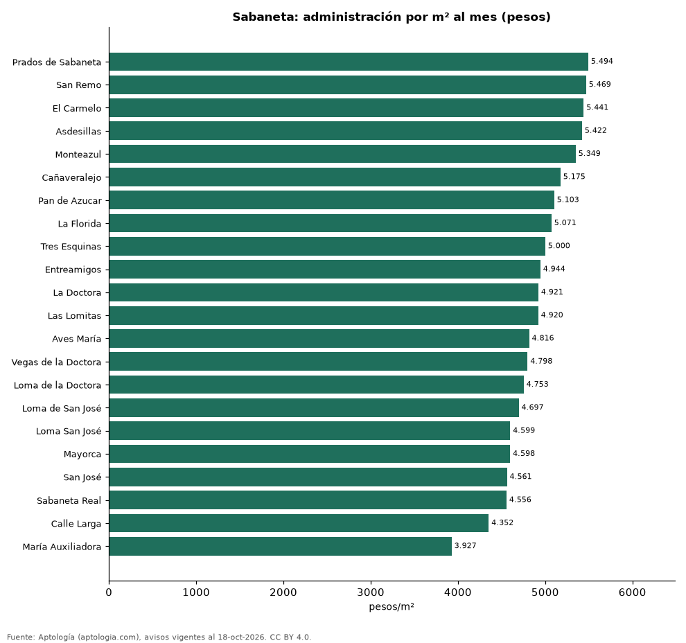

# Cuota de administración en Sabaneta por barrio: cuánto se paga por m² (octubre 2026)

**En Sabaneta, la administración más cara por metro cuadrado se paga en Prados de Sabaneta: 5.494 pesos por m² al mes en la mediana (390.000 pesos de cuota). La más barata, en María Auxiliadora, con 3.927 pesos por m².** La cuota mediana de toda la ciudad es 380.000 pesos al mes (4.890 pesos por m²).

*Resumen: analizamos la cuota de administración de 2.656 apartamentos en 22 barrios de Sabaneta con 30 avisos o más.*

**Actualizado:** 18 de octubre de 2026 (datos del 18 de octubre de 2026) · **Próxima actualización:** mensual.

## Resumen

| Indicador | Valor |
|---|---|
| Más cara por m² | Prados de Sabaneta: 5.494 pesos |
| Más barata por m² | María Auxiliadora: 3.927 pesos |
| Cuota mediana de la ciudad | 380.000 pesos |
| Barrios | 22 |

## Administración por barrio

| Barrio | Administración por m² al mes | Cuota mensual (mediana) | Avisos |
|---|---|---|---|
| Prados de Sabaneta | 5.494 pesos | 390.000 pesos | 30 |
| San Remo | 5.469 pesos | 380.000 pesos | 63 |
| El Carmelo | 5.441 pesos | 426.500 pesos | 34 |
| Asdesillas | 5.422 pesos | 390.000 pesos | 37 |
| Monteazul | 5.349 pesos | 364.100 pesos | 75 |
| Cañaveralejo | 5.175 pesos | 370.000 pesos | 64 |
| Pan de Azucar | 5.103 pesos | 380.000 pesos | 119 |
| La Florida | 5.071 pesos | 364.000 pesos | 45 |
| Tres Esquinas | 5.000 pesos | 360.997 pesos | 53 |
| Entreamigos | 4.944 pesos | 365.000 pesos | 85 |
| La Doctora | 4.921 pesos | 354.500 pesos | 202 |
| Las Lomitas | 4.920 pesos | 400.000 pesos | 305 |
| Aves María | 4.816 pesos | 460.000 pesos | 214 |
| Vegas de la Doctora | 4.798 pesos | 437.500 pesos | 52 |
| Loma de la Doctora | 4.753 pesos | 372.366 pesos | 62 |
| Loma de San José | 4.697 pesos | 370.000 pesos | 90 |
| Loma San José | 4.599 pesos | 372.500 pesos | 48 |
| Mayorca | 4.598 pesos | 348.000 pesos | 39 |
| San José | 4.561 pesos | 365.000 pesos | 211 |
| Sabaneta Real | 4.556 pesos | 352.500 pesos | 42 |
| Calle Larga | 4.352 pesos | 280.000 pesos | 87 |
| María Auxiliadora | 3.927 pesos | 203.000 pesos | 77 |

Medianas; ordenado de mayor a menor administración por m².

## Preguntas frecuentes

**¿Cuánto se paga de administración en Sabaneta?**
La cuota mediana es 380.000 pesos al mes (4.890 pesos por m²), según avisos de octubre de 2026.

**¿En qué barrio de Sabaneta es más cara la administración?**
En Prados de Sabaneta: 5.494 pesos por m² al mes.

## Metodología

- **Fuente:** exportes nocturnos de la base de datos de Aptología (aptologia.com) del 18 de octubre de 2026: avisos vigentes de vivienda en portales inmobiliarios de 13 países, recogidos por Aptología y vistos en línea entre el 11 y el 18 de octubre de 2026. Corte: 18 de octubre de 2026.
- **Depuración:** se eliminan duplicados exactos (misma ciudad, zona, tipo, precio, moneda, área, habitaciones y baños) y los precios fuera del percentil 1–99 de cada país, operación, moneda y tipo; el precio por m² usa solo avisos con área declarada entre 12 y 2.000 m² y también se recorta al P1–P99.
- **Qué se mide:** precios pedidos (publicados), no precios de cierre. En arriendo, el canon mensual sin administración, gastos comunes ni condominio.
- **Muestra mínima:** cada cifra publicada se apoya en al menos 30 avisos; las celdas con menos se omiten.
- **Colombia:** Precios en pesos colombianos, sin conversión de moneda.
- **Administración:** cuota mensual declarada en avisos de venta y de arriendo de apartamentos (se unen ambas operaciones porque la cuota es del inmueble, quitando repetidos con la misma ciudad, barrio, cuota, área, habitaciones y baños); se descartan cuotas por debajo de 30.000 o por encima de 6 millones de pesos y razones por m² fuera de 500–40.000 pesos.
- **Limitaciones:** la cobertura depende de los portales que recorre Aptología en cada país y es mayor en las ciudades grandes y en los segmentos medio-alto y alto; el área es la que declara el aviso, sin verificar; los nombres de zona vienen de los portales.
- **Privacidad:** solo se publican agregados; no se publica ningún dato personal, enlace a avisos ni nombre de anunciante.
- **Datos abiertos:** [datos.csv](datos.csv), licencia CC BY 4.0.

## Cómo citar

Pinzón Pineda, D. M. (2026). *Cuota de administración en Sabaneta por barrio: cuánto se paga por m² (octubre 2026)*. Aptología (aptologia.com). https://github.com/elbroker/aptologia-datos/tree/main/estudios/cuota-de-administracion-sabaneta-por-barrio-2026. Datos: datos.csv, licencia CC BY 4.0.
