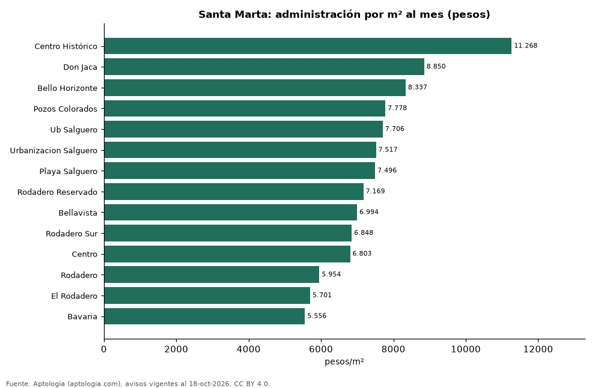

# Cuota de administración en Santa Marta por barrio: cuánto se paga por m² (octubre 2026)

**En Santa Marta, la administración más cara por metro cuadrado se paga en Centro Histórico: 11.268 pesos por m² al mes en la mediana (625.000 pesos de cuota). La más barata, en Bavaria, con 5.556 pesos por m².** La cuota mediana de toda la ciudad es 572.000 pesos al mes (7.060 pesos por m²).

*Resumen: analizamos la cuota de administración de 3.086 apartamentos en 14 barrios de Santa Marta con 30 avisos o más.*

**Actualizado:** 18 de octubre de 2026 (datos del 18 de octubre de 2026) · **Próxima actualización:** mensual.

## Resumen

| Indicador | Valor |
|---|---|
| Más cara por m² | Centro Histórico: 11.268 pesos |
| Más barata por m² | Bavaria: 5.556 pesos |
| Cuota mediana de la ciudad | 572.000 pesos |
| Barrios | 14 |

## Administración por barrio

| Barrio | Administración por m² al mes | Cuota mensual (mediana) | Avisos |
|---|---|---|---|
| Centro Histórico | 11.268 pesos | 625.000 pesos | 30 |
| Don Jaca | 8.850 pesos | 500.000 pesos | 65 |
| Bello Horizonte | 8.337 pesos | 736.000 pesos | 352 |
| Pozos Colorados | 7.778 pesos | 600.000 pesos | 391 |
| Ub Salguero | 7.706 pesos | 592.500 pesos | 90 |
| Urbanizacion Salguero | 7.517 pesos | 640.000 pesos | 136 |
| Playa Salguero | 7.496 pesos | 600.000 pesos | 246 |
| Rodadero Reservado | 7.169 pesos | 591.600 pesos | 48 |
| Bellavista | 6.994 pesos | 800.000 pesos | 96 |
| Rodadero Sur | 6.848 pesos | 530.000 pesos | 211 |
| Centro | 6.803 pesos | 625.000 pesos | 44 |
| Rodadero | 5.954 pesos | 493.500 pesos | 344 |
| El Rodadero | 5.701 pesos | 467.858 pesos | 42 |
| Bavaria | 5.556 pesos | 690.000 pesos | 131 |

Medianas; ordenado de mayor a menor administración por m².

## Preguntas frecuentes

**¿Cuánto se paga de administración en Santa Marta?**
La cuota mediana es 572.000 pesos al mes (7.060 pesos por m²), según avisos de octubre de 2026.

**¿En qué barrio de Santa Marta es más cara la administración?**
En Centro Histórico: 11.268 pesos por m² al mes.

## Metodología

- **Fuente:** exportes nocturnos de la base de datos de Aptología (aptologia.com) del 18 de octubre de 2026: avisos vigentes de vivienda en portales inmobiliarios de 13 países, recogidos por Aptología y vistos en línea entre el 11 y el 18 de octubre de 2026. Corte: 18 de octubre de 2026.
- **Depuración:** se eliminan duplicados exactos (misma ciudad, zona, tipo, precio, moneda, área, habitaciones y baños) y los precios fuera del percentil 1–99 de cada país, operación, moneda y tipo; el precio por m² usa solo avisos con área declarada entre 12 y 2.000 m² y también se recorta al P1–P99.
- **Qué se mide:** precios pedidos (publicados), no precios de cierre. En arriendo, el canon mensual sin administración, gastos comunes ni condominio.
- **Muestra mínima:** cada cifra publicada se apoya en al menos 30 avisos; las celdas con menos se omiten.
- **Colombia:** Precios en pesos colombianos, sin conversión de moneda.
- **Administración:** cuota mensual declarada en avisos de venta y de arriendo de apartamentos (se unen ambas operaciones porque la cuota es del inmueble, quitando repetidos con la misma ciudad, barrio, cuota, área, habitaciones y baños); se descartan cuotas por debajo de 30.000 o por encima de 6 millones de pesos y razones por m² fuera de 500–40.000 pesos.
- **Limitaciones:** la cobertura depende de los portales que recorre Aptología en cada país y es mayor en las ciudades grandes y en los segmentos medio-alto y alto; el área es la que declara el aviso, sin verificar; los nombres de zona vienen de los portales.
- **Privacidad:** solo se publican agregados; no se publica ningún dato personal, enlace a avisos ni nombre de anunciante.
- **Datos abiertos:** [datos.csv](datos.csv), licencia CC BY 4.0.

## Cómo citar

Pinzón Pineda, D. M. (2026). *Cuota de administración en Santa Marta por barrio: cuánto se paga por m² (octubre 2026)*. Aptología (aptologia.com). https://github.com/elbroker/aptologia-datos/tree/main/estudios/cuota-de-administracion-santa-marta-por-barrio-2026. Datos: datos.csv, licencia CC BY 4.0.
