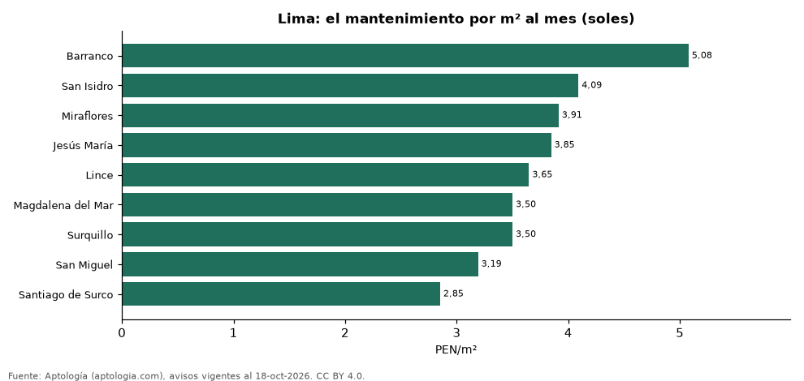

# Cuota de mantenimiento de departamentos en Lima por distrito (octubre 2026)

**En Lima, el mantenimiento de un departamento es en la mediana 280 soles (USD 81,5) al mes (3,52 soles (USD 1,0) por m²). El distrito más caro por m² es Barranco (5,08 soles (USD 1,5)) y el más barato, Santiago de Surco (2,85 soles (USD 0,8)).**

*Resumen: analizamos el mantenimiento declarado en 882 avisos de departamentos en venta y alquiler en 9 distritos de Lima con 30 avisos o más.*

**Actualizado:** 18 de octubre de 2026 (datos del 18 de octubre de 2026) · **Próxima actualización:** mensual.

## Resumen

| Indicador | Valor |
|---|---|
| Mediana mensual | 280 soles (USD 81,5) |
| Mediana por m² | 3,52 soles (USD 1,0) |
| Más cara por m² | Barranco: 5,08 soles (USD 1,5) |
| Más barata por m² | Santiago de Surco: 2,85 soles (USD 0,8) |
| Distritos | 9 |

## El mantenimiento por distrito

| Distrito | El mantenimiento por m² al mes | El mantenimiento mensual (mediana) | Avisos |
|---|---|---|---|
| Barranco | 5,08 soles (USD 1,5) | 330 soles (USD 96,1) | 44 |
| San Isidro | 4,09 soles (USD 1,2) | 500 soles (USD 146) | 100 |
| Miraflores | 3,91 soles (USD 1,1) | 400 soles (USD 116) | 216 |
| Jesús María | 3,85 soles (USD 1,1) | 250 soles (USD 72,8) | 50 |
| Lince | 3,65 soles (USD 1,1) | 245 soles (USD 71,3) | 36 |
| Magdalena del Mar | 3,50 soles (USD 1,0) | 250 soles (USD 72,8) | 49 |
| Surquillo | 3,50 soles (USD 1,0) | 230 soles (USD 66,9) | 33 |
| San Miguel | 3,19 soles (USD 0,9) | 200 soles (USD 58,2) | 57 |
| Santiago de Surco | 2,85 soles (USD 0,8) | 300 soles (USD 87,3) | 138 |

Medianas; ordenado de mayor a menor costo por m². Solo avisos en soles.

## Preguntas frecuentes

**¿Cuánto se paga de el mantenimiento en Lima?**
280 soles (USD 81,5) al mes en la mediana (3,52 soles (USD 1,0) por m²), según avisos de octubre de 2026.

**¿Dónde es más caro?**
En Barranco: 5,08 soles (USD 1,5) por m² al mes en la mediana.

## Metodología

- **Fuente:** exportes nocturnos de la base de datos de Aptología (aptologia.com) del 18 de octubre de 2026: avisos vigentes de vivienda en portales inmobiliarios de 13 países, recogidos por Aptología y vistos en línea entre el 11 y el 18 de octubre de 2026. Corte: 18 de octubre de 2026.
- **Depuración:** se eliminan duplicados exactos (misma ciudad, zona, tipo, precio, moneda, área, habitaciones y baños) y los precios fuera del percentil 1–99 de cada país, operación, moneda y tipo; el precio por m² usa solo avisos con área declarada entre 12 y 2.000 m² y también se recorta al P1–P99.
- **Qué se mide:** precios pedidos (publicados), no precios de cierre. En arriendo, el canon mensual sin administración, gastos comunes ni condominio.
- **Muestra mínima:** cada cifra publicada se apoya en al menos 30 avisos; las celdas con menos se omiten.
- **Monedas:** nunca se mezclan avisos de monedas distintas sin convertirlos. Conversión a dólares con la tasa de mercado de ExchangeRate-API (open.er-api.com, actualización del 18 Oct 2026): 1 USD = 3.182,80 COP, 1 USD = 18,47 M.N, 1 USD = 5,09 BRL, 1 USD = 3,44 PEN, 1 USD = 982,44 CLP, 1 USD = 1.514,57 ARS, 1 USD = 40,20 UYU, 1 USD = 5.705,37 PYG, 1 USD = 61,27 DOP, 1 USD = 0,89 EUR, 1 USD = 11,72 BOB; la UF chilena a 41.178,64 CLP (mindicador,cl. 18-oct-2026). Los avisos publicados en dólares se usan tal cual.
- **Moneda:** solo avisos en soles (la moneda mayoritaria de la cuota); nada se promedia entre monedas.
- **Cuota:** valor mensual de el mantenimiento declarado en avisos de venta y alquiler de departamentos (se unen ambas operaciones porque la cuota es del inmueble, quitando repetidos con la misma zona, cuota, área, habitaciones y baños); la razón por m² se recorta al percentil 1–99.
- **Limitaciones:** la cobertura depende de los portales que recorre Aptología en cada país y es mayor en las ciudades grandes y en los segmentos medio-alto y alto; el área es la que declara el aviso, sin verificar; los nombres de zona vienen de los portales.
- **Privacidad:** solo se publican agregados; no se publica ningún dato personal, enlace a avisos ni nombre de anunciante.
- **Datos abiertos:** [datos.csv](datos.csv), licencia CC BY 4.0.

## Cómo citar

Pinzón Pineda, D. M. (2026). *Cuota de mantenimiento de departamentos en Lima por distrito (octubre 2026)*. Aptología (aptologia.com). https://github.com/elbroker/aptologia-datos/tree/main/estudios/cuota-de-mantenimiento-lima-por-distrito-2026. Datos: datos.csv, licencia CC BY 4.0.
