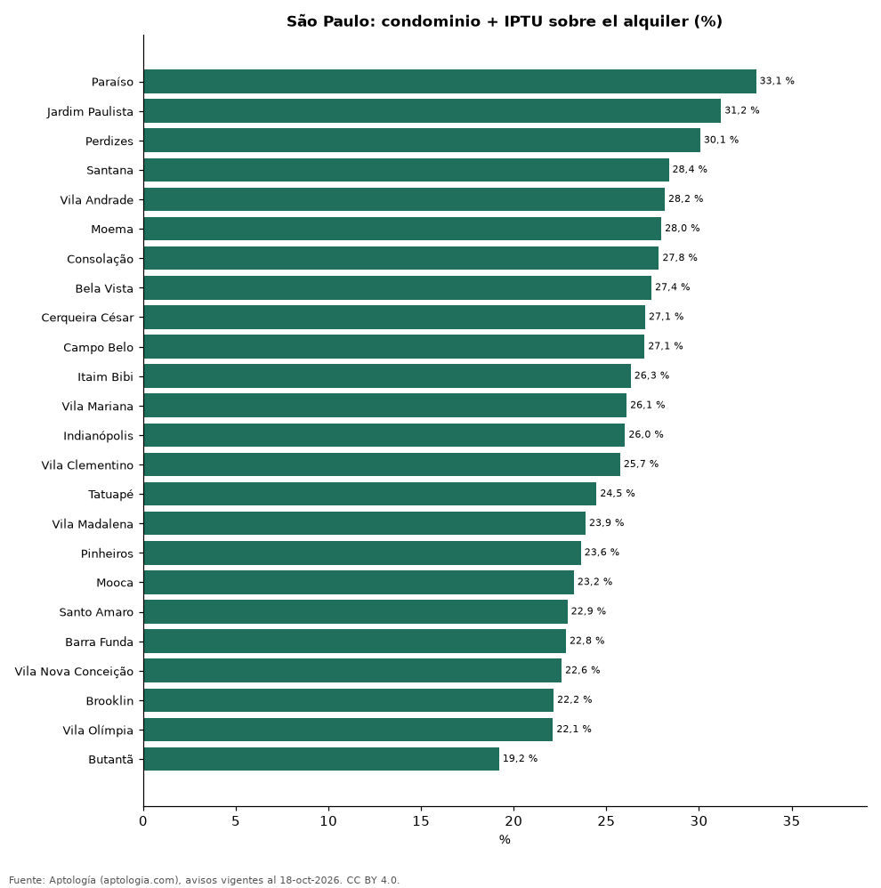

# Cuánto cuesta de verdad alquilar en São Paulo: alquiler, condominio e IPTU por tamaño y zona (octubre 2026)

**En São Paulo, el condominio y el IPTU suman en la mediana un 25,2 % al alquiler de un apartamento: el alquiler mediano es de 3.621 reales (USD 712) y el costo total mediano de 4.753 reales (USD 934) al mes.** El condominio mediano es de 950 reales y el IPTU mensual de 259 reales. La zona donde más pesa el costo extra es Paraíso (33,1 %) y donde menos, Butantã (19,2 %).

*Resumen: analizamos 10.896 apartamentos en alquiler en São Paulo con costo total informado.*

**Actualizado:** 18 de octubre de 2026 (datos del 18 de octubre de 2026) · **Próxima actualización:** mensual.

## Resumen

| Indicador | Valor |
|---|---|
| Alquiler mediano | 3.621 reales (USD 712) |
| Costo total mediano | 4.753 reales (USD 934) |
| Costo extra (mediana) | 25,2 % |
| Condominio mediano | 950 reales |
| IPTU mensual mediano | 259 reales |

## Costo por tamaño (reales al mes, medianas)

| Tamaño | Alquiler | Condominio | IPTU mensual | Costo total | Costo extra sobre el alquiler | Avisos |
|---|---|---|---|---|---|---|
| 1 habitación | 3.000 | 700 | 156 | 3.900 | 23,0 % | 3.185 |
| 2 habitaciones | 3.000 | 738 | 199 | 3.733 | 23,9 % | 4.869 |
| 3 habitaciones o más | 8.000 | 2.200 | 670 | 10.931 | 31,1 % | 2.822 |

Costo total = alquiler + condominio + IPTU, como lo informa el portal (custo total); costo extra = costo total ÷ alquiler − 1 (mediana por aviso).

## Costo extra por zona (100 avisos o más)

| Zona | Costo extra sobre el alquiler | Costo total (mediana, BRL) | Avisos |
|---|---|---|---|
| Paraíso | 33,1 % | 9.864 | 148 |
| Jardim Paulista | 31,2 % | 10.917 | 287 |
| Perdizes | 30,1 % | 7.507 | 228 |
| Santana | 28,4 % | 3.900 | 153 |
| Vila Andrade | 28,2 % | 4.701 | 228 |
| Moema | 28,0 % | 8.387 | 304 |
| Consolação | 27,8 % | 5.180 | 142 |
| Bela Vista | 27,4 % | 4.387 | 191 |
| Cerqueira César | 27,1 % | 11.592 | 136 |
| Campo Belo | 27,1 % | 7.175 | 175 |
| Itaim Bibi | 26,3 % | 12.244 | 304 |
| Vila Mariana | 26,1 % | 6.621 | 258 |
| Indianópolis | 26,0 % | 7.816 | 134 |
| Vila Clementino | 25,7 % | 5.244 | 114 |
| Tatuapé | 24,5 % | 4.286 | 173 |
| Vila Madalena | 23,9 % | 7.815 | 100 |
| Pinheiros | 23,6 % | 7.980 | 506 |
| Mooca | 23,2 % | 3.052 | 192 |
| Santo Amaro | 22,9 % | 5.351 | 140 |
| Barra Funda | 22,8 % | 3.300 | 115 |
| Vila Nova Conceição | 22,6 % | 12.388 | 186 |
| Brooklin | 22,2 % | 9.198 | 316 |
| Vila Olímpia | 22,1 % | 9.002 | 416 |
| Butantã | 19,2 % | 4.180 | 121 |

## Preguntas frecuentes

**¿Cuánto se paga de condominio e IPTU en São Paulo?**
En la mediana, 950 reales de condominio y 259 reales de IPTU al mes; juntos suman un 25,2 % al alquiler.

**¿Cuál es el costo total de alquilar un apartamento de 2 habitaciones en São Paulo?**
3.733 reales (USD 734) al mes en la mediana.

## Metodología

- **Fuente:** exportes nocturnos de la base de datos de Aptología (aptologia.com) del 18 de octubre de 2026: avisos vigentes de vivienda en portales inmobiliarios de 13 países, recogidos por Aptología y vistos en línea entre el 11 y el 18 de octubre de 2026. Corte: 18 de octubre de 2026.
- **Depuración:** se eliminan duplicados exactos (misma ciudad, zona, tipo, precio, moneda, área, habitaciones y baños) y los precios fuera del percentil 1–99 de cada país, operación, moneda y tipo; el precio por m² usa solo avisos con área declarada entre 12 y 2.000 m² y también se recorta al P1–P99.
- **Qué se mide:** precios pedidos (publicados), no precios de cierre. En arriendo, el canon mensual sin administración, gastos comunes ni condominio.
- **Muestra mínima:** cada cifra publicada se apoya en al menos 30 avisos; las celdas con menos se omiten.
- **Monedas:** nunca se mezclan avisos de monedas distintas sin convertirlos. Conversión a dólares con la tasa de mercado de ExchangeRate-API (open.er-api.com, actualización del 18 Oct 2026): 1 USD = 3.182,80 COP, 1 USD = 18,47 M.N, 1 USD = 5,09 BRL, 1 USD = 3,44 PEN, 1 USD = 982,44 CLP, 1 USD = 1.514,57 ARS, 1 USD = 40,20 UYU, 1 USD = 5.705,37 PYG, 1 USD = 61,27 DOP, 1 USD = 0,89 EUR, 1 USD = 11,72 BOB; la UF chilena a 41.178,64 CLP (mindicador,cl. 18-oct-2026). Los avisos publicados en dólares se usan tal cual.
- **Moneda:** reales (BRL); equivalencias en dólares con la tasa citada. Condominio e IPTU mensual informados por el portal.
- **Limitaciones:** la cobertura depende de los portales que recorre Aptología en cada país y es mayor en las ciudades grandes y en los segmentos medio-alto y alto; el área es la que declara el aviso, sin verificar; los nombres de zona vienen de los portales.
- **Privacidad:** solo se publican agregados; no se publica ningún dato personal, enlace a avisos ni nombre de anunciante.
- **Datos abiertos:** [datos.csv](datos.csv), licencia CC BY 4.0.

## Cómo citar

Pinzón Pineda, D. M. (2026). *Cuánto cuesta de verdad alquilar en São Paulo: alquiler, condominio e IPTU por tamaño y zona (octubre 2026)*. Aptología (aptologia.com). https://github.com/elbroker/aptologia-datos/tree/main/estudios/custo-total-do-aluguel-condominio-iptu-sao-paulo-2026. Datos: datos.csv, licencia CC BY 4.0.
