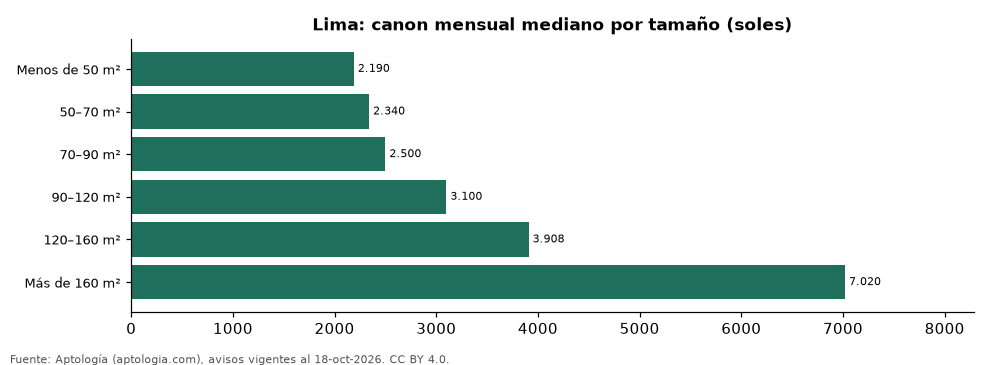

# Departamentos en alquiler en Lima según tamaño: precio y m² de cada grupo (octubre 2026)

**En Lima, un departamento en alquiler del grupo «Menos de 50 m²» se pide en 2.190 soles (USD 637) al mes en la mediana y uno del grupo «Más de 160 m²» en 7.020 soles (USD 2.043) al mes (+220,5 %).** Por metro cuadrado, el más barato es «120–160 m²» (29,8 soles (USD 8,7)/m² al mes) y el más caro «Menos de 50 m²» (52,1 soles (USD 15,2)/m² al mes).

*Resumen: analizamos 3.001 departamentos en alquiler en Lima con tamaño declarado.*

**Actualizado:** 18 de octubre de 2026 (datos del 18 de octubre de 2026) · **Próxima actualización:** mensual.

## Resumen

| Indicador | Valor |
|---|---|
| Menos de 50 m² | 2.190 soles (USD 637) |
| 50–70 m² | 2.340 soles (USD 681) |
| 70–90 m² | 2.500 soles (USD 728) |
| 90–120 m² | 3.100 soles (USD 902) |
| 120–160 m² | 3.908 soles (USD 1.138) |
| Más de 160 m² | 7.020 soles (USD 2.043) |
| Avisos | 3.001 |

## Canon mensual y m² por tamaño

| Tamaño | Canon mensual (mediana) | Rango típico (P25–P75) | Por m² (mediana) | Área mediana (m²) | Avisos |
|---|---|---|---|---|---|
| Menos de 50 m² | 2.190 soles (USD 637) | 1.750 soles (USD 509) – 2.500 soles (USD 728) | 52,1 soles (USD 15,2) | 43 | 233 |
| 50–70 m² | 2.340 soles (USD 681) | 1.850 soles (USD 538) – 2.800 soles (USD 815) | 39,7 soles (USD 11,6) | 60 | 517 |
| 70–90 m² | 2.500 soles (USD 728) | 2.000 soles (USD 582) – 3.000 soles (USD 873) | 31,8 soles (USD 9,2) | 79 | 523 |
| 90–120 m² | 3.100 soles (USD 902) | 2.600 soles (USD 757) – 3.797 soles (USD 1.105) | 30,3 soles (USD 8,8) | 100 | 591 |
| 120–160 m² | 3.908 soles (USD 1.138) | 3.131 soles (USD 911) – 4.820 soles (USD 1.403) | 29,8 soles (USD 8,7) | 130 | 468 |
| Más de 160 m² | 7.020 soles (USD 2.043) | 5.320 soles (USD 1.549) – 9.925 soles (USD 2.889) | 31,0 soles (USD 9,0) | 220 | 669 |

Medianas del canon pedido, sin administración ni gastos comunes; grupos con menos de 30 avisos se omiten.

## Preguntas frecuentes

**¿Cuánto cuesta alquilar un departamento de qué tamaño en Lima?**
Menos de 50 m²: 2.190 soles (USD 637) al mes; 50–70 m²: 2.340 soles (USD 681) al mes; 70–90 m²: 2.500 soles (USD 728) al mes; 90–120 m²: 3.100 soles (USD 902) al mes; 120–160 m²: 3.908 soles (USD 1.138) al mes; Más de 160 m²: 7.020 soles (USD 2.043) al mes (medianas de octubre de 2026).

**¿Qué grupo sale más barato por m²?**
Por metro cuadrado, el más barato es «120–160 m²» (29,8 soles (USD 8,7)/m² al mes) y el más caro «Menos de 50 m²» (52,1 soles (USD 15,2)/m² al mes).

## Metodología

- **Fuente:** exportes nocturnos de la base de datos de Aptología (aptologia.com) del 18 de octubre de 2026: avisos vigentes de vivienda en portales inmobiliarios de 13 países, recogidos por Aptología y vistos en línea entre el 11 y el 18 de octubre de 2026. Corte: 18 de octubre de 2026.
- **Depuración:** se eliminan duplicados exactos (misma ciudad, zona, tipo, precio, moneda, área, habitaciones y baños) y los precios fuera del percentil 1–99 de cada país, operación, moneda y tipo; el precio por m² usa solo avisos con área declarada entre 12 y 2.000 m² y también se recorta al P1–P99.
- **Qué se mide:** precios pedidos (publicados), no precios de cierre. En arriendo, el canon mensual sin administración, gastos comunes ni condominio.
- **Muestra mínima:** cada cifra publicada se apoya en al menos 30 avisos; las celdas con menos se omiten.
- **Monedas:** nunca se mezclan avisos de monedas distintas sin convertirlos. Conversión a dólares con la tasa de mercado de ExchangeRate-API (open.er-api.com, actualización del 18 Oct 2026): 1 USD = 3.182,80 COP, 1 USD = 18,47 M.N, 1 USD = 5,09 BRL, 1 USD = 3,44 PEN, 1 USD = 982,44 CLP, 1 USD = 1.514,57 ARS, 1 USD = 40,20 UYU, 1 USD = 5.705,37 PYG, 1 USD = 61,27 DOP, 1 USD = 0,89 EUR, 1 USD = 11,72 BOB; la UF chilena a 41.178,64 CLP (mindicador,cl. 18-oct-2026). Los avisos publicados en dólares se usan tal cual.
- **Monedas:** en cada ciudad y operación se usa solo la moneda mayoritaria de los avisos (los avisos en otra moneda se excluyen) y la mediana se convierte a dólares con la tasa citada; nunca se promedian avisos de monedas distintas.
- **Cordura:** solo se publica si la mediana crece con tamaño.
- **Limitaciones:** la cobertura depende de los portales que recorre Aptología en cada país y es mayor en las ciudades grandes y en los segmentos medio-alto y alto; el área es la que declara el aviso, sin verificar; los nombres de zona vienen de los portales.
- **Privacidad:** solo se publican agregados; no se publica ningún dato personal, enlace a avisos ni nombre de anunciante.
- **Datos abiertos:** [datos.csv](datos.csv), licencia CC BY 4.0.

## Cómo citar

Pinzón Pineda, D. M. (2026). *Departamentos en alquiler en Lima según tamaño: precio y m² de cada grupo (octubre 2026)*. Aptología (aptologia.com). https://github.com/elbroker/aptologia-datos/tree/main/estudios/departamentos-en-alquiler-por-tamano-lima-2026. Datos: datos.csv, licencia CC BY 4.0.
