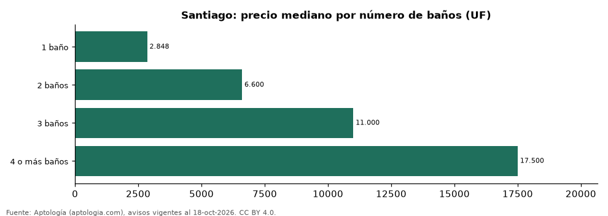

# Departamentos en venta en Santiago según número de baños: precio y m² de cada grupo (octubre 2026)

**En Santiago, un departamento en venta del grupo «1 baño» se pide en 2.848 UF (USD 119.394) en la mediana y uno del grupo «4 o más baños» en 17.500 UF (USD 733.509) (+514,4 %).** Por metro cuadrado, el más barato es «1 baño» (71 UF (USD 2.969)/m²) y el más caro «3 baños» (82 UF (USD 3.443)/m²).

*Resumen: analizamos 7.851 departamentos en venta en Santiago con número de baños declarado.*

**Actualizado:** 18 de octubre de 2026 (datos del 18 de octubre de 2026) · **Próxima actualización:** mensual.

## Resumen

| Indicador | Valor |
|---|---|
| 1 baño | 2.848 UF (USD 119.394) |
| 2 baños | 6.600 UF (USD 276.638) |
| 3 baños | 11.000 UF (USD 461.063) |
| 4 o más baños | 17.500 UF (USD 733.509) |
| Avisos | 7.851 |

## Precio y m² por número de baños

| Número de baños | Precio (mediana) | Rango típico (P25–P75) | Por m² (mediana) | Área mediana (m²) | Avisos |
|---|---|---|---|---|---|
| 1 baño | 2.848 UF (USD 119.394) | 2.047 UF (USD 85.810) – 4.251 UF (USD 178.190) | 71 UF (USD 2.969) | 42 | 2.120 |
| 2 baños | 6.600 UF (USD 276.638) | 4.034 UF (USD 169.084) – 8.800 UF (USD 368.850) | 80 UF (USD 3.344) | 77 | 3.254 |
| 3 baños | 11.000 UF (USD 461.063) | 9.200 UF (USD 385.616) – 13.495 UF (USD 565.640) | 82 UF (USD 3.443) | 130 | 1.743 |
| 4 o más baños | 17.500 UF (USD 733.509) | 13.500 UF (USD 565.850) – 22.500 UF (USD 943.083) | 78 UF (USD 3.263) | 230 | 734 |

Medianas del precio pedido; grupos con menos de 30 avisos se omiten.

## Preguntas frecuentes

**¿Cuánto cuesta comprar un departamento con cuántos baños en Santiago?**
1 baño: 2.848 UF (USD 119.394); 2 baños: 6.600 UF (USD 276.638); 3 baños: 11.000 UF (USD 461.063); 4 o más baños: 17.500 UF (USD 733.509) (medianas de octubre de 2026).

**¿Qué grupo sale más barato por m²?**
Por metro cuadrado, el más barato es «1 baño» (71 UF (USD 2.969)/m²) y el más caro «3 baños» (82 UF (USD 3.443)/m²).

## Metodología

- **Fuente:** exportes nocturnos de la base de datos de Aptología (aptologia.com) del 18 de octubre de 2026: avisos vigentes de vivienda en portales inmobiliarios de 13 países, recogidos por Aptología y vistos en línea entre el 11 y el 18 de octubre de 2026. Corte: 18 de octubre de 2026.
- **Depuración:** se eliminan duplicados exactos (misma ciudad, zona, tipo, precio, moneda, área, habitaciones y baños) y los precios fuera del percentil 1–99 de cada país, operación, moneda y tipo; el precio por m² usa solo avisos con área declarada entre 12 y 2.000 m² y también se recorta al P1–P99.
- **Qué se mide:** precios pedidos (publicados), no precios de cierre. En arriendo, el canon mensual sin administración, gastos comunes ni condominio.
- **Muestra mínima:** cada cifra publicada se apoya en al menos 30 avisos; las celdas con menos se omiten.
- **Monedas:** nunca se mezclan avisos de monedas distintas sin convertirlos. Conversión a dólares con la tasa de mercado de ExchangeRate-API (open.er-api.com, actualización del 18 Oct 2026): 1 USD = 3.182,80 COP, 1 USD = 18,47 M.N, 1 USD = 5,09 BRL, 1 USD = 3,44 PEN, 1 USD = 982,44 CLP, 1 USD = 1.514,57 ARS, 1 USD = 40,20 UYU, 1 USD = 5.705,37 PYG, 1 USD = 61,27 DOP, 1 USD = 0,89 EUR, 1 USD = 11,72 BOB; la UF chilena a 41.178,64 CLP (mindicador,cl. 18-oct-2026). Los avisos publicados en dólares se usan tal cual.
- **Monedas:** en cada ciudad y operación se usa solo la moneda mayoritaria de los avisos (los avisos en otra moneda se excluyen) y la mediana se convierte a dólares con la tasa citada; nunca se promedian avisos de monedas distintas.
- **Cordura:** solo se publica si la mediana crece con número de baños.
- **Limitaciones:** la cobertura depende de los portales que recorre Aptología en cada país y es mayor en las ciudades grandes y en los segmentos medio-alto y alto; el área es la que declara el aviso, sin verificar; los nombres de zona vienen de los portales.
- **Privacidad:** solo se publican agregados; no se publica ningún dato personal, enlace a avisos ni nombre de anunciante.
- **Datos abiertos:** [datos.csv](datos.csv), licencia CC BY 4.0.

## Cómo citar

Pinzón Pineda, D. M. (2026). *Departamentos en venta en Santiago según número de baños: precio y m² de cada grupo (octubre 2026)*. Aptología (aptologia.com). https://github.com/elbroker/aptologia-datos/tree/main/estudios/departamentos-en-venta-por-numero-de-banos-santiago-chile-2026. Datos: datos.csv, licencia CC BY 4.0.
