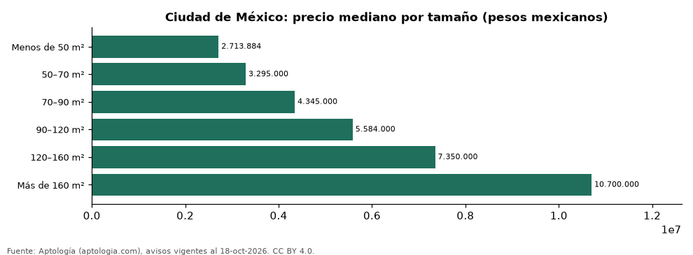

# Departamentos en venta en Ciudad de México según tamaño: precio y m² de cada grupo (octubre 2026)

**En Ciudad de México, un departamento en venta del grupo «Menos de 50 m²» se pide en 2.713.884 pesos mexicanos (USD 146.971) en la mediana y uno del grupo «Más de 160 m²» en 10.700.000 pesos mexicanos (USD 579.461) (+294,3 %).** Por metro cuadrado, el más barato es «Más de 160 m²» (48.611 pesos mexicanos (USD 2.633)/m²) y el más caro «Menos de 50 m²» (67.398 pesos mexicanos (USD 3.650)/m²).

*Resumen: analizamos 7.673 departamentos en venta en Ciudad de México con tamaño declarado.*

**Actualizado:** 18 de octubre de 2026 (datos del 18 de octubre de 2026) · **Próxima actualización:** mensual.

## Resumen

| Indicador | Valor |
|---|---|
| Menos de 50 m² | 2.713.884 pesos mexicanos (USD 146.971) |
| 50–70 m² | 3.295.000 pesos mexicanos (USD 178.441) |
| 70–90 m² | 4.345.000 pesos mexicanos (USD 235.304) |
| 90–120 m² | 5.584.000 pesos mexicanos (USD 302.403) |
| 120–160 m² | 7.350.000 pesos mexicanos (USD 398.041) |
| Más de 160 m² | 10.700.000 pesos mexicanos (USD 579.461) |
| Avisos | 7.673 |

## Precio y m² por tamaño

| Tamaño | Precio (mediana) | Rango típico (P25–P75) | Por m² (mediana) | Área mediana (m²) | Avisos |
|---|---|---|---|---|---|
| Menos de 50 m² | 2.713.884 pesos mexicanos (USD 146.971) | 2.100.000 pesos mexicanos (USD 113.726) – 3.209.152 pesos mexicanos (USD 173.792) | 67.398 pesos mexicanos (USD 3.650) | 43 | 287 |
| 50–70 m² | 3.295.000 pesos mexicanos (USD 178.441) | 2.604.603 pesos mexicanos (USD 141.053) – 4.030.756 pesos mexicanos (USD 218.286) | 53.167 pesos mexicanos (USD 2.879) | 63 | 1.544 |
| 70–90 m² | 4.345.000 pesos mexicanos (USD 235.304) | 3.500.000 pesos mexicanos (USD 189.543) – 5.338.682 pesos mexicanos (USD 289.117) | 55.835 pesos mexicanos (USD 3.024) | 78 | 2.007 |
| 90–120 m² | 5.584.000 pesos mexicanos (USD 302.403) | 4.500.006 pesos mexicanos (USD 243.699) – 6.632.085 pesos mexicanos (USD 359.162) | 53.774 pesos mexicanos (USD 2.912) | 103 | 1.601 |
| 120–160 m² | 7.350.000 pesos mexicanos (USD 398.041) | 5.950.000 pesos mexicanos (USD 322.223) – 8.700.000 pesos mexicanos (USD 471.150) | 53.333 pesos mexicanos (USD 2.888) | 136 | 1.128 |
| Más de 160 m² | 10.700.000 pesos mexicanos (USD 579.461) | 8.261.636 pesos mexicanos (USD 447.410) – 14.339.877 pesos mexicanos (USD 776.579) | 48.611 pesos mexicanos (USD 2.633) | 210 | 1.106 |

Medianas del precio pedido; grupos con menos de 30 avisos se omiten.

## Preguntas frecuentes

**¿Cuánto cuesta comprar un departamento de qué tamaño en Ciudad de México?**
Menos de 50 m²: 2.713.884 pesos mexicanos (USD 146.971); 50–70 m²: 3.295.000 pesos mexicanos (USD 178.441); 70–90 m²: 4.345.000 pesos mexicanos (USD 235.304); 90–120 m²: 5.584.000 pesos mexicanos (USD 302.403); 120–160 m²: 7.350.000 pesos mexicanos (USD 398.041); Más de 160 m²: 10.700.000 pesos mexicanos (USD 579.461) (medianas de octubre de 2026).

**¿Qué grupo sale más barato por m²?**
Por metro cuadrado, el más barato es «Más de 160 m²» (48.611 pesos mexicanos (USD 2.633)/m²) y el más caro «Menos de 50 m²» (67.398 pesos mexicanos (USD 3.650)/m²).

## Metodología

- **Fuente:** exportes nocturnos de la base de datos de Aptología (aptologia.com) del 18 de octubre de 2026: avisos vigentes de vivienda en portales inmobiliarios de 13 países, recogidos por Aptología y vistos en línea entre el 11 y el 18 de octubre de 2026. Corte: 18 de octubre de 2026.
- **Depuración:** se eliminan duplicados exactos (misma ciudad, zona, tipo, precio, moneda, área, habitaciones y baños) y los precios fuera del percentil 1–99 de cada país, operación, moneda y tipo; el precio por m² usa solo avisos con área declarada entre 12 y 2.000 m² y también se recorta al P1–P99.
- **Qué se mide:** precios pedidos (publicados), no precios de cierre. En arriendo, el canon mensual sin administración, gastos comunes ni condominio.
- **Muestra mínima:** cada cifra publicada se apoya en al menos 30 avisos; las celdas con menos se omiten.
- **Monedas:** nunca se mezclan avisos de monedas distintas sin convertirlos. Conversión a dólares con la tasa de mercado de ExchangeRate-API (open.er-api.com, actualización del 18 Oct 2026): 1 USD = 3.182,80 COP, 1 USD = 18,47 M.N, 1 USD = 5,09 BRL, 1 USD = 3,44 PEN, 1 USD = 982,44 CLP, 1 USD = 1.514,57 ARS, 1 USD = 40,20 UYU, 1 USD = 5.705,37 PYG, 1 USD = 61,27 DOP, 1 USD = 0,89 EUR, 1 USD = 11,72 BOB; la UF chilena a 41.178,64 CLP (mindicador,cl. 18-oct-2026). Los avisos publicados en dólares se usan tal cual.
- **Monedas:** en cada ciudad y operación se usa solo la moneda mayoritaria de los avisos (los avisos en otra moneda se excluyen) y la mediana se convierte a dólares con la tasa citada; nunca se promedian avisos de monedas distintas.
- **Cordura:** solo se publica si la mediana crece con tamaño.
- **Limitaciones:** la cobertura depende de los portales que recorre Aptología en cada país y es mayor en las ciudades grandes y en los segmentos medio-alto y alto; el área es la que declara el aviso, sin verificar; los nombres de zona vienen de los portales.
- **Privacidad:** solo se publican agregados; no se publica ningún dato personal, enlace a avisos ni nombre de anunciante.
- **Datos abiertos:** [datos.csv](datos.csv), licencia CC BY 4.0.

## Cómo citar

Pinzón Pineda, D. M. (2026). *Departamentos en venta en Ciudad de México según tamaño: precio y m² de cada grupo (octubre 2026)*. Aptología (aptologia.com). https://github.com/elbroker/aptologia-datos/tree/main/estudios/departamentos-en-venta-por-tamano-ciudad-de-mexico-2026. Datos: datos.csv, licencia CC BY 4.0.
