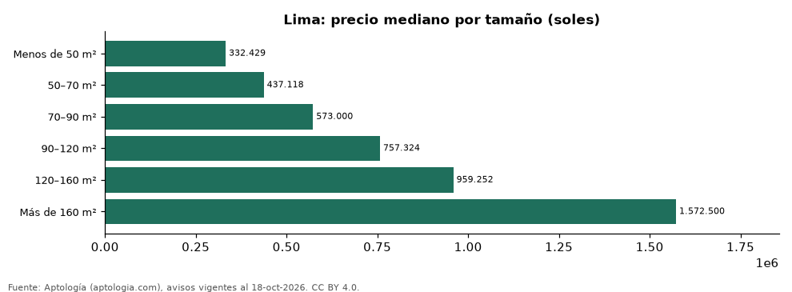

# Departamentos en venta en Lima según tamaño: precio y m² de cada grupo (octubre 2026)

**En Lima, un departamento en venta del grupo «Menos de 50 m²» se pide en 332.429 soles (USD 96.762) en la mediana y uno del grupo «Más de 160 m²» en 1.572.500 soles (USD 457.718) (+373,0 %).** Por metro cuadrado, el más barato es «Más de 160 m²» (7.000 soles (USD 2.037)/m²) y el más caro «Menos de 50 m²» (8.050 soles (USD 2.343)/m²).

*Resumen: analizamos 6.254 departamentos en venta en Lima con tamaño declarado.*

**Actualizado:** 18 de octubre de 2026 (datos del 18 de octubre de 2026) · **Próxima actualización:** mensual.

## Resumen

| Indicador | Valor |
|---|---|
| Menos de 50 m² | 332.429 soles (USD 96.762) |
| 50–70 m² | 437.118 soles (USD 127.235) |
| 70–90 m² | 573.000 soles (USD 166.787) |
| 90–120 m² | 757.324 soles (USD 220.439) |
| 120–160 m² | 959.252 soles (USD 279.216) |
| Más de 160 m² | 1.572.500 soles (USD 457.718) |
| Avisos | 6.254 |

## Precio y m² por tamaño

| Tamaño | Precio (mediana) | Rango típico (P25–P75) | Por m² (mediana) | Área mediana (m²) | Avisos |
|---|---|---|---|---|---|
| Menos de 50 m² | 332.429 soles (USD 96.762) | 279.000 soles (USD 81.210) – 394.000 soles (USD 114.684) | 8.050 soles (USD 2.343) | 41 | 644 |
| 50–70 m² | 437.118 soles (USD 127.235) | 371.851 soles (USD 108.237) – 520.600 soles (USD 151.534) | 7.339 soles (USD 2.136) | 60 | 1.493 |
| 70–90 m² | 573.000 soles (USD 166.787) | 469.000 soles (USD 136.515) – 693.938 soles (USD 201.989) | 7.389 soles (USD 2.151) | 78 | 1.266 |
| 90–120 m² | 757.324 soles (USD 220.439) | 610.000 soles (USD 177.557) – 915.188 soles (USD 266.389) | 7.380 soles (USD 2.148) | 102 | 1.052 |
| 120–160 m² | 959.252 soles (USD 279.216) | 775.000 soles (USD 225.584) – 1.151.550 soles (USD 335.189) | 7.237 soles (USD 2.107) | 135 | 724 |
| Más de 160 m² | 1.572.500 soles (USD 457.718) | 1.226.500 soles (USD 357.005) – 2.135.755 soles (USD 621.668) | 7.000 soles (USD 2.037) | 215 | 1.075 |

Medianas del precio pedido; grupos con menos de 30 avisos se omiten.

## Preguntas frecuentes

**¿Cuánto cuesta comprar un departamento de qué tamaño en Lima?**
Menos de 50 m²: 332.429 soles (USD 96.762); 50–70 m²: 437.118 soles (USD 127.235); 70–90 m²: 573.000 soles (USD 166.787); 90–120 m²: 757.324 soles (USD 220.439); 120–160 m²: 959.252 soles (USD 279.216); Más de 160 m²: 1.572.500 soles (USD 457.718) (medianas de octubre de 2026).

**¿Qué grupo sale más barato por m²?**
Por metro cuadrado, el más barato es «Más de 160 m²» (7.000 soles (USD 2.037)/m²) y el más caro «Menos de 50 m²» (8.050 soles (USD 2.343)/m²).

## Metodología

- **Fuente:** exportes nocturnos de la base de datos de Aptología (aptologia.com) del 18 de octubre de 2026: avisos vigentes de vivienda en portales inmobiliarios de 13 países, recogidos por Aptología y vistos en línea entre el 11 y el 18 de octubre de 2026. Corte: 18 de octubre de 2026.
- **Depuración:** se eliminan duplicados exactos (misma ciudad, zona, tipo, precio, moneda, área, habitaciones y baños) y los precios fuera del percentil 1–99 de cada país, operación, moneda y tipo; el precio por m² usa solo avisos con área declarada entre 12 y 2.000 m² y también se recorta al P1–P99.
- **Qué se mide:** precios pedidos (publicados), no precios de cierre. En arriendo, el canon mensual sin administración, gastos comunes ni condominio.
- **Muestra mínima:** cada cifra publicada se apoya en al menos 30 avisos; las celdas con menos se omiten.
- **Monedas:** nunca se mezclan avisos de monedas distintas sin convertirlos. Conversión a dólares con la tasa de mercado de ExchangeRate-API (open.er-api.com, actualización del 18 Oct 2026): 1 USD = 3.182,80 COP, 1 USD = 18,47 M.N, 1 USD = 5,09 BRL, 1 USD = 3,44 PEN, 1 USD = 982,44 CLP, 1 USD = 1.514,57 ARS, 1 USD = 40,20 UYU, 1 USD = 5.705,37 PYG, 1 USD = 61,27 DOP, 1 USD = 0,89 EUR, 1 USD = 11,72 BOB; la UF chilena a 41.178,64 CLP (mindicador,cl. 18-oct-2026). Los avisos publicados en dólares se usan tal cual.
- **Monedas:** en cada ciudad y operación se usa solo la moneda mayoritaria de los avisos (los avisos en otra moneda se excluyen) y la mediana se convierte a dólares con la tasa citada; nunca se promedian avisos de monedas distintas.
- **Cordura:** solo se publica si la mediana crece con tamaño.
- **Limitaciones:** la cobertura depende de los portales que recorre Aptología en cada país y es mayor en las ciudades grandes y en los segmentos medio-alto y alto; el área es la que declara el aviso, sin verificar; los nombres de zona vienen de los portales.
- **Privacidad:** solo se publican agregados; no se publica ningún dato personal, enlace a avisos ni nombre de anunciante.
- **Datos abiertos:** [datos.csv](datos.csv), licencia CC BY 4.0.

## Cómo citar

Pinzón Pineda, D. M. (2026). *Departamentos en venta en Lima según tamaño: precio y m² de cada grupo (octubre 2026)*. Aptología (aptologia.com). https://github.com/elbroker/aptologia-datos/tree/main/estudios/departamentos-en-venta-por-tamano-lima-2026. Datos: datos.csv, licencia CC BY 4.0.
