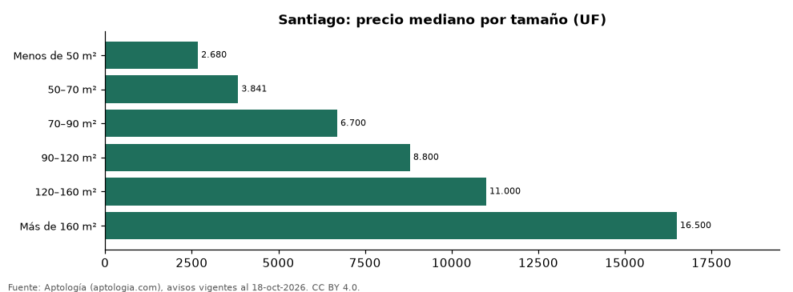

# Departamentos en venta en Santiago según tamaño: precio y m² de cada grupo (octubre 2026)

**En Santiago, un departamento en venta del grupo «Menos de 50 m²» se pide en 2.680 UF (USD 112.332) en la mediana y uno del grupo «Más de 160 m²» en 16.500 UF (USD 691.594) (+515,7 %).** Por metro cuadrado, el más barato es «50–70 m²» (67 UF (USD 2.821)/m²) y el más caro «90–120 m²» (85 UF (USD 3.576)/m²).

*Resumen: analizamos 5.833 departamentos en venta en Santiago con tamaño declarado.*

**Actualizado:** 18 de octubre de 2026 (datos del 18 de octubre de 2026) · **Próxima actualización:** mensual.

## Resumen

| Indicador | Valor |
|---|---|
| Menos de 50 m² | 2.680 UF (USD 112.332) |
| 50–70 m² | 3.841 UF (USD 160.987) |
| 70–90 m² | 6.700 UF (USD 280.829) |
| 90–120 m² | 8.800 UF (USD 368.850) |
| 120–160 m² | 11.000 UF (USD 461.063) |
| Más de 160 m² | 16.500 UF (USD 691.594) |
| Avisos | 5.833 |

## Precio y m² por tamaño

| Tamaño | Precio (mediana) | Rango típico (P25–P75) | Por m² (mediana) | Área mediana (m²) | Avisos |
|---|---|---|---|---|---|
| Menos de 50 m² | 2.680 UF (USD 112.332) | 1.920 UF (USD 80.476) – 3.700 UF (USD 155.085) | 74 UF (USD 3.095) | 39 | 1.341 |
| 50–70 m² | 3.841 UF (USD 160.987) | 2.800 UF (USD 117.361) – 5.725 UF (USD 239.962) | 67 UF (USD 2.821) | 60 | 1.091 |
| 70–90 m² | 6.700 UF (USD 280.829) | 5.200 UF (USD 217.957) – 7.990 UF (USD 334.899) | 85 UF (USD 3.570) | 78 | 862 |
| 90–120 m² | 8.800 UF (USD 368.850) | 7.388 UF (USD 309.667) – 10.000 UF (USD 419.148) | 85 UF (USD 3.576) | 102 | 912 |
| 120–160 m² | 11.000 UF (USD 461.063) | 9.800 UF (USD 410.765) – 12.900 UF (USD 540.701) | 83 UF (USD 3.468) | 137 | 811 |
| Más de 160 m² | 16.500 UF (USD 691.594) | 12.875 UF (USD 539.653) – 21.050 UF (USD 882.307) | 73 UF (USD 3.066) | 220 | 816 |

Medianas del precio pedido; grupos con menos de 30 avisos se omiten.

## Preguntas frecuentes

**¿Cuánto cuesta comprar un departamento de qué tamaño en Santiago?**
Menos de 50 m²: 2.680 UF (USD 112.332); 50–70 m²: 3.841 UF (USD 160.987); 70–90 m²: 6.700 UF (USD 280.829); 90–120 m²: 8.800 UF (USD 368.850); 120–160 m²: 11.000 UF (USD 461.063); Más de 160 m²: 16.500 UF (USD 691.594) (medianas de octubre de 2026).

**¿Qué grupo sale más barato por m²?**
Por metro cuadrado, el más barato es «50–70 m²» (67 UF (USD 2.821)/m²) y el más caro «90–120 m²» (85 UF (USD 3.576)/m²).

## Metodología

- **Fuente:** exportes nocturnos de la base de datos de Aptología (aptologia.com) del 18 de octubre de 2026: avisos vigentes de vivienda en portales inmobiliarios de 13 países, recogidos por Aptología y vistos en línea entre el 11 y el 18 de octubre de 2026. Corte: 18 de octubre de 2026.
- **Depuración:** se eliminan duplicados exactos (misma ciudad, zona, tipo, precio, moneda, área, habitaciones y baños) y los precios fuera del percentil 1–99 de cada país, operación, moneda y tipo; el precio por m² usa solo avisos con área declarada entre 12 y 2.000 m² y también se recorta al P1–P99.
- **Qué se mide:** precios pedidos (publicados), no precios de cierre. En arriendo, el canon mensual sin administración, gastos comunes ni condominio.
- **Muestra mínima:** cada cifra publicada se apoya en al menos 30 avisos; las celdas con menos se omiten.
- **Monedas:** nunca se mezclan avisos de monedas distintas sin convertirlos. Conversión a dólares con la tasa de mercado de ExchangeRate-API (open.er-api.com, actualización del 18 Oct 2026): 1 USD = 3.182,80 COP, 1 USD = 18,47 M.N, 1 USD = 5,09 BRL, 1 USD = 3,44 PEN, 1 USD = 982,44 CLP, 1 USD = 1.514,57 ARS, 1 USD = 40,20 UYU, 1 USD = 5.705,37 PYG, 1 USD = 61,27 DOP, 1 USD = 0,89 EUR, 1 USD = 11,72 BOB; la UF chilena a 41.178,64 CLP (mindicador,cl. 18-oct-2026). Los avisos publicados en dólares se usan tal cual.
- **Monedas:** en cada ciudad y operación se usa solo la moneda mayoritaria de los avisos (los avisos en otra moneda se excluyen) y la mediana se convierte a dólares con la tasa citada; nunca se promedian avisos de monedas distintas.
- **Cordura:** solo se publica si la mediana crece con tamaño.
- **Limitaciones:** la cobertura depende de los portales que recorre Aptología en cada país y es mayor en las ciudades grandes y en los segmentos medio-alto y alto; el área es la que declara el aviso, sin verificar; los nombres de zona vienen de los portales.
- **Privacidad:** solo se publican agregados; no se publica ningún dato personal, enlace a avisos ni nombre de anunciante.
- **Datos abiertos:** [datos.csv](datos.csv), licencia CC BY 4.0.

## Cómo citar

Pinzón Pineda, D. M. (2026). *Departamentos en venta en Santiago según tamaño: precio y m² de cada grupo (octubre 2026)*. Aptología (aptologia.com). https://github.com/elbroker/aptologia-datos/tree/main/estudios/departamentos-en-venta-por-tamano-santiago-chile-2026. Datos: datos.csv, licencia CC BY 4.0.
