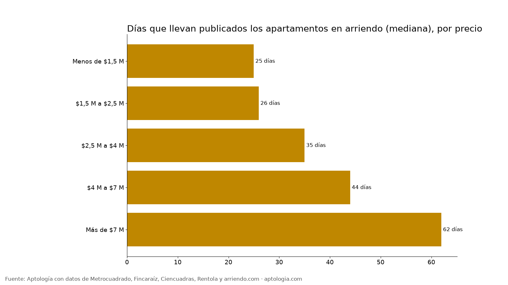
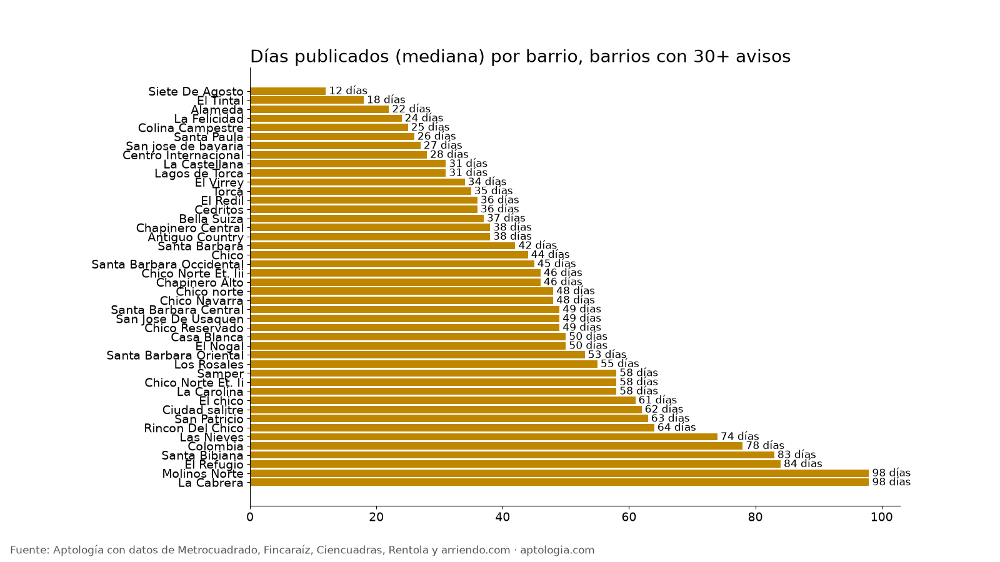

# ¿Cuánto se demora en arrendarse un apartamento en Bogotá? Días publicados por barrio y precio (octubre 2026)

**Un apartamento en arriendo en Bogotá lleva publicado en la mediana 32 días, y 3 de cada 10 llevan más de 60.** El precio pesa mucho: por debajo de $1,5 millones la mediana es 25 días y por encima de $7 millones, 62 días (la mitad lleva más de dos meses). Los de 2 habitaciones son los que menos duran publicados (27 días).

*Resumen: 11.618 apartamentos activos de Fincaraíz y Ciencuadras con fecha de publicación, sin duplicados, corte al 12 de octubre de 2026.*

**Actualizado:** 12 de octubre de 2026 · **Próxima actualización:** mensual.

**Qué mide y qué no:** medimos cuántos días lleva publicado cada aviso que sigue activo (la edad del aviso), no el tiempo exacto hasta firmar el contrato. Es el mejor indicador disponible hoy: nuestra ingesta empezó el 9 de octubre de 2026 y todavía no tiene suficientes avisos cerrados para medir el tiempo hasta arrendarse. Lo actualizaremos con ese dato. Los avisos que se arriendan rápido salen antes de la muestra, así que estas cifras exageran algo el tiempo real; sirven para comparar barrios y precios entre sí.

## Por precio

| Canon | Días publicados (mediana) | Rango típico | % con menos de 7 días | % con más de 60 días | Avisos |
|---|---|---|---|---|---|
| Menos de $1,5 M | 25 | 11 – 56 | 18,5 % | 21,8 % | 2.726 |
| $1,5 M a $2,5 M | 26 | 11 – 56 | 16,7 % | 22,5 % | 4.692 |
| $2,5 M a $4 M | 35 | 15 – 88 | 12,6 % | 33,6 % | 1.576 |
| $4 M a $7 M | 44 | 19 – 103 | 11,1 % | 39,6 % | 1.193 |
| Más de $7 M | 62 | 24 – 160 | 6,6 % | 50,9 % | 1.431 |

## Por estrato y habitaciones

| Grupo | Días (mediana) | % con más de 60 días | Avisos |
|---|---|---|---|
| Estrato 2 | 25 | 26,2 % | 302 |
| Estrato 3 | 27 | 27,6 % | 1.940 |
| Estrato 4 | 37 | 33,3 % | 1.894 |
| Estrato 5 | 34 | 34,1 % | 965 |
| Estrato 6 | 58 | 48,6 % | 1.991 |
| 1 hab | 34 | 32,5 % | 3.394 |
| 2 hab | 27 | 24,3 % | 4.804 |
| 3 hab | 33 | 29,9 % | 2.973 |

## Por barrio

| Barrio | Días (mediana) | % con más de 60 días | Avisos |
|---|---|---|---|
| [Siete De Agosto](/arriendo/bogota/siete-de-agosto) | 12 | 14,7 % | 34 |
| [El Tintal](/arriendo/bogota/el-tintal) | 18 | 16,7 % | 36 |
| [Alameda](/arriendo/bogota/alameda) | 22 | 27,3 % | 44 |
| [La Felicidad](/arriendo/bogota/la-felicidad) | 24 | 15,4 % | 39 |
| [Colina Campestre](/arriendo/bogota/colina-campestre) | 25 | 20,5 % | 73 |
| [Santa Paula](/arriendo/bogota/santa-paula) | 26 | 17,9 % | 39 |
| [San jose de bavaria](/arriendo/bogota/san-jose-de-bavaria) | 27 | 24,4 % | 41 |
| [Centro Internacional](/arriendo/bogota/centro-internacional) | 28 | 30,8 % | 52 |
| [La Castellana](/arriendo/bogota/la-castellana) | 31 | 29,0 % | 31 |
| [Lagos de Torca](/arriendo/bogota/lagos-de-torca) | 31 | 26,9 % | 67 |
| [El Virrey](/arriendo/bogota/el-virrey) | 34 | 36,4 % | 77 |
| [Torca](/arriendo/bogota/torca) | 35 | 20,6 % | 34 |
| [El Redil](/arriendo/bogota/el-redil) | 36 | 40,0 % | 60 |
| [Cedritos](/arriendo/bogota/cedritos) | 36 | 31,5 % | 124 |
| [Bella Suiza](/arriendo/bogota/bella-suiza) | 37 | 30,8 % | 52 |
| [Chapinero Central](/arriendo/bogota/chapinero-central) | 38 | 38,0 % | 71 |
| [Antiguo Country](/arriendo/bogota/antiguo-country) | 38 | 37,8 % | 74 |
| [Santa Barbara](/arriendo/bogota/santa-barbara) | 42 | 41,0 % | 183 |
| [Chico](/arriendo/bogota/chico) | 44 | 39,2 % | 51 |
| [Santa Barbara Occidental](/arriendo/bogota/santa-barbara-occidental) | 45 | 40,5 % | 84 |
| [Chico Norte Et. Iii](/arriendo/bogota/chico-norte-et-iii) | 46 | 47,1 % | 70 |
| [Chapinero Alto](/arriendo/bogota/chapinero-alto) | 46 | 40,4 % | 47 |
| [Chico norte](/arriendo/bogota/chico-norte) | 48 | 44,6 % | 372 |
| [Chico Navarra](/arriendo/bogota/chico-navarra) | 48 | 39,3 % | 61 |
| [Santa Barbara Central](/arriendo/bogota/santa-barbara-central) | 49 | 39,5 % | 76 |
| [San Jose De Usaquen](/arriendo/bogota/san-jose-de-usaquen) | 49 | 33,3 % | 33 |
| [Chico Reservado](/arriendo/bogota/chico-reservado) | 49 | 47,5 % | 61 |
| [Casa Blanca](/arriendo/bogota/casa-blanca) | 50 | 31,2 % | 32 |
| [El Nogal](/arriendo/bogota/el-nogal) | 50 | 46,1 % | 76 |
| [Santa Barbara Oriental](/arriendo/bogota/santa-barbara-oriental) | 53 | 46,2 % | 39 |
| [Los Rosales](/arriendo/bogota/los-rosales) | 55 | 48,7 % | 187 |
| [Samper](/arriendo/bogota/samper) | 58 | 46,7 % | 30 |
| [Chico Norte Et. Ii](/arriendo/bogota/chico-norte-et-ii) | 58 | 50,0 % | 48 |
| [La Carolina](/arriendo/bogota/la-carolina) | 58 | 50,0 % | 36 |
| [El chico](/arriendo/bogota/el-chico) | 61 | 51,4 % | 70 |
| [Ciudad salitre](/arriendo/bogota/ciudad-salitre) | 62 | 51,8 % | 85 |
| [San Patricio](/arriendo/bogota/san-patricio) | 63 | 50,6 % | 89 |
| [Rincon Del Chico](/arriendo/bogota/rincon-del-chico) | 64 | 52,9 % | 34 |
| [Las Nieves](/arriendo/bogota/las-nieves) | 74 | 53,3 % | 60 |
| [Colombia](/arriendo/bogota/colombia) | 78 | 54,1 % | 37 |
| [Santa Bibiana](/arriendo/bogota/santa-bibiana) | 83 | 62,2 % | 37 |
| [El Refugio](/arriendo/bogota/el-refugio) | 84 | 62,9 % | 70 |
| [Molinos Norte](/arriendo/bogota/molinos-norte) | 98 | 53,3 % | 30 |
| [La Cabrera](/arriendo/bogota/la-cabrera) | 98 | 60,7 % | 150 |

**Cómo usarlo para decidir:** si buscas, un apartamento que lleva más de 60 días publicado suele tener margen para negociar el canon. Si arriendas el tuyo, compara con tu barrio y tu rango de precio: si llevas mucho más que la mediana, el precio probablemente está alto.

## Preguntas frecuentes

**¿Cuánto se demora en arrendarse un apartamento en Bogotá?**
Los apartamentos activos llevan publicados 32 días en la mediana (corte al 12 de octubre de 2026); el 29 % lleva más de 60 días. Es la edad de los avisos activos, no el tiempo exacto hasta el contrato.

**¿Los apartamentos baratos se arriendan más rápido?**
Sí. Por debajo de $1,5 millones la mediana es 25 días; entre $4 y $7 millones, 44; por encima de $7 millones, 62.

**¿Qué estrato se arrienda más rápido?**
Estratos 2 y 3 (25 y 27 días). Estrato 6 es el más lento (58 días).

**¿En qué barrio se arriendan más rápido los apartamentos?**
Entre barrios con 30+ avisos: Siete De Agosto (12 días) y El Tintal (18 días). Los más lentos: La Cabrera (98 días) y Molinos Norte (98).

**¿Puedo negociar un arriendo que lleva mucho tiempo publicado?**
Es la mejor señal para hacerlo. Pregunta desde cuándo está disponible y ofrece un canon cercano a la mediana del barrio.

## Metodología

- **Fuente:** base de ingesta diaria de Aptología, con avisos públicos de Metrocuadrado, Fincaraíz, Ciencuadras, Rentola y arriendo.com. Corte al 12 de octubre de 2026.
- **Filtros:** avisos vivos que pasan el control de calidad, solo apartamentos en Bogotá, canon entre $400.000 y $30.000.000. Se excluyen TikTok y Facebook Marketplace.
- **Duplicados:** se deja un aviso por grupo de duplicados (el mismo inmueble en varios portales). Quedan 21.042 apartamentos únicos.
- **Días publicados:** fecha de corte menos la fecha de publicación que muestra el portal (Fincaraíz y Ciencuadras; Metrocuadrado no la publica). Se descartan edades mayores a 730 días. Si el anunciante republica, la fecha se reinicia.
- **Limitaciones:** son precios pedidos, no cerrados. Los barrios vienen tal como los escribe cada portal, así que un mismo sector puede aparecer con dos nombres. Solo se publican grupos con al menos 20 avisos.
- **Datos abiertos:** [datos.csv](datos.csv), licencia CC BY 4.0.

## Cómo citar

Pinzón Pineda, D. M. (2026). *¿Cuánto se demora en arrendarse un apartamento en Bogotá? Días publicados por barrio y precio (octubre 2026)*. Aptología. https://www.aptologia.com/estudios/dias-para-arrendar-apartamento-bogota. Datos: datos.csv, licencia CC BY 4.0.
