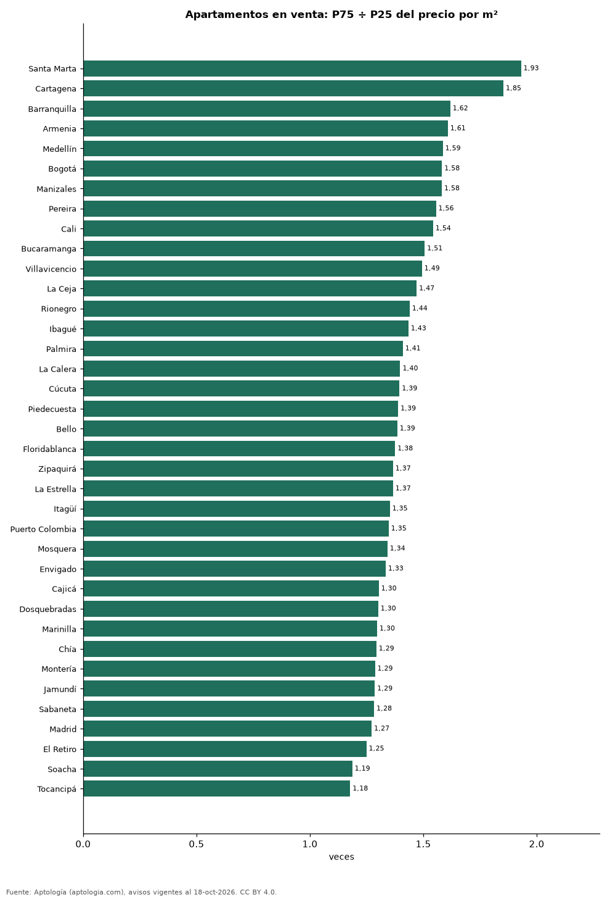

# Cuánto varía el precio del metro cuadrado dentro de cada ciudad de Colombia: dispersión en 37 ciudades (octubre 2026)

**En Santa Marta el metro cuadrado del apartamento caro típico (percentil 75) cuesta 1,93 veces el del barato típico (percentil 25), la mayor dispersión de 37 ciudades colombianas; en Tocancipá la relación es de solo 1,18.** En Bogotá el rango va de 5,81 millones de pesos a 9,19 millones de pesos por m² (1,58 veces). Una dispersión alta indica que el barrio y el estrato pesan más en el precio.

*Resumen: comparamos los percentiles del precio por m² de 120.352 apartamentos en venta en 37 ciudades con 100 avisos o más.*

**Actualizado:** 18 de octubre de 2026 (datos del 18 de octubre de 2026) · **Próxima actualización:** mensual.

## Resumen

| Indicador | Valor |
|---|---|
| Mayor dispersión | Santa Marta: 1,93× |
| Menor dispersión | Tocancipá: 1,18× |
| Bogotá | 1,58× |

## Percentiles del precio por m² por ciudad

| Ciudad | P25 (millones/m²) | Mediana | P75 | P75 ÷ P25 | Avisos |
|---|---|---|---|---|---|
| Santa Marta | 5,64 | 8,72 | 10,89 | 1,93 | 3.779 |
| Cartagena | 5,69 | 7,86 | 10,54 | 1,85 | 5.774 |
| Barranquilla | 3,58 | 4,53 | 5,79 | 1,62 | 7.532 |
| Armenia | 4,09 | 5,33 | 6,58 | 1,61 | 2.278 |
| Medellín | 5,87 | 7,50 | 9,32 | 1,59 | 20.515 |
| Bogotá | 5,81 | 7,26 | 9,19 | 1,58 | 31.265 |
| Manizales | 4,43 | 5,65 | 7,01 | 1,58 | 2.788 |
| Pereira | 4,33 | 5,50 | 6,73 | 1,56 | 4.376 |
| Cali | 3,89 | 4,65 | 6,00 | 1,54 | 9.365 |
| Bucaramanga | 3,84 | 4,67 | 5,79 | 1,51 | 2.439 |
| Villavicencio | 3,57 | 4,20 | 5,33 | 1,49 | 347 |
| La Ceja | 5,10 | 5,92 | 7,50 | 1,47 | 312 |
| Rionegro | 6,02 | 7,44 | 8,67 | 1,44 | 3.023 |
| Ibagué | 3,49 | 4,24 | 5,00 | 1,43 | 1.217 |
| Palmira | 3,55 | 4,19 | 5,00 | 1,41 | 112 |
| La Calera | 4,82 | 5,83 | 6,73 | 1,40 | 139 |
| Cúcuta | 3,04 | 3,55 | 4,24 | 1,39 | 561 |
| Piedecuesta | 3,16 | 3,66 | 4,39 | 1,39 | 246 |
| Bello | 4,62 | 5,46 | 6,39 | 1,39 | 2.319 |
| Floridablanca | 4,35 | 5,18 | 5,98 | 1,38 | 919 |
| Zipaquirá | 3,61 | 4,37 | 4,93 | 1,37 | 819 |
| La Estrella | 5,49 | 6,44 | 7,50 | 1,37 | 561 |
| Itagüí | 5,70 | 6,77 | 7,71 | 1,35 | 2.012 |
| Puerto Colombia | 4,78 | 5,87 | 6,44 | 1,35 | 144 |
| Mosquera | 4,12 | 4,93 | 5,53 | 1,34 | 817 |
| Envigado | 7,20 | 8,45 | 9,61 | 1,33 | 5.735 |
| Cajicá | 5,00 | 5,67 | 6,52 | 1,30 | 1.517 |
| Dosquebradas | 4,11 | 4,63 | 5,34 | 1,30 | 607 |
| Marinilla | 4,98 | 5,65 | 6,45 | 1,30 | 164 |
| Chía | 4,89 | 5,53 | 6,33 | 1,29 | 1.507 |
| Montería | 3,27 | 3,72 | 4,20 | 1,29 | 288 |
| Jamundí | 3,18 | 3,58 | 4,09 | 1,29 | 466 |
| Sabaneta | 6,20 | 7,12 | 7,95 | 1,28 | 4.375 |
| Madrid | 3,25 | 3,61 | 4,13 | 1,27 | 475 |
| El Retiro | 8,29 | 9,32 | 10,35 | 1,25 | 618 |
| Soacha | 3,10 | 3,39 | 3,68 | 1,19 | 566 |
| Tocancipá | 3,40 | 3,64 | 4,00 | 1,18 | 264 |

P25 y P75 = percentiles 25 y 75 del precio pedido por m²; entre ellos queda la mitad central de la oferta. Solo ciudades con 100 avisos o más con área.

## Preguntas frecuentes

**¿En qué ciudad de Colombia varía más el precio de la vivienda?**
En Santa Marta: el P75 del m² es 1,93 veces el P25.

**¿Cuál es el rango normal del m² en Bogotá?**
La mitad central de la oferta está entre 5,81 millones de pesos y 9,19 millones de pesos por m².

## Metodología

- **Fuente:** exportes nocturnos de la base de datos de Aptología (aptologia.com) del 18 de octubre de 2026: avisos vigentes de vivienda en portales inmobiliarios de 13 países, recogidos por Aptología y vistos en línea entre el 11 y el 18 de octubre de 2026. Corte: 18 de octubre de 2026.
- **Depuración:** se eliminan duplicados exactos (misma ciudad, zona, tipo, precio, moneda, área, habitaciones y baños) y los precios fuera del percentil 1–99 de cada país, operación, moneda y tipo; el precio por m² usa solo avisos con área declarada entre 12 y 2.000 m² y también se recorta al P1–P99.
- **Qué se mide:** precios pedidos (publicados), no precios de cierre. En arriendo, el canon mensual sin administración, gastos comunes ni condominio.
- **Muestra mínima:** cada cifra publicada se apoya en al menos 30 avisos; las celdas con menos se omiten.
- **Colombia:** Precios en pesos colombianos, sin conversión de moneda.
- **Limitaciones:** la cobertura depende de los portales que recorre Aptología en cada país y es mayor en las ciudades grandes y en los segmentos medio-alto y alto; el área es la que declara el aviso, sin verificar; los nombres de zona vienen de los portales.
- **Privacidad:** solo se publican agregados; no se publica ningún dato personal, enlace a avisos ni nombre de anunciante.
- **Datos abiertos:** [datos.csv](datos.csv), licencia CC BY 4.0.

## Cómo citar

Pinzón Pineda, D. M. (2026). *Cuánto varía el precio del metro cuadrado dentro de cada ciudad de Colombia: dispersión en 37 ciudades (octubre 2026)*. Aptología (aptologia.com). https://github.com/elbroker/aptologia-datos/tree/main/estudios/dispersion-del-precio-m2-ciudades-colombia-2026. Datos: datos.csv, licencia CC BY 4.0.
