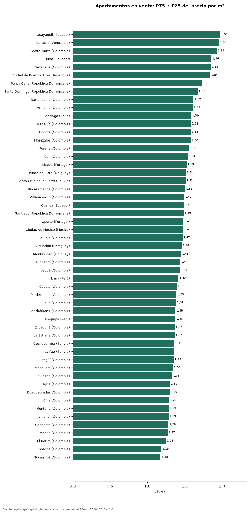

# Cuánto varía el precio del metro cuadrado dentro de cada ciudad de Latinoamérica y Portugal: dispersión en 53 ciudades (octubre 2026)

**En Guayaquil (Ecuador) el metro cuadrado del apartamento caro típico (percentil 75) cuesta 1,98 veces el del barato típico (percentil 25), la mayor dispersión de 53 ciudades; en Tocancipá (Colombia), solo 1,18 veces.** La mediana de las 53 ciudades es 1,46 veces.

*Resumen: comparamos los percentiles del precio por m² de 177.789 apartamentos en venta en 53 ciudades con 200 avisos o más.*

**Actualizado:** 18 de octubre de 2026 (datos del 18 de octubre de 2026) · **Próxima actualización:** mensual.

## Resumen

| Indicador | Valor |
|---|---|
| Mayor dispersión | Guayaquil (Ecuador): 1,98× |
| Menor dispersión | Tocancipá (Colombia): 1,18× |
| Mediana de ciudades | 1,46× |

## Percentiles del precio por m² por ciudad

| Ciudad | P25 (USD/m²) | Mediana | P75 | P75 ÷ P25 | Avisos |
|---|---|---|---|---|---|
| Guayaquil (Ecuador) | USD 932 | USD 1.364 | USD 1.842 | 1,98 | 915 |
| Caracas (Venezuela) | USD 1.029 | USD 1.400 | USD 2.013 | 1,96 | 1.464 |
| Santa Marta (Colombia) | USD 1.772 | USD 2.740 | USD 3.421 | 1,93 | 3.779 |
| Quito (Ecuador) | USD 759 | USD 1.000 | USD 1.410 | 1,86 | 2.240 |
| Cartagena (Colombia) | USD 1.787 | USD 2.469 | USD 3.311 | 1,85 | 5.774 |
| Ciudad de Buenos Aires (Argentina) | USD 1.852 | USD 2.558 | USD 3.414 | 1,84 | 8.128 |
| Punta Cana (República Dominicana) | USD 1.785 | USD 2.527 | USD 3.093 | 1,73 | 440 |
| Santo Domingo (República Dominicana) | USD 1.500 | USD 1.975 | USD 2.507 | 1,67 | 6.196 |
| Barranquilla (Colombia) | USD 1.124 | USD 1.424 | USD 1.819 | 1,62 | 7.532 |
| Armenia (Colombia) | USD 1.285 | USD 1.675 | USD 2.066 | 1,61 | 2.278 |
| Santiago (Chile) | USD 2.531 | USD 3.297 | USD 4.022 | 1,59 | 5.715 |
| Medellín (Colombia) | USD 1.846 | USD 2.356 | USD 2.927 | 1,59 | 20.515 |
| Bogotá (Colombia) | USD 1.826 | USD 2.282 | USD 2.889 | 1,58 | 31.265 |
| Manizales (Colombia) | USD 1.393 | USD 1.776 | USD 2.203 | 1,58 | 2.788 |
| Pereira (Colombia) | USD 1.360 | USD 1.728 | USD 2.116 | 1,56 | 4.376 |
| Cali (Colombia) | USD 1.222 | USD 1.461 | USD 1.885 | 1,54 | 9.365 |
| Lisboa (Portugal) | USD 6.735 | USD 8.383 | USD 10.273 | 1,53 | 1.548 |
| Punta del Este (Uruguay) | USD 2.955 | USD 3.604 | USD 4.472 | 1,51 | 4.562 |
| Santa Cruz de la Sierra (Bolivia) | USD 1.000 | USD 1.241 | USD 1.512 | 1,51 | 1.679 |
| Bucaramanga (Colombia) | USD 1.208 | USD 1.466 | USD 1.819 | 1,51 | 2.439 |
| Villavicencio (Colombia) | USD 1.122 | USD 1.321 | USD 1.676 | 1,49 | 347 |
| Cuenca (Ecuador) | USD 1.000 | USD 1.238 | USD 1.492 | 1,49 | 331 |
| Santiago (República Dominicana) | USD 1.278 | USD 1.496 | USD 1.898 | 1,49 | 522 |
| Oporto (Portugal) | USD 4.878 | USD 5.820 | USD 7.218 | 1,48 | 607 |
| Ciudad de México (México) | USD 2.370 | USD 2.894 | USD 3.507 | 1,48 | 7.519 |
| La Ceja (Colombia) | USD 1.603 | USD 1.861 | USD 2.356 | 1,47 | 312 |
| Asunción (Paraguay) | USD 1.524 | USD 1.869 | USD 2.224 | 1,46 | 4.307 |
| Montevideo (Uruguay) | USD 2.500 | USD 3.040 | USD 3.634 | 1,45 | 4.466 |
| Rionegro (Colombia) | USD 1.892 | USD 2.337 | USD 2.723 | 1,44 | 3.023 |
| Ibagué (Colombia) | USD 1.095 | USD 1.332 | USD 1.571 | 1,43 | 1.217 |
| Lima (Perú) | USD 1.792 | USD 2.137 | USD 2.537 | 1,42 | 6.152 |
| Cúcuta (Colombia) | USD 954 | USD 1.116 | USD 1.331 | 1,39 | 561 |
| Piedecuesta (Colombia) | USD 992 | USD 1.151 | USD 1.378 | 1,39 | 246 |
| Bello (Colombia) | USD 1.451 | USD 1.716 | USD 2.009 | 1,39 | 2.319 |
| Floridablanca (Colombia) | USD 1.366 | USD 1.626 | USD 1.879 | 1,38 | 919 |
| Arequipa (Perú) | USD 1.047 | USD 1.227 | USD 1.440 | 1,38 | 488 |
| Zipaquirá (Colombia) | USD 1.133 | USD 1.372 | USD 1.548 | 1,37 | 819 |
| La Estrella (Colombia) | USD 1.725 | USD 2.023 | USD 2.356 | 1,37 | 561 |
| Cochabamba (Bolivia) | USD 825 | USD 971 | USD 1.120 | 1,36 | 366 |
| La Paz (Bolivia) | USD 931 | USD 1.099 | USD 1.261 | 1,36 | 462 |
| Itagüí (Colombia) | USD 1.791 | USD 2.126 | USD 2.422 | 1,35 | 2.012 |
| Mosquera (Colombia) | USD 1.295 | USD 1.548 | USD 1.738 | 1,34 | 817 |
| Envigado (Colombia) | USD 2.262 | USD 2.656 | USD 3.018 | 1,33 | 5.735 |
| Cajicá (Colombia) | USD 1.571 | USD 1.782 | USD 2.047 | 1,30 | 1.517 |
| Dosquebradas (Colombia) | USD 1.290 | USD 1.456 | USD 1.678 | 1,30 | 607 |
| Chía (Colombia) | USD 1.538 | USD 1.737 | USD 1.987 | 1,29 | 1.507 |
| Montería (Colombia) | USD 1.027 | USD 1.168 | USD 1.321 | 1,29 | 288 |
| Jamundí (Colombia) | USD 1.000 | USD 1.125 | USD 1.285 | 1,29 | 466 |
| Sabaneta (Colombia) | USD 1.948 | USD 2.237 | USD 2.499 | 1,28 | 4.375 |
| Madrid (Colombia) | USD 1.020 | USD 1.134 | USD 1.298 | 1,27 | 475 |
| El Retiro (Colombia) | USD 2.604 | USD 2.929 | USD 3.252 | 1,25 | 618 |
| Soacha (Colombia) | USD 974 | USD 1.066 | USD 1.156 | 1,19 | 566 |
| Tocancipá (Colombia) | USD 1.067 | USD 1.145 | USD 1.257 | 1,18 | 264 |

P25 y P75 = percentiles 25 y 75 del precio pedido por m², en la moneda mayoritaria de cada ciudad convertida a dólares (la razón no depende de la tasa).

## Preguntas frecuentes

**¿En qué ciudad latinoamericana varía más el precio del m²?**
En Guayaquil (Ecuador): el P75 es 1,98 veces el P25.

**¿Dónde es más homogéneo?**
En Tocancipá (Colombia): 1,18 veces.

## Metodología

- **Fuente:** exportes nocturnos de la base de datos de Aptología (aptologia.com) del 18 de octubre de 2026: avisos vigentes de vivienda en portales inmobiliarios de 13 países, recogidos por Aptología y vistos en línea entre el 11 y el 18 de octubre de 2026. Corte: 18 de octubre de 2026.
- **Depuración:** se eliminan duplicados exactos (misma ciudad, zona, tipo, precio, moneda, área, habitaciones y baños) y los precios fuera del percentil 1–99 de cada país, operación, moneda y tipo; el precio por m² usa solo avisos con área declarada entre 12 y 2.000 m² y también se recorta al P1–P99.
- **Qué se mide:** precios pedidos (publicados), no precios de cierre. En arriendo, el canon mensual sin administración, gastos comunes ni condominio.
- **Muestra mínima:** cada cifra publicada se apoya en al menos 30 avisos; las celdas con menos se omiten.
- **Monedas:** nunca se mezclan avisos de monedas distintas sin convertirlos. Conversión a dólares con la tasa de mercado de ExchangeRate-API (open.er-api.com, actualización del 18 Oct 2026): 1 USD = 3.182,80 COP, 1 USD = 18,47 M.N, 1 USD = 5,09 BRL, 1 USD = 3,44 PEN, 1 USD = 982,44 CLP, 1 USD = 1.514,57 ARS, 1 USD = 40,20 UYU, 1 USD = 5.705,37 PYG, 1 USD = 61,27 DOP, 1 USD = 0,89 EUR, 1 USD = 11,72 BOB; la UF chilena a 41.178,64 CLP (mindicador,cl. 18-oct-2026). Los avisos publicados en dólares se usan tal cual.
- **Monedas:** en cada ciudad y operación se usa solo la moneda mayoritaria de los avisos (los avisos en otra moneda se excluyen) y la mediana se convierte a dólares con la tasa citada; nunca se promedian avisos de monedas distintas.
- **Limitaciones:** la cobertura depende de los portales que recorre Aptología en cada país y es mayor en las ciudades grandes y en los segmentos medio-alto y alto; el área es la que declara el aviso, sin verificar; los nombres de zona vienen de los portales.
- **Privacidad:** solo se publican agregados; no se publica ningún dato personal, enlace a avisos ni nombre de anunciante.
- **Datos abiertos:** [datos.csv](datos.csv), licencia CC BY 4.0.

## Cómo citar

Pinzón Pineda, D. M. (2026). *Cuánto varía el precio del metro cuadrado dentro de cada ciudad de Latinoamérica y Portugal: dispersión en 53 ciudades (octubre 2026)*. Aptología (aptologia.com). https://github.com/elbroker/aptologia-datos/tree/main/estudios/dispersion-del-precio-m2-ciudades-latinoamerica-2026. Datos: datos.csv, licencia CC BY 4.0.
