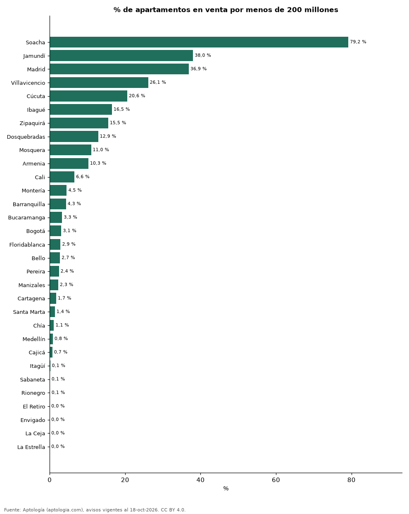

# ¿Qué porcentaje de los apartamentos en venta cuesta menos de 200, 350 o 500 millones? 31 ciudades de Colombia (octubre 2026)

**En Soacha el 79,2 % de los apartamentos en venta se pide en menos de 200 millones de pesos, la mayor proporción de 31 ciudades; en Bogotá solo el 3,1 %.** La ciudad con más oferta por encima de 1.200 millones es Bogotá, con el 31,6 % de sus avisos; en Bogotá, el 19,9 % cuesta menos de 350 millones.

*Resumen: clasificamos 121.892 apartamentos en venta de 31 ciudades con 300 avisos o más en seis rangos de precio pedido.*

**Actualizado:** 18 de octubre de 2026 (datos del 18 de octubre de 2026) · **Próxima actualización:** mensual.

## Resumen

| Indicador | Valor |
|---|---|
| Más oferta bajo 200 M | Soacha: 79,2 % |
| Bogotá bajo 200 M | 3,1 % |
| Más oferta sobre 1.200 M | Bogotá: 31,6 % |
| Ciudades | 31 |

## Reparto de la oferta por rango de precio (millones de pesos)

| Ciudad | Menos de 200 M | 200–350 M | 350–500 M | 500–800 M | 800 M–1.200 M | Más de 1.200 M | Avisos |
|---|---|---|---|---|---|---|---|
| Soacha | 79,2 % | 19,9 % | 0,2 % | 0,2 % | 0,5 % | 0,0 % | 572 |
| Jamundí | 38,0 % | 43,7 % | 13,7 % | 3,2 % | 1,1 % | 0,4 % | 476 |
| Madrid | 36,9 % | 57,3 % | 2,9 % | 2,9 % | 0,0 % | 0,0 % | 480 |
| Villavicencio | 26,1 % | 35,7 % | 17,6 % | 13,2 % | 4,7 % | 2,7 % | 364 |
| Cúcuta | 20,6 % | 47,1 % | 20,4 % | 9,3 % | 2,0 % | 0,6 % | 666 |
| Ibagué | 16,5 % | 37,1 % | 25,6 % | 14,8 % | 4,8 % | 1,2 % | 1.260 |
| Zipaquirá | 15,5 % | 61,7 % | 17,7 % | 2,3 % | 1,3 % | 1,5 % | 825 |
| Dosquebradas | 12,9 % | 61,2 % | 21,2 % | 4,1 % | 0,3 % | 0,3 % | 614 |
| Mosquera | 11,0 % | 48,1 % | 34,6 % | 6,2 % | 0,0 % | 0,1 % | 819 |
| Armenia | 10,3 % | 32,0 % | 25,3 % | 23,9 % | 5,9 % | 2,6 % | 2.320 |
| Cali | 6,6 % | 33,4 % | 16,9 % | 20,0 % | 11,9 % | 11,2 % | 9.505 |
| Montería | 4,5 % | 34,0 % | 35,5 % | 19,0 % | 6,0 % | 0,9 % | 332 |
| Barranquilla | 4,3 % | 24,2 % | 27,9 % | 25,2 % | 9,0 % | 9,4 % | 7.903 |
| Bucaramanga | 3,3 % | 28,0 % | 28,8 % | 25,9 % | 7,1 % | 6,9 % | 2.509 |
| Bogotá | 3,1 % | 16,8 % | 12,7 % | 20,7 % | 15,0 % | 31,6 % | 31.911 |
| Floridablanca | 2,9 % | 17,3 % | 48,2 % | 23,4 % | 7,0 % | 1,2 % | 939 |
| Bello | 2,7 % | 48,2 % | 37,5 % | 10,9 % | 0,5 % | 0,1 % | 2.347 |
| Pereira | 2,4 % | 27,7 % | 29,8 % | 26,4 % | 8,5 % | 5,1 % | 4.450 |
| Manizales | 2,3 % | 27,6 % | 29,1 % | 29,5 % | 8,7 % | 2,8 % | 2.824 |
| Cartagena | 1,7 % | 8,9 % | 13,5 % | 25,9 % | 23,0 % | 27,0 % | 6.126 |
| Santa Marta | 1,4 % | 13,0 % | 25,6 % | 27,7 % | 18,1 % | 14,2 % | 3.920 |
| Chía | 1,1 % | 51,5 % | 29,2 % | 12,9 % | 2,3 % | 2,9 % | 1.512 |
| Medellín | 0,8 % | 7,9 % | 11,2 % | 26,7 % | 24,4 % | 28,9 % | 20.940 |
| Cajicá | 0,7 % | 37,0 % | 36,1 % | 22,4 % | 3,3 % | 0,5 % | 1.526 |
| Itagüí | 0,1 % | 16,0 % | 43,2 % | 37,0 % | 3,0 % | 0,6 % | 2.019 |
| Sabaneta | 0,1 % | 11,2 % | 24,7 % | 55,8 % | 6,7 % | 1,5 % | 4.393 |
| Rionegro | 0,1 % | 24,2 % | 23,1 % | 38,4 % | 6,3 % | 7,8 % | 3.052 |
| El Retiro | 0,0 % | 3,2 % | 10,0 % | 47,0 % | 28,5 % | 11,3 % | 621 |
| Envigado | 0,0 % | 1,7 % | 9,8 % | 35,6 % | 31,9 % | 21,0 % | 5.788 |
| La Ceja | 0,0 % | 33,1 % | 38,9 % | 26,8 % | 1,0 % | 0,3 % | 314 |
| La Estrella | 0,0 % | 30,6 % | 33,6 % | 33,3 % | 2,5 % | 0,0 % | 565 |

Porcentaje de los avisos de apartamentos en venta de cada ciudad en cada rango de precio pedido; cada fila suma 100 %.

## Preguntas frecuentes

**¿En qué ciudad hay más apartamentos de menos de 200 millones?**
En Soacha: el 79,2 % de la oferta (octubre de 2026).

**¿Cuántos apartamentos de menos de 350 millones hay en Bogotá?**
El 19,9 % de los apartamentos en venta en Bogotá se pide en menos de 350 millones de pesos.

## Metodología

- **Fuente:** exportes nocturnos de la base de datos de Aptología (aptologia.com) del 18 de octubre de 2026: avisos vigentes de vivienda en portales inmobiliarios de 13 países, recogidos por Aptología y vistos en línea entre el 11 y el 18 de octubre de 2026. Corte: 18 de octubre de 2026.
- **Depuración:** se eliminan duplicados exactos (misma ciudad, zona, tipo, precio, moneda, área, habitaciones y baños) y los precios fuera del percentil 1–99 de cada país, operación, moneda y tipo; el precio por m² usa solo avisos con área declarada entre 12 y 2.000 m² y también se recorta al P1–P99.
- **Qué se mide:** precios pedidos (publicados), no precios de cierre. En arriendo, el canon mensual sin administración, gastos comunes ni condominio.
- **Muestra mínima:** cada cifra publicada se apoya en al menos 30 avisos; las celdas con menos se omiten.
- **Colombia:** Precios en pesos colombianos, sin conversión de moneda.
- **Rangos:** precio total pedido; se incluyen las ciudades con al menos 300 apartamentos en venta para que cada porcentaje sea estable.
- **Limitaciones:** la cobertura depende de los portales que recorre Aptología en cada país y es mayor en las ciudades grandes y en los segmentos medio-alto y alto; el área es la que declara el aviso, sin verificar; los nombres de zona vienen de los portales.
- **Privacidad:** solo se publican agregados; no se publica ningún dato personal, enlace a avisos ni nombre de anunciante.
- **Datos abiertos:** [datos.csv](datos.csv), licencia CC BY 4.0.

## Cómo citar

Pinzón Pineda, D. M. (2026). *¿Qué porcentaje de los apartamentos en venta cuesta menos de 200, 350 o 500 millones? 31 ciudades de Colombia (octubre 2026)*. Aptología (aptologia.com). https://github.com/elbroker/aptologia-datos/tree/main/estudios/distribucion-de-la-oferta-por-rango-de-precio-ciudades-colombia-2026. Datos: datos.csv, licencia CC BY 4.0.
