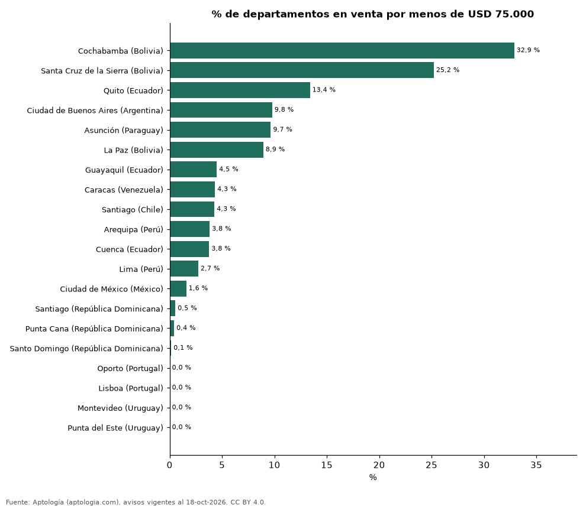

# ¿Qué porcentaje de los departamentos en venta cuesta menos de 75.000 dólares? 20 ciudades de Latinoamérica y Portugal (octubre 2026)

**En Cochabamba (Bolivia) el 32,9 % de los departamentos en venta se pide en menos de 75.000 dólares, la mayor proporción de 20 ciudades; en Lisboa (Portugal) el 93,5 % supera los 350.000 dólares.**

*Resumen: clasificamos 64.529 departamentos en venta de 20 ciudades con 300 avisos o más en cinco rangos de precio en dólares.*

**Actualizado:** 18 de octubre de 2026 (datos del 18 de octubre de 2026) · **Próxima actualización:** mensual.

## Resumen

| Indicador | Valor |
|---|---|
| Más oferta bajo USD 75.000 | Cochabamba (Bolivia): 32,9 % |
| Más oferta sobre USD 350.000 | Lisboa (Portugal): 93,5 % |
| Ciudades | 20 |

## Reparto de la oferta por rango de precio en dólares

| Ciudad | Menos de USD 75.000 | USD 75.000–125.000 | USD 125.000–200.000 | USD 200.000–350.000 | Más de USD 350.000 | Avisos |
|---|---|---|---|---|---|---|
| Cochabamba (Bolivia) | 32,9 % | 39,8 % | 19,5 % | 6,4 % | 1,3 % | 374 |
| Santa Cruz de la Sierra (Bolivia) | 25,2 % | 39,1 % | 24,0 % | 8,4 % | 3,3 % | 1.868 |
| Quito (Ecuador) | 13,4 % | 26,1 % | 33,1 % | 21,5 % | 5,9 % | 2.337 |
| Ciudad de Buenos Aires (Argentina) | 9,8 % | 24,7 % | 25,9 % | 19,8 % | 19,8 % | 8.308 |
| Asunción (Paraguay) | 9,7 % | 31,0 % | 32,2 % | 16,6 % | 10,6 % | 5.833 |
| La Paz (Bolivia) | 8,9 % | 34,7 % | 38,5 % | 15,6 % | 2,3 % | 481 |
| Guayaquil (Ecuador) | 4,5 % | 21,1 % | 38,1 % | 25,3 % | 11,0 % | 978 |
| Caracas (Venezuela) | 4,3 % | 13,7 % | 24,2 % | 26,9 % | 30,9 % | 1.503 |
| Santiago (Chile) | 4,3 % | 15,4 % | 15,7 % | 24,2 % | 40,5 % | 7.959 |
| Arequipa (Perú) | 3,8 % | 31,5 % | 41,2 % | 18,1 % | 5,3 % | 524 |
| Cuenca (Ecuador) | 3,8 % | 35,2 % | 39,4 % | 18,1 % | 3,5 % | 398 |
| Lima (Perú) | 2,7 % | 21,8 % | 32,1 % | 27,4 % | 16,0 % | 6.265 |
| Ciudad de México (México) | 1,6 % | 4,6 % | 20,9 % | 42,0 % | 30,8 % | 7.877 |
| Santiago (República Dominicana) | 0,5 % | 12,7 % | 45,5 % | 35,5 % | 5,8 % | 550 |
| Punta Cana (República Dominicana) | 0,4 % | 19,8 % | 28,1 % | 29,6 % | 22,0 % | 469 |
| Santo Domingo (República Dominicana) | 0,1 % | 6,9 % | 28,7 % | 39,2 % | 25,0 % | 6.757 |
| Oporto (Portugal) | 0,0 % | 0,0 % | 0,0 % | 24,6 % | 75,4 % | 625 |
| Lisboa (Portugal) | 0,0 % | 0,0 % | 0,0 % | 6,5 % | 93,5 % | 1.583 |
| Montevideo (Uruguay) | 0,0 % | 10,2 % | 46,9 % | 27,0 % | 15,9 % | 4.642 |
| Punta del Este (Uruguay) | 0,0 % | 1,0 % | 14,1 % | 32,1 % | 52,8 % | 5.198 |

Porcentaje de los avisos de cada ciudad en cada rango; cada fila suma 100 %.

## Preguntas frecuentes

**¿Dónde hay más departamentos de menos de 75.000 dólares?**
En Cochabamba (Bolivia): el 32,9 % de la oferta en venta (octubre de 2026).

**¿Dónde es más común la vivienda de más de 350.000 dólares?**
En Lisboa (Portugal), con el 93,5 % de los avisos.

## Metodología

- **Fuente:** exportes nocturnos de la base de datos de Aptología (aptologia.com) del 18 de octubre de 2026: avisos vigentes de vivienda en portales inmobiliarios de 13 países, recogidos por Aptología y vistos en línea entre el 11 y el 18 de octubre de 2026. Corte: 18 de octubre de 2026.
- **Depuración:** se eliminan duplicados exactos (misma ciudad, zona, tipo, precio, moneda, área, habitaciones y baños) y los precios fuera del percentil 1–99 de cada país, operación, moneda y tipo; el precio por m² usa solo avisos con área declarada entre 12 y 2.000 m² y también se recorta al P1–P99.
- **Qué se mide:** precios pedidos (publicados), no precios de cierre. En arriendo, el canon mensual sin administración, gastos comunes ni condominio.
- **Muestra mínima:** cada cifra publicada se apoya en al menos 30 avisos; las celdas con menos se omiten.
- **Monedas:** nunca se mezclan avisos de monedas distintas sin convertirlos. Conversión a dólares con la tasa de mercado de ExchangeRate-API (open.er-api.com, actualización del 18 Oct 2026): 1 USD = 3.182,80 COP, 1 USD = 18,47 M.N, 1 USD = 5,09 BRL, 1 USD = 3,44 PEN, 1 USD = 982,44 CLP, 1 USD = 1.514,57 ARS, 1 USD = 40,20 UYU, 1 USD = 5.705,37 PYG, 1 USD = 61,27 DOP, 1 USD = 0,89 EUR, 1 USD = 11,72 BOB; la UF chilena a 41.178,64 CLP (mindicador,cl. 18-oct-2026). Los avisos publicados en dólares se usan tal cual.
- **Monedas:** en cada ciudad y operación se usa solo la moneda mayoritaria de los avisos (los avisos en otra moneda se excluyen) y la mediana se convierte a dólares con la tasa citada; nunca se promedian avisos de monedas distintas.
- **Rangos:** precio total pedido convertido a dólares; ciudades con al menos 300 departamentos en venta en la moneda mayoritaria. Colombia se analiza aparte en pesos.
- **Limitaciones:** la cobertura depende de los portales que recorre Aptología en cada país y es mayor en las ciudades grandes y en los segmentos medio-alto y alto; el área es la que declara el aviso, sin verificar; los nombres de zona vienen de los portales.
- **Privacidad:** solo se publican agregados; no se publica ningún dato personal, enlace a avisos ni nombre de anunciante.
- **Datos abiertos:** [datos.csv](datos.csv), licencia CC BY 4.0.

## Cómo citar

Pinzón Pineda, D. M. (2026). *¿Qué porcentaje de los departamentos en venta cuesta menos de 75.000 dólares? 20 ciudades de Latinoamérica y Portugal (octubre 2026)*. Aptología (aptologia.com). https://github.com/elbroker/aptologia-datos/tree/main/estudios/distribucion-de-la-oferta-por-rango-de-precio-ciudades-latinoamerica-2026. Datos: datos.csv, licencia CC BY 4.0.
