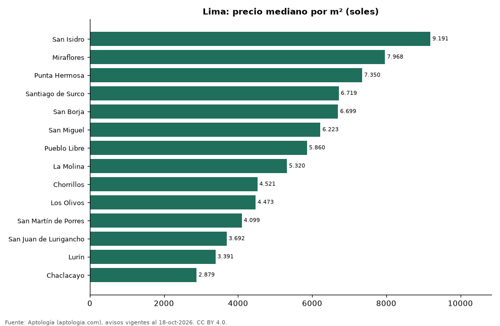

# Distritos más caros y más baratos de Lima para comprar casa: ranking por m² (octubre 2026)

**En Lima, el distrito con el m² más caro para comprar casa es San Isidro (9.191 soles (USD 2.675)/m²) y el más barato Chaclacayo (2.879 soles (USD 838)/m²), 3,2 veces menos.** Comparamos 14 distritos con al menos 30 avisos con área.

*Resumen: analizamos 1.934 casas en venta con área declarada en 14 distritos de Lima.*

**Actualizado:** 18 de octubre de 2026 (datos del 18 de octubre de 2026) · **Próxima actualización:** mensual.

## Resumen

| Indicador | Valor |
|---|---|
| Más caro por m² | San Isidro: 9.191 soles (USD 2.675) |
| Más barato por m² | Chaclacayo: 2.879 soles (USD 838) |
| Diferencia | 3,2 veces |
| Distritos | 14 |

## Ranking de distritos por precio del m²

| Distrito | Por m² (mediana) | Precio (mediana) | Área mediana (m²) | Avisos con área |
|---|---|---|---|---|
| San Isidro | 9.191 soles (USD 2.675) | 3.900.375 soles (USD 1.135.307) | 422 | 190 |
| Miraflores | 7.968 soles (USD 2.319) | 2.501.250 soles (USD 728.055) | 335 | 156 |
| Punta Hermosa | 7.350 soles (USD 2.139) | 2.145.000 soles (USD 624.359) | 320 | 35 |
| Santiago de Surco | 6.719 soles (USD 1.956) | 2.156.754 soles (USD 627.780) | 318 | 406 |
| San Borja | 6.699 soles (USD 1.950) | 2.249.100 soles (USD 654.660) | 342 | 94 |
| San Miguel | 6.223 soles (USD 1.811) | 1.142.400 soles (USD 332.526) | 188 | 59 |
| Pueblo Libre | 5.860 soles (USD 1.706) | 1.303.500 soles (USD 379.418) | 225 | 38 |
| La Molina | 5.320 soles (USD 1.549) | 3.000.000 soles (USD 873.229) | 595 | 673 |
| Chorrillos | 4.521 soles (USD 1.316) | 1.332.000 soles (USD 387.714) | 317 | 75 |
| Los Olivos | 4.473 soles (USD 1.302) | 945.250 soles (USD 275.140) | 202 | 38 |
| San Martín de Porres | 4.099 soles (USD 1.193) | 700.000 soles (USD 203.753) | 188 | 45 |
| San Juan de Lurigancho | 3.692 soles (USD 1.075) | 699.200 soles (USD 203.521) | 170 | 50 |
| Lurín | 3.391 soles (USD 987) | 972.000 soles (USD 282.926) | 244 | 38 |
| Chaclacayo | 2.879 soles (USD 838) | 1.041.600 soles (USD 303.185) | 331 | 37 |

Medianas; solo distritos con 30 avisos o más con área declarada.

## Preguntas frecuentes

**¿Cuál es el distrito más caro de Lima para comprar?**
San Isidro, con 9.191 soles (USD 2.675) por m² en la mediana (octubre de 2026).

**¿Y el más barato?**
Chaclacayo, con 2.879 soles (USD 838) por m².

## Metodología

- **Fuente:** exportes nocturnos de la base de datos de Aptología (aptologia.com) del 18 de octubre de 2026: avisos vigentes de vivienda en portales inmobiliarios de 13 países, recogidos por Aptología y vistos en línea entre el 11 y el 18 de octubre de 2026. Corte: 18 de octubre de 2026.
- **Depuración:** se eliminan duplicados exactos (misma ciudad, zona, tipo, precio, moneda, área, habitaciones y baños) y los precios fuera del percentil 1–99 de cada país, operación, moneda y tipo; el precio por m² usa solo avisos con área declarada entre 12 y 2.000 m² y también se recorta al P1–P99.
- **Qué se mide:** precios pedidos (publicados), no precios de cierre. En arriendo, el canon mensual sin administración, gastos comunes ni condominio.
- **Muestra mínima:** cada cifra publicada se apoya en al menos 30 avisos; las celdas con menos se omiten.
- **Monedas:** nunca se mezclan avisos de monedas distintas sin convertirlos. Conversión a dólares con la tasa de mercado de ExchangeRate-API (open.er-api.com, actualización del 18 Oct 2026): 1 USD = 3.182,80 COP, 1 USD = 18,47 M.N, 1 USD = 5,09 BRL, 1 USD = 3,44 PEN, 1 USD = 982,44 CLP, 1 USD = 1.514,57 ARS, 1 USD = 40,20 UYU, 1 USD = 5.705,37 PYG, 1 USD = 61,27 DOP, 1 USD = 0,89 EUR, 1 USD = 11,72 BOB; la UF chilena a 41.178,64 CLP (mindicador,cl. 18-oct-2026). Los avisos publicados en dólares se usan tal cual.
- **Monedas:** en cada ciudad y operación se usa solo la moneda mayoritaria de los avisos (los avisos en otra moneda se excluyen) y la mediana se convierte a dólares con la tasa citada; nunca se promedian avisos de monedas distintas.
- **Limitaciones:** la cobertura depende de los portales que recorre Aptología en cada país y es mayor en las ciudades grandes y en los segmentos medio-alto y alto; el área es la que declara el aviso, sin verificar; los nombres de zona vienen de los portales.
- **Privacidad:** solo se publican agregados; no se publica ningún dato personal, enlace a avisos ni nombre de anunciante.
- **Datos abiertos:** [datos.csv](datos.csv), licencia CC BY 4.0.

## Cómo citar

Pinzón Pineda, D. M. (2026). *Distritos más caros y más baratos de Lima para comprar casa: ranking por m² (octubre 2026)*. Aptología (aptologia.com). https://github.com/elbroker/aptologia-datos/tree/main/estudios/distritos-con-casas-mas-caras-y-baratas-lima-venta-m2-2026. Datos: datos.csv, licencia CC BY 4.0.
