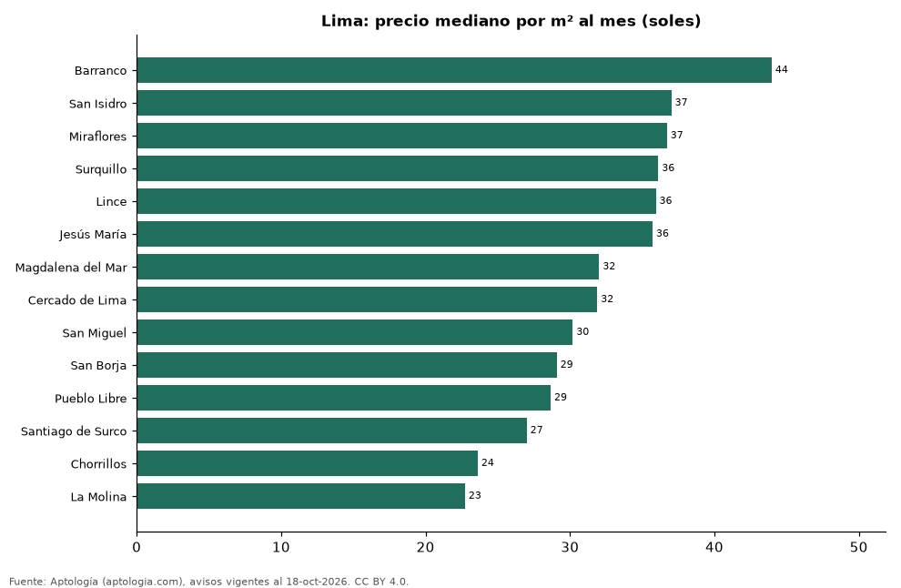

# Distritos más caros y más baratos de Lima para alquilar departamento: ranking por m² (octubre 2026)

**En Lima, el distrito con el m² más caro para alquilar departamento es Barranco (44,0 soles (USD 12,8)/m² al mes) y el más barato La Molina (22,7 soles (USD 6,6)/m² al mes), 1,9 veces menos.** Comparamos 14 distritos con al menos 30 avisos con área.

*Resumen: analizamos 2.709 departamentos en alquiler con área declarada en 14 distritos de Lima.*

**Actualizado:** 18 de octubre de 2026 (datos del 18 de octubre de 2026) · **Próxima actualización:** mensual.

## Resumen

| Indicador | Valor |
|---|---|
| Más caro por m² | Barranco: 44,0 soles (USD 12,8) |
| Más barato por m² | La Molina: 22,7 soles (USD 6,6) |
| Diferencia | 1,9 veces |
| Distritos | 14 |

## Ranking de distritos por precio del m²

| Distrito | Por m² (mediana) | Canon (mediana) | Área mediana (m²) | Avisos con área |
|---|---|---|---|---|
| Barranco | 44,0 soles (USD 12,8) | 2.800 soles (USD 815) | 62 | 155 |
| San Isidro | 37,0 soles (USD 10,8) | 4.836 soles (USD 1.408) | 150 | 466 |
| Miraflores | 36,7 soles (USD 10,7) | 3.710 soles (USD 1.080) | 110 | 919 |
| Surquillo | 36,1 soles (USD 10,5) | 2.200 soles (USD 640) | 64 | 85 |
| Lince | 35,9 soles (USD 10,5) | 2.450 soles (USD 713) | 72 | 71 |
| Jesús María | 35,7 soles (USD 10,4) | 2.600 soles (USD 757) | 70 | 89 |
| Magdalena del Mar | 32,0 soles (USD 9,3) | 2.500 soles (USD 728) | 78 | 94 |
| Cercado de Lima | 31,9 soles (USD 9,3) | 2.100 soles (USD 611) | 60 | 31 |
| San Miguel | 30,2 soles (USD 8,8) | 2.000 soles (USD 582) | 70 | 140 |
| San Borja | 29,1 soles (USD 8,5) | 3.186 soles (USD 927) | 104 | 92 |
| Pueblo Libre | 28,7 soles (USD 8,3) | 2.250 soles (USD 655) | 80 | 56 |
| Santiago de Surco | 27,0 soles (USD 7,9) | 3.500 soles (USD 1.019) | 124 | 403 |
| Chorrillos | 23,6 soles (USD 6,9) | 1.850 soles (USD 538) | 75 | 45 |
| La Molina | 22,7 soles (USD 6,6) | 2.500 soles (USD 728) | 110 | 63 |

Medianas; solo distritos con 30 avisos o más con área declarada.

## Preguntas frecuentes

**¿Cuál es el distrito más caro de Lima para alquilar?**
Barranco, con 44,0 soles (USD 12,8) por m² al mes en la mediana (octubre de 2026).

**¿Y el más barato?**
La Molina, con 22,7 soles (USD 6,6) por m² al mes.

## Metodología

- **Fuente:** exportes nocturnos de la base de datos de Aptología (aptologia.com) del 18 de octubre de 2026: avisos vigentes de vivienda en portales inmobiliarios de 13 países, recogidos por Aptología y vistos en línea entre el 11 y el 18 de octubre de 2026. Corte: 18 de octubre de 2026.
- **Depuración:** se eliminan duplicados exactos (misma ciudad, zona, tipo, precio, moneda, área, habitaciones y baños) y los precios fuera del percentil 1–99 de cada país, operación, moneda y tipo; el precio por m² usa solo avisos con área declarada entre 12 y 2.000 m² y también se recorta al P1–P99.
- **Qué se mide:** precios pedidos (publicados), no precios de cierre. En arriendo, el canon mensual sin administración, gastos comunes ni condominio.
- **Muestra mínima:** cada cifra publicada se apoya en al menos 30 avisos; las celdas con menos se omiten.
- **Monedas:** nunca se mezclan avisos de monedas distintas sin convertirlos. Conversión a dólares con la tasa de mercado de ExchangeRate-API (open.er-api.com, actualización del 18 Oct 2026): 1 USD = 3.182,80 COP, 1 USD = 18,47 M.N, 1 USD = 5,09 BRL, 1 USD = 3,44 PEN, 1 USD = 982,44 CLP, 1 USD = 1.514,57 ARS, 1 USD = 40,20 UYU, 1 USD = 5.705,37 PYG, 1 USD = 61,27 DOP, 1 USD = 0,89 EUR, 1 USD = 11,72 BOB; la UF chilena a 41.178,64 CLP (mindicador,cl. 18-oct-2026). Los avisos publicados en dólares se usan tal cual.
- **Monedas:** en cada ciudad y operación se usa solo la moneda mayoritaria de los avisos (los avisos en otra moneda se excluyen) y la mediana se convierte a dólares con la tasa citada; nunca se promedian avisos de monedas distintas.
- **Limitaciones:** la cobertura depende de los portales que recorre Aptología en cada país y es mayor en las ciudades grandes y en los segmentos medio-alto y alto; el área es la que declara el aviso, sin verificar; los nombres de zona vienen de los portales.
- **Privacidad:** solo se publican agregados; no se publica ningún dato personal, enlace a avisos ni nombre de anunciante.
- **Datos abiertos:** [datos.csv](datos.csv), licencia CC BY 4.0.

## Cómo citar

Pinzón Pineda, D. M. (2026). *Distritos más caros y más baratos de Lima para alquilar departamento: ranking por m² (octubre 2026)*. Aptología (aptologia.com). https://github.com/elbroker/aptologia-datos/tree/main/estudios/distritos-mas-caros-y-baratos-lima-alquiler-m2-2026. Datos: datos.csv, licencia CC BY 4.0.
