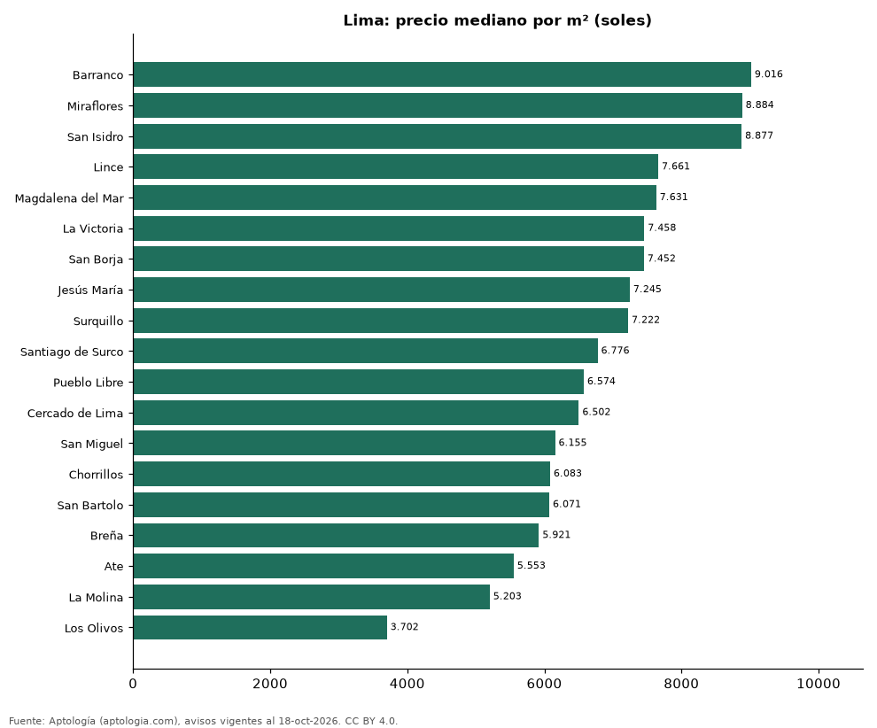

# Distritos más caros y más baratos de Lima para comprar departamento: ranking por m² (octubre 2026)

**En Lima, el distrito con el m² más caro para comprar departamento es Barranco (9.016 soles (USD 2.624)/m²) y el más barato Los Olivos (3.702 soles (USD 1.078)/m²), 2,4 veces menos.** Comparamos 19 distritos con al menos 30 avisos con área.

*Resumen: analizamos 6.043 departamentos en venta con área declarada en 19 distritos de Lima.*

**Actualizado:** 18 de octubre de 2026 (datos del 18 de octubre de 2026) · **Próxima actualización:** mensual.

## Resumen

| Indicador | Valor |
|---|---|
| Más caro por m² | Barranco: 9.016 soles (USD 2.624) |
| Más barato por m² | Los Olivos: 3.702 soles (USD 1.078) |
| Diferencia | 2,4 veces |
| Distritos | 19 |

## Ranking de distritos por precio del m²

| Distrito | Por m² (mediana) | Precio (mediana) | Área mediana (m²) | Avisos con área |
|---|---|---|---|---|
| Barranco | 9.016 soles (USD 2.624) | 591.016 soles (USD 172.031) | 64 | 180 |
| Miraflores | 8.884 soles (USD 2.586) | 923.450 soles (USD 268.794) | 102 | 1.114 |
| San Isidro | 8.877 soles (USD 2.584) | 994.250 soles (USD 289.403) | 120 | 685 |
| Lince | 7.661 soles (USD 2.230) | 518.892 soles (USD 151.037) | 69 | 211 |
| Magdalena del Mar | 7.631 soles (USD 2.221) | 569.610 soles (USD 165.800) | 74 | 286 |
| La Victoria | 7.458 soles (USD 2.171) | 430.000 soles (USD 125.163) | 58 | 168 |
| San Borja | 7.452 soles (USD 2.169) | 956.250 soles (USD 278.342) | 127 | 268 |
| Jesús María | 7.245 soles (USD 2.109) | 490.174 soles (USD 142.678) | 70 | 272 |
| Surquillo | 7.222 soles (USD 2.102) | 454.750 soles (USD 132.367) | 65 | 346 |
| Santiago de Surco | 6.776 soles (USD 1.972) | 823.300 soles (USD 239.643) | 118 | 1.039 |
| Pueblo Libre | 6.574 soles (USD 1.913) | 432.180 soles (USD 125.797) | 68 | 214 |
| Cercado de Lima | 6.502 soles (USD 1.893) | 410.100 soles (USD 119.370) | 64 | 315 |
| San Miguel | 6.155 soles (USD 1.792) | 416.200 soles (USD 121.146) | 69 | 399 |
| Chorrillos | 6.083 soles (USD 1.771) | 370.000 soles (USD 107.698) | 63 | 242 |
| San Bartolo | 6.071 soles (USD 1.767) | 507.000 soles (USD 147.576) | 88 | 73 |
| Breña | 5.921 soles (USD 1.723) | 424.340 soles (USD 123.515) | 72 | 76 |
| Ate | 5.553 soles (USD 1.616) | 406.728 soles (USD 118.389) | 72 | 50 |
| La Molina | 5.203 soles (USD 1.514) | 625.000 soles (USD 181.923) | 121 | 69 |
| Los Olivos | 3.702 soles (USD 1.078) | 321.300 soles (USD 93.523) | 88 | 36 |

Medianas; solo distritos con 30 avisos o más con área declarada.

## Preguntas frecuentes

**¿Cuál es el distrito más caro de Lima para comprar?**
Barranco, con 9.016 soles (USD 2.624) por m² en la mediana (octubre de 2026).

**¿Y el más barato?**
Los Olivos, con 3.702 soles (USD 1.078) por m².

## Metodología

- **Fuente:** exportes nocturnos de la base de datos de Aptología (aptologia.com) del 18 de octubre de 2026: avisos vigentes de vivienda en portales inmobiliarios de 13 países, recogidos por Aptología y vistos en línea entre el 11 y el 18 de octubre de 2026. Corte: 18 de octubre de 2026.
- **Depuración:** se eliminan duplicados exactos (misma ciudad, zona, tipo, precio, moneda, área, habitaciones y baños) y los precios fuera del percentil 1–99 de cada país, operación, moneda y tipo; el precio por m² usa solo avisos con área declarada entre 12 y 2.000 m² y también se recorta al P1–P99.
- **Qué se mide:** precios pedidos (publicados), no precios de cierre. En arriendo, el canon mensual sin administración, gastos comunes ni condominio.
- **Muestra mínima:** cada cifra publicada se apoya en al menos 30 avisos; las celdas con menos se omiten.
- **Monedas:** nunca se mezclan avisos de monedas distintas sin convertirlos. Conversión a dólares con la tasa de mercado de ExchangeRate-API (open.er-api.com, actualización del 18 Oct 2026): 1 USD = 3.182,80 COP, 1 USD = 18,47 M.N, 1 USD = 5,09 BRL, 1 USD = 3,44 PEN, 1 USD = 982,44 CLP, 1 USD = 1.514,57 ARS, 1 USD = 40,20 UYU, 1 USD = 5.705,37 PYG, 1 USD = 61,27 DOP, 1 USD = 0,89 EUR, 1 USD = 11,72 BOB; la UF chilena a 41.178,64 CLP (mindicador,cl. 18-oct-2026). Los avisos publicados en dólares se usan tal cual.
- **Monedas:** en cada ciudad y operación se usa solo la moneda mayoritaria de los avisos (los avisos en otra moneda se excluyen) y la mediana se convierte a dólares con la tasa citada; nunca se promedian avisos de monedas distintas.
- **Limitaciones:** la cobertura depende de los portales que recorre Aptología en cada país y es mayor en las ciudades grandes y en los segmentos medio-alto y alto; el área es la que declara el aviso, sin verificar; los nombres de zona vienen de los portales.
- **Privacidad:** solo se publican agregados; no se publica ningún dato personal, enlace a avisos ni nombre de anunciante.
- **Datos abiertos:** [datos.csv](datos.csv), licencia CC BY 4.0.

## Cómo citar

Pinzón Pineda, D. M. (2026). *Distritos más caros y más baratos de Lima para comprar departamento: ranking por m² (octubre 2026)*. Aptología (aptologia.com). https://github.com/elbroker/aptologia-datos/tree/main/estudios/distritos-mas-caros-y-baratos-lima-venta-m2-2026. Datos: datos.csv, licencia CC BY 4.0.
