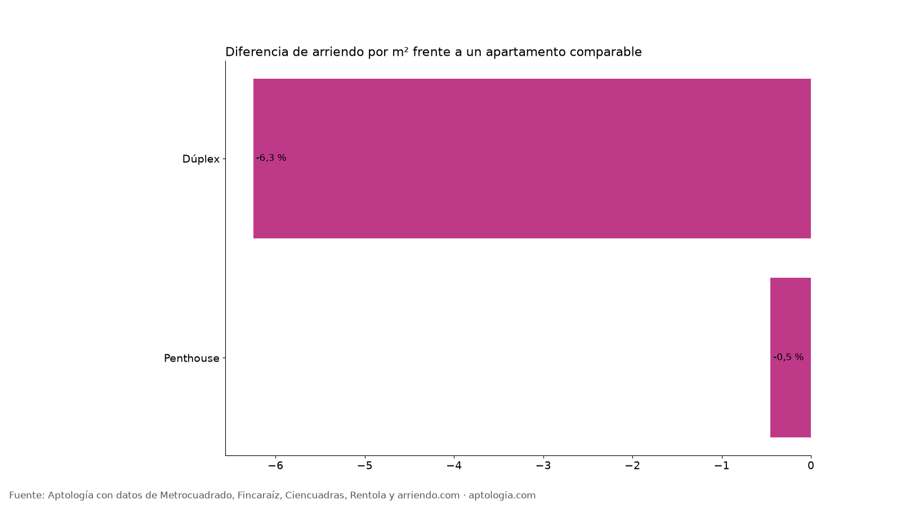
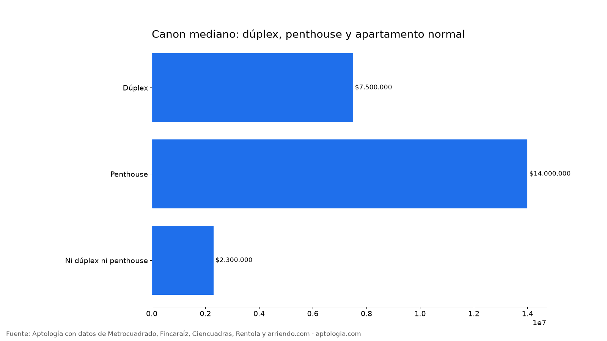

# Dúplex y penthouse en arriendo en Bogotá: cuánto más cuestan que un apartamento normal (2026)

**En Bogotá, un penthouse en arriendo cuesta 0,5 % menos por m² que un apartamento comparable y un dúplex 6,3 % menos.** El canon mediano es $14.000.000 para un penthouse, $7.500.000 para un dúplex y $2.300.000 para el resto.

*Resumen: analizamos 18.920 apartamentos en arriendo únicos en Bogotá con descripción, 745 dúplex y 359 penthouse.*

**Actualizado:** 13 de octubre de 2026 · **Próxima actualización:** mensual.

## Dúplex y penthouse

| Tipo | Avisos | % de avisos | Canon mediano | Área mediana | Por m² | Diferencia por m² (comparable) |
|---|---|---|---|---|---|---|
| Dúplex | 745 | 3,9 % | $7.500.000 | 136 m² | $49.405/m² | -6,3 % |
| Penthouse | 359 | 1,9 % | $14.000.000 | 255 m² | $55.114/m² | -0,5 % |
| Ni dúplex ni penthouse | 17.816 | 94,2 % | $2.300.000 | 56 m² | $47.500/m² | base |

**Cómo usarlo para decidir:** el dúplex da más área y separación entre zona social y alcobas; el penthouse suma terraza y vista. Compara su precio por m² con el de un apartamento normal del mismo estrato antes de pagar la diferencia.

## Preguntas frecuentes

**¿Cuánto más cuesta un penthouse en arriendo en Bogotá?**
-0,5 % por m² frente a un apartamento comparable; canon mediano $14.000.000, corte al 13 de octubre de 2026.

**¿Cuánto cuesta un dúplex en arriendo en Bogotá?**
La mediana es $7.500.000 al mes, con 136 m².

## Metodología

- **Fuente:** base de ingesta diaria de Aptología, con avisos públicos de Metrocuadrado, Fincaraíz, Ciencuadras, Rentola y arriendo.com. Corte al 13 de octubre de 2026.
- **Filtros:** avisos vivos que pasan el control de calidad, en Bogotá, canon entre $400.000 y $30.000.000. Se excluyen TikTok y Facebook Marketplace.
- **Duplicados:** se deja un aviso por grupo de duplicados (el mismo inmueble en varios portales).
- **Prima emparejada:** se compara el precio por m² de avisos con y sin el atributo dentro de la misma celda de estrato × habitaciones (mínimo 8 avisos por lado) y se reporta la mediana ponderada de las diferencias. Así la prima no se confunde con estrato o tamaño. El atributo se detecta en el texto del aviso, por lo que solo cuentan avisos con descripción. Dúplex y penthouse se detectan en el texto del aviso; si un aviso menciona ambos, cuenta como penthouse.
- **Limitaciones:** son precios pedidos, no cerrados. Los barrios y localidades vienen tal como los escribe cada portal.
- **Datos abiertos:** [datos.csv](data/duplex_y_penthouse_arriendo_bogota_datos.csv), licencia CC BY 4.0.

## Cómo citar

Pinzón Pineda, D. M. (2026). *Dúplex y penthouse en arriendo en Bogotá: cuánto más cuestan que un apartamento normal (2026)*. Aptología. https://www.aptologia.com/estudios/duplex-y-penthouse-arriendo-bogota. Datos: datos.csv, licencia CC BY 4.0.
