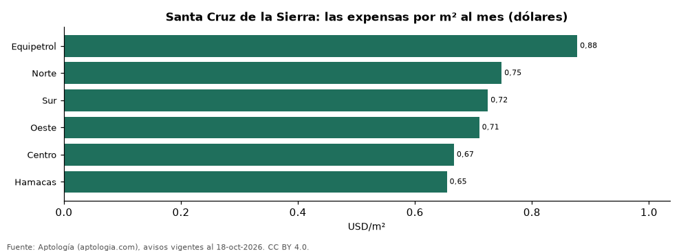

# Expensas de departamentos en Santa Cruz de la Sierra por zona (octubre 2026)

**En Santa Cruz de la Sierra, las expensas de un departamento son en la mediana USD 70 al mes (USD 0,75 por m²). La zona más cara por m² es Equipetrol (USD 0,88) y la más barata, Hamacas (USD 0,65).**

*Resumen: analizamos las expensas declaradas en 809 avisos de departamentos en venta y alquiler en 6 zonas de Santa Cruz de la Sierra con 30 avisos o más.*

**Actualizado:** 18 de octubre de 2026 (datos del 18 de octubre de 2026) · **Próxima actualización:** mensual.

## Resumen

| Indicador | Valor |
|---|---|
| Mediana mensual | USD 70 |
| Mediana por m² | USD 0,75 |
| Más cara por m² | Equipetrol: USD 0,88 |
| Más barata por m² | Hamacas: USD 0,65 |
| Zonas | 6 |

## Las expensas por zona

| Zona | Las expensas por m² al mes | Las expensas mensual (mediana) | Avisos |
|---|---|---|---|
| Equipetrol | USD 0,88 | USD 80 | 170 |
| Norte | USD 0,75 | USD 70 | 282 |
| Sur | USD 0,72 | USD 70 | 55 |
| Oeste | USD 0,71 | USD 80 | 123 |
| Centro | USD 0,67 | USD 60 | 81 |
| Hamacas | USD 0,65 | USD 72 | 39 |

Medianas; ordenado de mayor a menor costo por m². Solo avisos en dólares.

## Preguntas frecuentes

**¿Cuánto se paga de expensas en Santa Cruz de la Sierra?**
USD 70 al mes en la mediana (USD 0,75 por m²), según avisos de octubre de 2026.

**¿Dónde es más caro?**
En Equipetrol: USD 0,88 por m² al mes en la mediana.

## Metodología

- **Fuente:** exportes nocturnos de la base de datos de Aptología (aptologia.com) del 18 de octubre de 2026: avisos vigentes de vivienda en portales inmobiliarios de 13 países, recogidos por Aptología y vistos en línea entre el 11 y el 18 de octubre de 2026. Corte: 18 de octubre de 2026.
- **Depuración:** se eliminan duplicados exactos (misma ciudad, zona, tipo, precio, moneda, área, habitaciones y baños) y los precios fuera del percentil 1–99 de cada país, operación, moneda y tipo; el precio por m² usa solo avisos con área declarada entre 12 y 2.000 m² y también se recorta al P1–P99.
- **Qué se mide:** precios pedidos (publicados), no precios de cierre. En arriendo, el canon mensual sin administración, gastos comunes ni condominio.
- **Muestra mínima:** cada cifra publicada se apoya en al menos 30 avisos; las celdas con menos se omiten.
- **Monedas:** nunca se mezclan avisos de monedas distintas sin convertirlos. Conversión a dólares con la tasa de mercado de ExchangeRate-API (open.er-api.com, actualización del 18 Oct 2026): 1 USD = 3.182,80 COP, 1 USD = 18,47 M.N, 1 USD = 5,09 BRL, 1 USD = 3,44 PEN, 1 USD = 982,44 CLP, 1 USD = 1.514,57 ARS, 1 USD = 40,20 UYU, 1 USD = 5.705,37 PYG, 1 USD = 61,27 DOP, 1 USD = 0,89 EUR, 1 USD = 11,72 BOB; la UF chilena a 41.178,64 CLP (mindicador,cl. 18-oct-2026). Los avisos publicados en dólares se usan tal cual.
- **Moneda:** solo avisos en dólares (la moneda mayoritaria de la cuota); nada se promedia entre monedas.
- **Cuota:** valor mensual de las expensas declarado en avisos de venta y alquiler de departamentos (se unen ambas operaciones porque la cuota es del inmueble, quitando repetidos con la misma zona, cuota, área, habitaciones y baños); la razón por m² se recorta al percentil 1–99.
- **Limitaciones:** la cobertura depende de los portales que recorre Aptología en cada país y es mayor en las ciudades grandes y en los segmentos medio-alto y alto; el área es la que declara el aviso, sin verificar; los nombres de zona vienen de los portales.
- **Privacidad:** solo se publican agregados; no se publica ningún dato personal, enlace a avisos ni nombre de anunciante.
- **Datos abiertos:** [datos.csv](datos.csv), licencia CC BY 4.0.

## Cómo citar

Pinzón Pineda, D. M. (2026). *Expensas de departamentos en Santa Cruz de la Sierra por zona (octubre 2026)*. Aptología (aptologia.com). https://github.com/elbroker/aptologia-datos/tree/main/estudios/expensas-santa-cruz-de-la-sierra-por-zona-2026. Datos: datos.csv, licencia CC BY 4.0.
