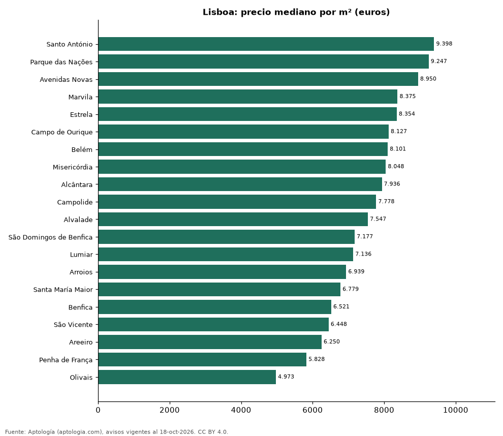

# Freguesias más caras y más baratas de Lisboa para comprar apartamento: ranking por m² (octubre 2026)

**En Lisboa, la freguesia con el m² más caro para comprar apartamento es Santo António (9.398 euros (USD 10.565)/m²) y la más barata Olivais (4.973 euros (USD 5.590)/m²), 1,9 veces menos.** Comparamos 20 freguesias con al menos 30 avisos con área.

*Resumen: analizamos 1.487 apartamentos en venta con área declarada en 20 freguesias de Lisboa.*

**Actualizado:** 18 de octubre de 2026 (datos del 18 de octubre de 2026) · **Próxima actualización:** mensual.

## Resumen

| Indicador | Valor |
|---|---|
| Más caro por m² | Santo António: 9.398 euros (USD 10.565) |
| Más barato por m² | Olivais: 4.973 euros (USD 5.590) |
| Diferencia | 1,9 veces |
| Freguesias | 20 |

## Ranking de freguesias por precio del m²

| Freguesia | Por m² (mediana) | Precio (mediana) | Área mediana (m²) | Avisos con área |
|---|---|---|---|---|
| Santo António | 9.398 euros (USD 10.565) | 745.000 euros (USD 837.442) | 85 | 126 |
| Parque das Nações | 9.247 euros (USD 10.395) | 710.000 euros (USD 798.099) | 79 | 57 |
| Avenidas Novas | 8.950 euros (USD 10.061) | 1.052.520 euros (USD 1.183.120) | 120 | 116 |
| Marvila | 8.375 euros (USD 9.414) | 920.000 euros (USD 1.034.156) | 96 | 56 |
| Estrela | 8.354 euros (USD 9.390) | 712.500 euros (USD 800.909) | 85 | 112 |
| Campo de Ourique | 8.127 euros (USD 9.136) | 539.750 euros (USD 606.724) | 66 | 46 |
| Belém | 8.101 euros (USD 9.106) | 1.500.000 euros (USD 1.686.125) | 203 | 41 |
| Misericórdia | 8.048 euros (USD 9.046) | 625.000 euros (USD 702.552) | 79 | 111 |
| Alcântara | 7.936 euros (USD 8.921) | 645.000 euros (USD 725.034) | 81 | 50 |
| Campolide | 7.778 euros (USD 8.743) | 746.000 euros (USD 838.566) | 90 | 45 |
| Alvalade | 7.547 euros (USD 8.483) | 697.500 euros (USD 784.048) | 100 | 54 |
| São Domingos de Benfica | 7.177 euros (USD 8.068) | 629.900 euros (USD 708.060) | 91 | 37 |
| Lumiar | 7.136 euros (USD 8.021) | 788.000 euros (USD 885.777) | 115 | 157 |
| Arroios | 6.939 euros (USD 7.800) | 599.000 euros (USD 673.326) | 86 | 121 |
| Santa María Maior | 6.779 euros (USD 7.620) | 575.000 euros (USD 646.348) | 83 | 120 |
| Benfica | 6.521 euros (USD 7.330) | 469.000 euros (USD 527.195) | 71 | 43 |
| São Vicente | 6.448 euros (USD 7.249) | 350.000 euros (USD 393.429) | 59 | 55 |
| Areeiro | 6.250 euros (USD 7.026) | 885.000 euros (USD 994.813) | 135 | 41 |
| Penha de França | 5.828 euros (USD 6.551) | 408.500 euros (USD 459.188) | 66 | 54 |
| Olivais | 4.973 euros (USD 5.590) | 394.900 euros (USD 443.900) | 84 | 45 |

Medianas; solo freguesias con 30 avisos o más con área declarada.

## Preguntas frecuentes

**¿Cuál es la freguesia más cara de Lisboa para comprar?**
Santo António, con 9.398 euros (USD 10.565) por m² en la mediana (octubre de 2026).

**¿Y la más barata?**
Olivais, con 4.973 euros (USD 5.590) por m².

## Metodología

- **Fuente:** exportes nocturnos de la base de datos de Aptología (aptologia.com) del 18 de octubre de 2026: avisos vigentes de vivienda en portales inmobiliarios de 13 países, recogidos por Aptología y vistos en línea entre el 11 y el 18 de octubre de 2026. Corte: 18 de octubre de 2026.
- **Depuración:** se eliminan duplicados exactos (misma ciudad, zona, tipo, precio, moneda, área, habitaciones y baños) y los precios fuera del percentil 1–99 de cada país, operación, moneda y tipo; el precio por m² usa solo avisos con área declarada entre 12 y 2.000 m² y también se recorta al P1–P99.
- **Qué se mide:** precios pedidos (publicados), no precios de cierre. En arriendo, el canon mensual sin administración, gastos comunes ni condominio.
- **Muestra mínima:** cada cifra publicada se apoya en al menos 30 avisos; las celdas con menos se omiten.
- **Monedas:** nunca se mezclan avisos de monedas distintas sin convertirlos. Conversión a dólares con la tasa de mercado de ExchangeRate-API (open.er-api.com, actualización del 18 Oct 2026): 1 USD = 3.182,80 COP, 1 USD = 18,47 M.N, 1 USD = 5,09 BRL, 1 USD = 3,44 PEN, 1 USD = 982,44 CLP, 1 USD = 1.514,57 ARS, 1 USD = 40,20 UYU, 1 USD = 5.705,37 PYG, 1 USD = 61,27 DOP, 1 USD = 0,89 EUR, 1 USD = 11,72 BOB; la UF chilena a 41.178,64 CLP (mindicador,cl. 18-oct-2026). Los avisos publicados en dólares se usan tal cual.
- **Monedas:** en cada ciudad y operación se usa solo la moneda mayoritaria de los avisos (los avisos en otra moneda se excluyen) y la mediana se convierte a dólares con la tasa citada; nunca se promedian avisos de monedas distintas.
- **Limitaciones:** la cobertura depende de los portales que recorre Aptología en cada país y es mayor en las ciudades grandes y en los segmentos medio-alto y alto; el área es la que declara el aviso, sin verificar; los nombres de zona vienen de los portales.
- **Privacidad:** solo se publican agregados; no se publica ningún dato personal, enlace a avisos ni nombre de anunciante.
- **Datos abiertos:** [datos.csv](datos.csv), licencia CC BY 4.0.

## Cómo citar

Pinzón Pineda, D. M. (2026). *Freguesias más caras y más baratas de Lisboa para comprar apartamento: ranking por m² (octubre 2026)*. Aptología (aptologia.com). https://github.com/elbroker/aptologia-datos/tree/main/estudios/freguesias-mas-caras-y-baratas-lisboa-venta-m2-2026. Datos: datos.csv, licencia CC BY 4.0.
