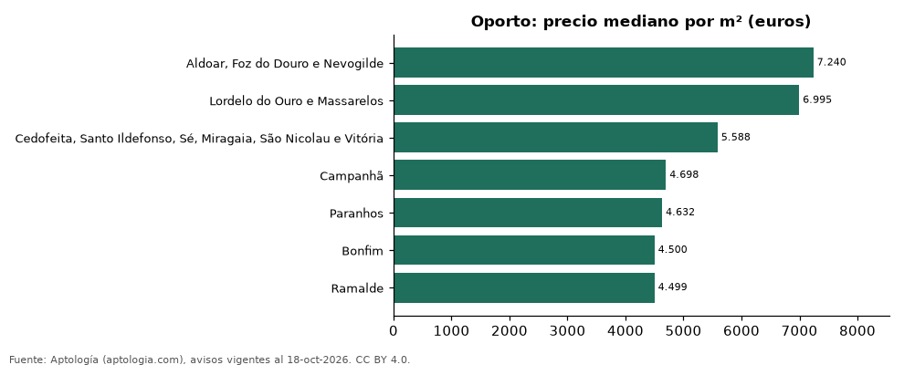

# Freguesias más caras y más baratas de Oporto para comprar apartamento: ranking por m² (octubre 2026)

**En Oporto, la freguesia con el m² más caro para comprar apartamento es Aldoar, Foz do Douro e Nevogilde (7.240 euros (USD 8.138)/m²) y la más barata Ramalde (4.499 euros (USD 5.057)/m²), 1,6 veces menos.** Comparamos 7 freguesias con al menos 30 avisos con área.

*Resumen: analizamos 607 apartamentos en venta con área declarada en 7 freguesias de Oporto.*

**Actualizado:** 18 de octubre de 2026 (datos del 18 de octubre de 2026) · **Próxima actualización:** mensual.

## Resumen

| Indicador | Valor |
|---|---|
| Más caro por m² | Aldoar, Foz do Douro e Nevogilde: 7.240 euros (USD 8.138) |
| Más barato por m² | Ramalde: 4.499 euros (USD 5.057) |
| Diferencia | 1,6 veces |
| Freguesias | 7 |

## Ranking de freguesias por precio del m²

| Freguesia | Por m² (mediana) | Precio (mediana) | Área mediana (m²) | Avisos con área |
|---|---|---|---|---|
| Aldoar, Foz do Douro e Nevogilde | 7.240 euros (USD 8.138) | 695.000 euros (USD 781.238) | 102 | 49 |
| Lordelo do Ouro e Massarelos | 6.995 euros (USD 7.863) | 820.000 euros (USD 921.748) | 119 | 85 |
| Cedofeita, Santo Ildefonso, Sé, Miragaia, São Nicolau e Vitória | 5.588 euros (USD 6.282) | 405.000 euros (USD 455.254) | 75 | 161 |
| Campanhã | 4.698 euros (USD 5.281) | 410.000 euros (USD 460.874) | 86 | 67 |
| Paranhos | 4.632 euros (USD 5.207) | 327.000 euros (USD 367.575) | 74 | 94 |
| Bonfim | 4.500 euros (USD 5.058) | 400.000 euros (USD 449.633) | 85 | 69 |
| Ramalde | 4.499 euros (USD 5.057) | 458.250 euros (USD 515.111) | 100 | 82 |

Medianas; solo freguesias con 30 avisos o más con área declarada.

## Preguntas frecuentes

**¿Cuál es la freguesia más cara de Oporto para comprar?**
Aldoar, Foz do Douro e Nevogilde, con 7.240 euros (USD 8.138) por m² en la mediana (octubre de 2026).

**¿Y la más barata?**
Ramalde, con 4.499 euros (USD 5.057) por m².

## Metodología

- **Fuente:** exportes nocturnos de la base de datos de Aptología (aptologia.com) del 18 de octubre de 2026: avisos vigentes de vivienda en portales inmobiliarios de 13 países, recogidos por Aptología y vistos en línea entre el 11 y el 18 de octubre de 2026. Corte: 18 de octubre de 2026.
- **Depuración:** se eliminan duplicados exactos (misma ciudad, zona, tipo, precio, moneda, área, habitaciones y baños) y los precios fuera del percentil 1–99 de cada país, operación, moneda y tipo; el precio por m² usa solo avisos con área declarada entre 12 y 2.000 m² y también se recorta al P1–P99.
- **Qué se mide:** precios pedidos (publicados), no precios de cierre. En arriendo, el canon mensual sin administración, gastos comunes ni condominio.
- **Muestra mínima:** cada cifra publicada se apoya en al menos 30 avisos; las celdas con menos se omiten.
- **Monedas:** nunca se mezclan avisos de monedas distintas sin convertirlos. Conversión a dólares con la tasa de mercado de ExchangeRate-API (open.er-api.com, actualización del 18 Oct 2026): 1 USD = 3.182,80 COP, 1 USD = 18,47 M.N, 1 USD = 5,09 BRL, 1 USD = 3,44 PEN, 1 USD = 982,44 CLP, 1 USD = 1.514,57 ARS, 1 USD = 40,20 UYU, 1 USD = 5.705,37 PYG, 1 USD = 61,27 DOP, 1 USD = 0,89 EUR, 1 USD = 11,72 BOB; la UF chilena a 41.178,64 CLP (mindicador,cl. 18-oct-2026). Los avisos publicados en dólares se usan tal cual.
- **Monedas:** en cada ciudad y operación se usa solo la moneda mayoritaria de los avisos (los avisos en otra moneda se excluyen) y la mediana se convierte a dólares con la tasa citada; nunca se promedian avisos de monedas distintas.
- **Limitaciones:** la cobertura depende de los portales que recorre Aptología en cada país y es mayor en las ciudades grandes y en los segmentos medio-alto y alto; el área es la que declara el aviso, sin verificar; los nombres de zona vienen de los portales.
- **Privacidad:** solo se publican agregados; no se publica ningún dato personal, enlace a avisos ni nombre de anunciante.
- **Datos abiertos:** [datos.csv](datos.csv), licencia CC BY 4.0.

## Cómo citar

Pinzón Pineda, D. M. (2026). *Freguesias más caras y más baratas de Oporto para comprar apartamento: ranking por m² (octubre 2026)*. Aptología (aptologia.com). https://github.com/elbroker/aptologia-datos/tree/main/estudios/freguesias-mas-caras-y-baratas-oporto-venta-m2-2026. Datos: datos.csv, licencia CC BY 4.0.
